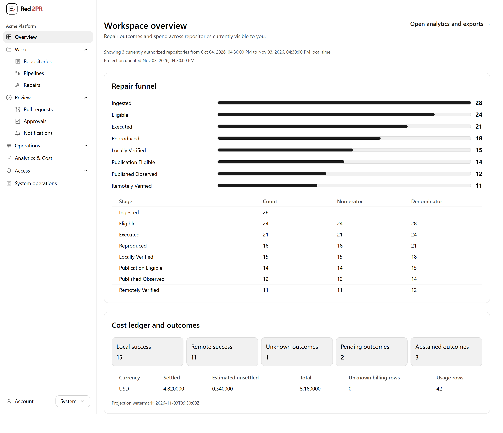
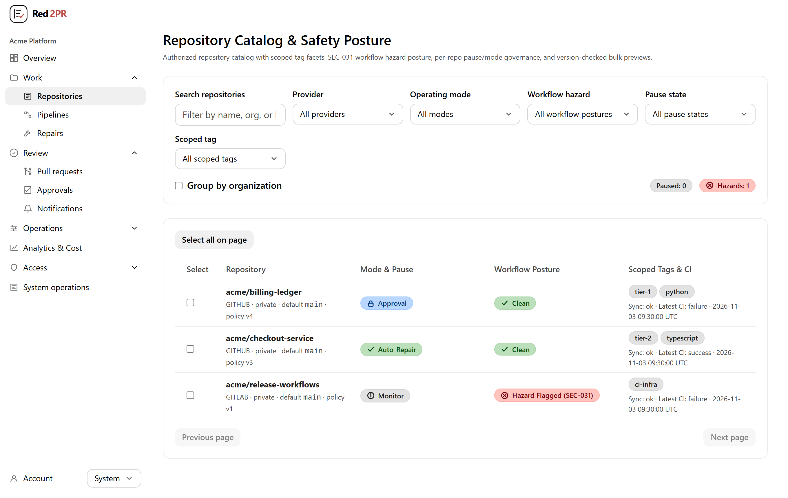
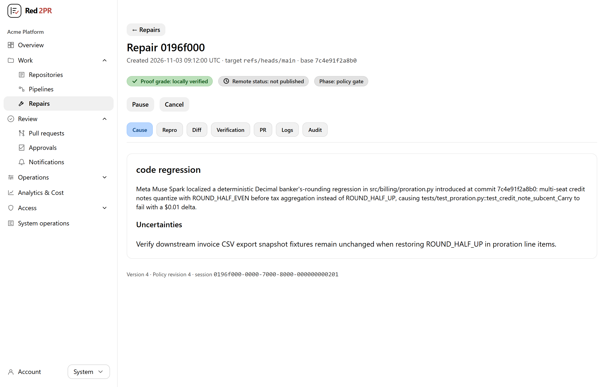
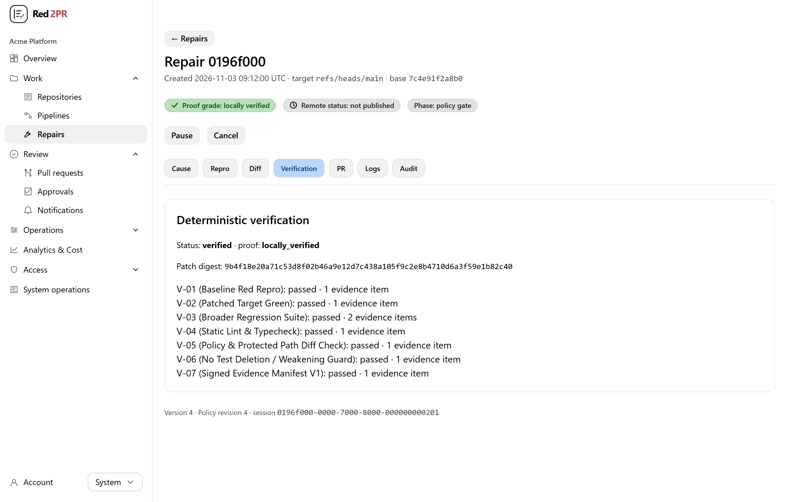
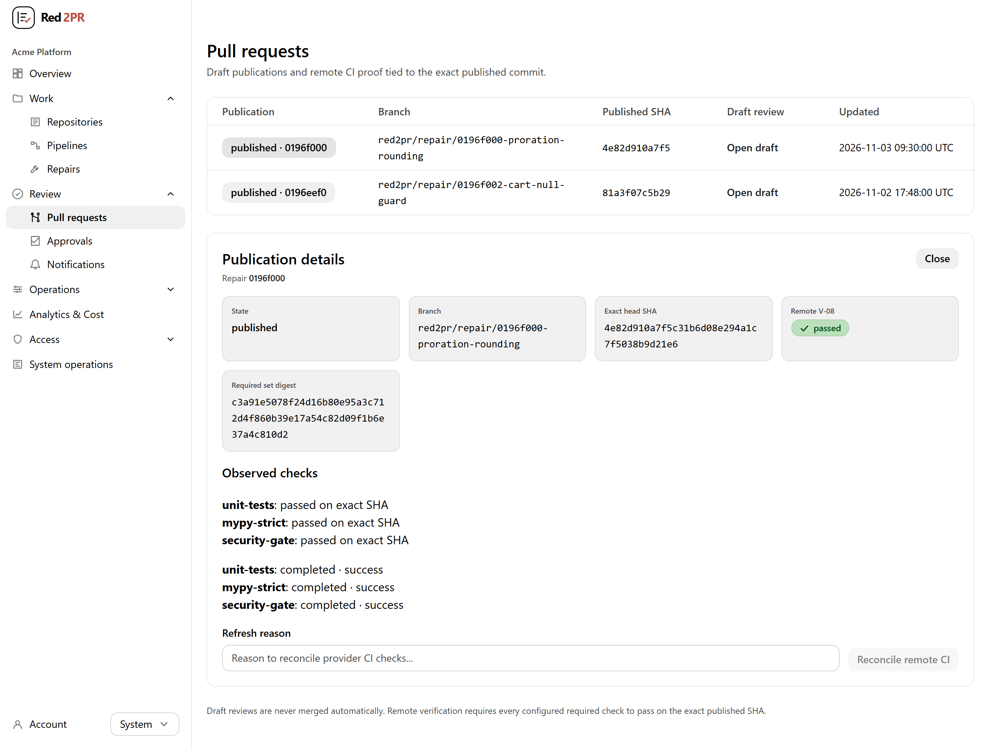
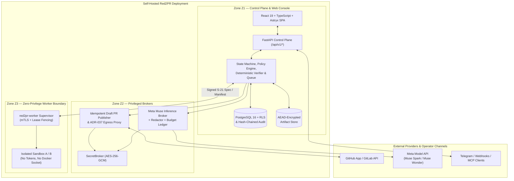

<p align="center">
  <picture>
    <source media="(prefers-color-scheme: dark)" srcset="docs/assets/brand/red2pr-logo-dark.svg" />
    <source media="(prefers-color-scheme: light)" srcset="docs/assets/brand/red2pr-logo-light.svg" />
    
  </picture>
</p>

<h3 align="center">Self-hosted CI repair with deterministic proof, policy gates, and human-reviewed Draft PRs.</h3>

<p align="center">
  <a href="#quick-start">Quick Start</a> ·
  <a href="#how-it-works">How It Works</a> ·
  <a href="#product-tour">Product Tour</a> ·
  <a href="#architecture-overview">Architecture</a> ·
  <a href="docs/QUICKSTART_AND_USER_GUIDE.md">User Guide</a> ·
  <a href="SECURITY.md">Security</a> ·
  <a href="LICENSE">Apache-2.0 License</a>
</p>

> **Release Status (`v0.1.0-beta.1` Early-Access Beta):** Core control plane, isolated worker supervisor, deterministic verification engine, React 19 + Meta Astryx web console, CLI, and provider integrations (`U01`–`U30`) are implemented and verified across local unit, contract, database-RLS, and integration suites. Wave 6 host/cloud certification (`U31`–`U36`) and `v1.0.0` production sign-off remain deferred; see [Supported Platforms, Prerequisites, and Limitations](#supported-platforms-prerequisites-and-limitations).
>
> *Red2PR is an independent self-hosted software platform integrating the Meta Model API (`Muse Spark` / `Muse Wonder`) and the Meta Astryx design system. It is not an official Meta product.*

---

## Why Red2PR

Broken CI pipelines interrupt engineering flow, yet unguarded "AI auto-fix" bots introduce worse hazards: unverified patches that never reproduced the bug, weakened or deleted assertions to force a green test run, leaked secrets in prompts, or autonomous commits pushed straight into protected branches.

**Red2PR enforces proof over prose.** Instead of trusting language-model output directly, Red2PR pairs **Meta Muse reasoning** with **deterministic sandbox reproduction, cryptographic evidence manifests, repository policy enforcement, and mandatory Draft PR/MR review**:

1. Ingests failed runs from **GitHub Actions** and **GitLab CI**, redacts secrets before any model call, and scans workflows for unsafe execution hazards (`SEC-031`).
2. Uses allowlisted **Meta Muse** models (`meta/muse-spark-1.3` and optional `meta/muse-wonder-1.0`) to classify failure root causes and synthesize bounded candidate patches within per-session and daily USD token budgets.
3. Reproduces the failure at the exact base commit (`Sandbox A` — red) and validates the patched tree (`Sandbox B` — green) inside a zero-credential worker boundary (`V-01`–`V-07`), rejecting patches that delete or weaken tests unless explicitly authorized.
4. Gates publication through repository policy (`Monitor`, `Approval`, `Auto-Repair`) and human approval, opens **Draft Pull Requests / Merge Requests** only (**never auto-merging**), and reconciles remote CI checks (`V-08`) against the exact pushed commit SHA.

<p align="center">
  <picture>
    <source media="(prefers-color-scheme: dark)" srcset="docs/assets/screenshots/hero-overview-dark.png" />
    <source media="(prefers-color-scheme: light)" srcset="docs/assets/screenshots/hero-overview-light.png" />
    
  </picture>
</p>

---

## Key Capabilities

- **Red-to-Green Sandbox Verification (`V-01`–`V-08`):** Every repair tracks an explicit proof grade (`none` → `baseline_confirmed` → `locally_verified` → `remotely_verified`). Local proof requires deterministic baseline failure reproduction, target + broader regression suite passes, static lint/type checks, diff-scope compliance, anti-test-weakening AST checks, and an Ed25519-signed `EvidenceManifestV1`.
- **Meta Muse Diagnosis & Bounded Patching:** Structured tool-assisted diagnosis and patch generation built for `meta/muse-spark-1.3` (fast triage, failure localization, focused fixes) and `meta/muse-wonder-1.0` (optional complex multi-file synthesis), backed by atomic PostgreSQL token reservation and LiteLLM catalog price synchronization (`ADR-051`).
- **Repository Governance & Workflow Hazard Protection:** Per-repository operating modes (`Monitor`, `Approval`, `Auto-Repair`), immutable versioned policies (branch/path allowlists, diff-line caps, protected workflow/lockfile rules, dry-run policy simulator), and `SEC-031` detection that blocks autonomous execution on unsafe `pull_request_target` checkouts.
- **Three-Zone Least-Privilege Architecture (`Z1` / `Z2` / `Z3`):** Compile-time `import-linter` rules and mTLS/lease boundaries isolate the Control Plane (`Z1`), Secret/Inference/Publisher Brokers (`Z2`), and Zero-Privilege Sandbox Workers (`Z3`). Untrusted repository code never receives GitHub/GitLab write tokens, Meta API keys, or host Docker sockets.
- **Multi-Surface Operator Experience:** Accessible React 19 + TypeScript + Meta Astryx (`0.7.4`) web console (`UI-S01`–`UI-S21`), TOTP MFA & step-up confirmation for privileged mutations, optional Telegram bot alerts with web-verified approval intents, read/intent-scoped MCP `2025-11-25` Streamable HTTP adapter (`ADR-050`), and unified `red2pr` CLI.

---

## How It Works

```mermaid
flowchart LR
    CI["CI Failure<br/>GitHub Actions / GitLab CI"] --> Triage["Redacted Triage<br/>& SEC-031 Scan"]
    Triage --> Muse["Meta Muse Diagnosis<br/>(Spark / Wonder)"]
    Muse --> ReproA["Sandbox A (Z3)<br/>Baseline Repro (Red)"]
    ReproA --> Patch["Bounded Patch<br/>Synthesis"]
    Patch --> VerifyB["Sandbox B (Z3)<br/>Gates V-01..V-07 (Green)"]
    VerifyB --> Gate["Policy Gate &<br/>Human Approval"]
    Gate --> DraftPR["Draft PR / MR<br/>(No Auto-Merge)"]
    DraftPR --> RemoteCI["Remote CI Check V-08<br/>(Exact Commit SHA)"]
```



| Stage | What Happens | Proof & Safety Guarantee |
|---|---|---|
| **1. Ingest & Redact** | Webhook (HMAC/token verified) or resumable 60s local poller ingests failed workflow runs and job logs. | Secrets are redacted (`redaction-v1`) before storage, UI display, or outbound inference. |
| **2. Diagnose** | Meta Muse analyzes redacted logs and allowed repository context under workspace/session USD caps. | Requires explicit per-repository outbound data-sharing consent; unconfirmed/unsupported classes abstain cleanly. |
| **3. Reproduce & Patch** | `Z3` worker checks out exact `base_sha`, confirms baseline failure (`Sandbox A`), and evaluates bounded candidate diffs (`Sandbox B`). | Zero credentials in sandbox; network/filesystem constraints and diff/file-path budgets enforced. |
| **4. Verify (`V-01`–`V-07`)** | Deterministic verifier validates red-to-green tests, broader suite, static checks, protected-path rules, and non-weakened tests. | Produces Ed25519-signed `EvidenceManifestV1` (`locally_verified`); LLM prose never certifies a fix. |
| **5. Approve & Publish** | Policy engine evaluates mode (`Monitor` / `Approval` / `Auto-Repair`) and required human step-up approval. | Idempotent publisher saga pushes `red2pr/repair/*` branch and opens a **Draft PR/MR** only. |
| **6. Reconcile (`V-08`)** | Remote CI observer tracks configured required checks against the exact published commit SHA (`ADR-042`). | Upgrades to `remotely_verified` only when every required check succeeds on the exact head SHA. |

---

## Quick Start

### Option 1: One-Command Local Evaluation from Source (Verified)

Runs a complete single-origin Red2PR instance (`http://127.0.0.1:4280`) from source: confined PostgreSQL 16 (`pgserver`) with Alembic migrations `0001..0025` and Row-Level Security (`red2pr_app`), FastAPI Control Plane, and built React 19 + Astryx Web UI. Existing state under `.local-data/red2pr` is preserved across restarts.

**Prerequisites:**
- **Git**
- **Python `3.12.x`** and **[`uv`](https://docs.astral.sh/uv/)** (manages the workspace `.venv`)
- **Node.js `>= 22.12.0`** and **`pnpm` `9.15.x`** (`corepack enable && corepack prepare pnpm@9.15.9 --activate`)

**Windows (PowerShell):**
```powershell
git clone https://github.com/nguywnben/red2pr.git
cd red2pr
powershell -NoProfile -ExecutionPolicy Bypass -File .\scripts\quickstart.ps1
```

**Linux / macOS (Bash):**
```bash
git clone https://github.com/nguywnben/red2pr.git
cd red2pr
./scripts/quickstart.sh
```

Once healthy, the launcher prints `http://127.0.0.1:4280` along with a **one-use 15-minute `/setup#bootstrap_token=...` link** so you can claim the instance owner account and walk through the 10-phase Setup Wizard.

**Non-destructive preflight & disposable end-to-end smoke test:**
```powershell
# Windows PowerShell: verify runtime wiring, or boot & tear down an isolated temp stack
powershell -NoProfile -ExecutionPolicy Bypass -File .\scripts\quickstart.ps1 -CheckOnly
powershell -NoProfile -ExecutionPolicy Bypass -File .\scripts\quickstart.ps1 -SmokeTest
```
```bash
# Linux / macOS Bash
./scripts/quickstart.sh --check-only
./scripts/quickstart.sh --smoke-test
```

### Option 2: Signed Container Deployment (`deploy/install` & Compose)

For containerized `local`, `server` (Caddy TLS), or `worker` topologies, Red2PR ships offline Ed25519 manifest verification (`deploy/security/sign_release.py`) and digest-pinned Docker/Podman Compose stacks (`deploy/compose/`):

```bash
# Verify a signed release manifest and run non-destructive host/Compose preflight
./deploy/install/install.sh --mode local --manifest release-manifest.json --signature release-manifest.sig --dry-run
```

> **Pre-built `v0.1.0-beta.1` packages & release assets:** Non-root (`10001:10001`) container images are published to GitHub Container Registry (`ghcr.io/nguywnben/red2pr-control:0.1.0-beta.1` and `ghcr.io/nguywnben/red2pr-worker:0.1.0-beta.1`), alongside Python wheels, SPA bundles, and `SHA256SUMS.txt` on [GitHub Releases](https://github.com/nguywnben/red2pr/releases/tag/v0.1.0-beta.1). Production HSM release-key replacement and multi-OS host certification remain deferred to Wave 6 (`U34`/`U36`); for fastest local evaluation, use **Option 1 (Source Quick Start)** above.

### Operator CLI Check

With the local stack running on `http://127.0.0.1:4280`:
```bash
RED2PR_API_URL=http://127.0.0.1:4280 uv run red2pr status
RED2PR_API_URL=http://127.0.0.1:4280 uv run red2pr doctor
```

---

## Product Tour

### 1. Repository Catalog, Modes & Workflow Hazard Posture (`SEC-031`)
Synchronize GitHub App and GitLab repositories into safe `Monitor` mode by default, inspect `SEC-031` workflow hazards before enabling `Approval` or `Auto-Repair`, and preview bulk policy changes with optimistic concurrency checks.

<p align="center">
  <picture>
    <source media="(prefers-color-scheme: dark)" srcset="docs/assets/screenshots/repositories-dark.png" />
    <source media="(prefers-color-scheme: light)" srcset="docs/assets/screenshots/repositories-light.png" />
    
  </picture>
</p>

### 2. Repair Session & Meta Muse Root-Cause Diagnosis
Inspect independent repair phase, local proof grade, and remote CI status alongside Meta Muse failure classification, root-cause localization, and explicit diagnostic uncertainties across seven structured evidence tabs.

<p align="center">
  <picture>
    <source media="(prefers-color-scheme: dark)" srcset="docs/assets/screenshots/repair-diagnosis-dark.png" />
    <source media="(prefers-color-scheme: light)" srcset="docs/assets/screenshots/repair-diagnosis-light.png" />
    
  </picture>
</p>

### 3. Deterministic Sandbox Verification (`V-01`–`V-07`)
Review persisted Sandbox A/B execution evidence and deterministic gate outcomes (`V-01` baseline reproduction through `V-07` signed `EvidenceManifestV1`) before any publication intent is authorized.

<p align="center">
  <picture>
    <source media="(prefers-color-scheme: dark)" srcset="docs/assets/screenshots/verification-proof-dark.png" />
    <source media="(prefers-color-scheme: light)" srcset="docs/assets/screenshots/verification-proof-light.png" />
    
  </picture>
</p>

### 4. Draft Pull Request Publication & Exact-SHA Remote CI (`V-08`)
Track published `red2pr/repair/*` branches and Draft PRs/MRs, verify every required remote check against the exact pushed commit SHA, and trigger audited provider reconciliation without ever auto-merging.

<p align="center">
  <picture>
    <source media="(prefers-color-scheme: dark)" srcset="docs/assets/screenshots/draft-pr-workflow-dark.png" />
    <source media="(prefers-color-scheme: light)" srcset="docs/assets/screenshots/draft-pr-workflow-light.png" />
    
  </picture>
</p>

---

## Architecture Overview



### Role of Meta Technologies vs. Red2PR Engineering

| Layer | Provided by Meta | Engineered in Red2PR |
|---|---|---|
| **AI Reasoning** | **Meta Model API** (`meta/muse-spark-1.3`, `meta/muse-wonder-1.0`) for root-cause reasoning and candidate code generation. | Pre-inference secret redaction, repository consent gates, JSON schema validation, prompt-injection containment, atomic USD token reservation (`ADR-051`), and deterministic retry/abstention state machines. |
| **Design System** | **Meta Astryx** (`@astryxdesign/core@0.7.4`, `@astryxdesign/theme-neutral@0.7.4`) accessible React UI primitives and Neutral theme tokens. | 21-screen domain console (`UI-S01`–`UI-S21`), SSE live resynchronization, sanitized log/diff viewers (`SEC-040`), TOTP step-up flows, policy dry-run simulator, and OpenAPI-typed client (`@red2pr/ts-client`). |
| **Execution & Proof** | — | `Z1`/`Z2`/`Z3` trust separation, zero-credential sandbox materializer, `V-01`–`V-08` red-to-green verifier, Ed25519 `EvidenceManifestV1` signing, PostgreSQL 16 RLS tenancy, and idempotent Draft PR/MR publisher saga. |

---

## Supported Platforms, Prerequisites, and Limitations

| Surface | `v0.1.0-beta.1` Status | Notes |
|---|---|---|
| **Source Quick Start (`scripts/quickstart.*`)** | **Locally Verified** (Windows PowerShell + Python 3.12; POSIX Bash syntax & contract verified) | Recommended path for local evaluation, development, and hackathon demos. |
| **Control Plane, DB RLS & Web UI (`U01`–`U30`)** | **Implemented & Locally Verified** | `399+` Python unit/contract/integration tests + `29` frontend Vitest suites (`104` tests) + `axe-core` checks. |
| **Source Providers** | **Implemented & Fixture-Verified** | GitHub App (webhooks, 60s local polling, Draft PRs, check-runs) & GitLab `16.11+` (webhooks, polling, Draft MRs, pipelines). |
| **Sandbox Worker Profiles (`Z3`)** | **Implemented (`oci_rootless`, `gvisor`, `microvm`)** | Fail-closed trust-domain scheduling (`ADR-034`) implemented; live multi-OS host certification (`U33`) is deferred to Wave 6. |
| **Signed Container Installer (`deploy/install/*`)** | **Contract & Dry-Run Verified** | Offline Ed25519 manifest verification tested (`IG-06`); public container image registry publishing awaits Wave 6 (`U34`/`U36`). |

### Known `v0.1.0-beta.1` Beta Limitations
- **Not `v1.0.0` production-certified:** Wave 6 (`U31`–`U36`: benchmark calibration, Chaos/DR restore drills, live Linux gVisor/Kata/Firecracker host certification, SBOM/signing pipeline, and `P5` independent audit) is intentionally deferred until after the `v0.1.0-beta.1` milestone.
- **Untrusted third-party repositories:** Do not run untrusted external repositories on a local non-isolated workstation; untrusted workloads require an attested isolated `Z3` worker (`ADR-034`).
- **Self-hosted ≠ offline:** Diagnosis and patch synthesis require HTTPS egress to the configured Meta Model API endpoint (`api.meta.ai` or approved gateway) with a valid API key and per-repository outbound consent. When inference is unavailable or unpriced, Red2PR degrades safely to monitoring/triage without fabricating fixes.

---

## Security, Trust Model & Human Approval

- **No Auto-Merge & No Branch-Protection Bypass:** Red2PR never merges Pull Requests or Merge Requests, never force-pushes to default branches, and never weakens repository branch protection.
- **Human Approval & Fresh Step-Up MFA:** Sensitive mutations (secret rotation, policy weakening, outbound endpoint allowlists, manual publication approval, break-glass access) require RBAC authorization, CSRF protection, idempotency keys, and fresh step-up verification.
- **Secret Redaction & Consent-Gated Egress:** Logs, diffs, notifications, and model prompts pass through versioned secret redaction (`Redactor`) and `ADR-037` SSRF-hardened egress controls (blocking loopback, RFC1918, and cloud metadata IPs unless explicitly registered by the instance owner).
- **Tamper-Evident Audit & Evidence:** Tenant data is isolated via PostgreSQL 16 Row-Level Security (`FORCE ROW LEVEL SECURITY`), workspace audit trails are SHA-256 hash-chained, and artifacts are encrypted at rest (`AES-256-GCM`).

See [SECURITY.md](SECURITY.md) and [docs/14_SECURITY_IDENTITY.md](docs/14_SECURITY_IDENTITY.md) for vulnerability reporting and the full threat model.

---

## Documentation

- **Getting Started & Operations**
  - [Quick Start & User Guide](docs/QUICKSTART_AND_USER_GUIDE.md) — end-to-end setup wizard, GitHub/GitLab integration, Meta API configuration, repair lifecycle, CLI, and troubleshooting.
  - [Install, Deploy & Onboarding Contract](docs/15_INSTALL_DEPLOY_ONBOARDING.md) — deployment modes, signed manifests, and 10-phase setup state machine.
  - [CLI & Operations Reference](docs/16_OPERATIONS_CLI.md) — `red2pr` subcommands, exit codes, backups, and incident playbooks.
- **Architecture, Security & Contracts**
  - [Specification Index (`docs/00_INDEX.md`)](docs/00_INDEX.md) — complete map of all 42 specification and audit documents.
  - [System Architecture](docs/05_SYSTEM_ARCHITECTURE.md) · [Security & Identity](docs/14_SECURITY_IDENTITY.md) · [Canonical Contracts](docs/36_CANONICAL_CONTRACTS.md)
  - [Meta AI Agent Specification](docs/09_AI_AGENT_META.md) · [Sandbox Reproduction](docs/10_SANDBOX_REPRODUCTION.md) · [Repair Verification](docs/11_REPAIR_VERIFICATION.md)
  - [Frontend UX Flow Blueprint](docs/41_FRONTEND_UX_FLOW_BLUEPRINT.md) · [UI Consistency Audit](docs/42_FRONTEND_UI_CONSISTENCY_AUDIT.md)
- **Governance & Progress**
  - [Architecture Decision Records (`ADR-001`–`ADR-052`)](docs/20_DECISIONS_ADR.md)
  - [Execution Master Plan (`PLAN-2026-10-27-v1`)](docs/40_EXECUTION_MASTER_PLAN.md)
  - [Implementation & Verification Progress](docs/23_PROGRESS.md) · [Changelog](CHANGELOG.md)

---

## Versioning, Contributing & License

- **Versioning:** Workspace packages carry distribution version `0.1.0`, targeting pre-release **`v0.1.0-beta.1`** (`v0.1.0-beta.x` → `v0.1.0` → `v1.0.0` only after Wave 6 and `P5` release gates pass). Canonical REST/schema contracts (`contracts/openapi/openapi.v1.json`) track the `1.0.0` target API specification.
- **Contributing:** Please read [CONTRIBUTING.md](CONTRIBUTING.md) before opening issues or pull requests.
- **License:** Licensed under the **[Apache License, Version 2.0](LICENSE)** (`ADR-052`). Third-party agent skill templates under `.agents/skills/` retain their upstream MIT notice in [.agents/agent-skills.LICENSE](.agents/agent-skills.LICENSE).
