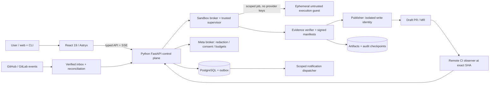

# System architecture — component boundaries and deployment

## Accepted implementation-language boundary
- **Web client:** React 19 + TypeScript + Vite, Astryx UI components + thin Red2PR design wrappers; static compiled files served through same-origin reverse proxy. No Next.js runtime required.
- **Control plane/API/AI orchestration:** Python + FastAPI; typed schemas/Pydantic and PostgreSQL are technical proposals under ADR-013/035. Execution/workers are independent security boundary.
- **Frontend↔backend contract:** OpenAPI-derived TypeScript client, schema validation and backward compatibility; SSE for repair progress with resync from REST, avoid trusting SSE as authority.
- **No Python↔React conflict:** JavaScript/TypeScript runs in browser/build toolchain; Python runs server-side.


## Proposed architecture: modular monolith + isolated executors

```text
GitHub/GitLab -> [TLS Ingress] -> [Provider Webhook Adapter] -> [Inbox+Queue]
                                  |                         |
                         [Provider API client]     [Durable Orchestrator]
                                  |                         |
                       [Evidence Collector] -> [Triage/Meta Agent]
                                                    |
                                       [Sandbox Manager via Worker Broker]
                                                    |
                                        [Baseline / Patch / Test Runner]
                                                    |
                                 [Deterministic Verification + Policy Gate]
                                                    |
                                         [Publisher (separate identity)]
                                                    |
                                       [Draft PR/MR + remote CI tracker]

Web Dashboard/CLI -> [API + Auth/RBAC] -> [Control Plane/PostgreSQL]
                                             | [Queue/Outbox]
                                             | [Object Evidence Store]
                                             | [Secrets Broker]
                                             | [Notifications/Telegram]
                                             | [Telemetry/Analytics]
```

## Module map and responsibility ownership
| Module | Responsibility | Has credentials? | Runs target repo code? |
|---|---|---|---|
| `api` | Auth/UI API, user actions, CSRF/RBAC, setup | session keys | No |
| `integrations` | GitHub/GitLab/Telegram auth, webhook/polling | provider scoped | No |
| `orchestrator` | repair state, budget, concurrency, approval | DB/queue | No |
| `evidence` | logs/artifacts, normalization, redaction | provider read token | No |
| `inference` | Meta adapter, structured output, bounded tools | Meta key (via broker) | No |
| `policy` | branch/file gates, diff integrity, eligibility, scopes | No | No |
| `sandbox-broker` | create ephemeral worker jobs, capability tickets | narrow broker creds | Dispatch only |
| `worker` | checkout provided sanitized snapshot, reproduce/test | no provider write/Meta keys | **Yes, isolated** |
| `verifier` | verify execution evidence, compare baseline/patch | artifact read only | No |
| `publisher` | create branch/commit/draft PR/MR | short-lived provider write | No |
| `notifications` | route/deliver messages and callback links | bot tokens/webhook secrets | No |
| `analytics` | event aggregation, reporting | read-only DB | No |

**Module API contracts** are defined in [07_API_CONTRACTS.md](07_API_CONTRACTS.md), state transitions in [08_EVENTS_STATE_MACHINES.md](08_EVENTS_STATE_MACHINES.md), and isolation in [10_SANDBOX_REPRODUCTION.md](10_SANDBOX_REPRODUCTION.md).

## Durable workflow mechanics
- PostgreSQL is source-of-truth; transactional inbox/outbox and queue jobs indexed by logical repair key. Redis + Dramatiq preferred initial worker queue **only if** durable recovery is implemented in DB; Redis state alone cannot represent durable truth.
- Atomic transitions with optimistic concurrency version; expiring leases and heartbeats; retry with jitter; poison/dead-letter queue and manual reconciliation.
- API/event contracts versioned; all side effects keyed by operation IDs and idempotent reconciliation; honor provider rate limits.
- Artifacts immutable/content-addressed where practical, encrypted storage; provenance SHA-256 and recording retention/authorization.

## Trust zones
**Z0:** public ingress (webhook, browser, Telegram); **Z1:** authenticated control plane; **Z2:** privileged publisher/secrets; **Z3:** untrusted sandbox; **Z4:** external Meta and source providers. Traffic Z1→Z3 via task broker, no sensitive credentials through worker; Z3 outbound network allowlisted by profile; Z3 must not reach Z1/Z2 DB or metadata services.

## Platform profiles
- **Personal local:** Windows (WSL2/container runtime), macOS, Linux desktop. One user/small trusted repo set; read-only polling default. For untrusted code, separate isolated VM/host required; do not imply Docker alone is secure enough.
- **Single server:** Linux + HTTPS webhook, PostgreSQL and object storage, worker on separate host for any untrusted repo; reverse proxy and backups.
- **Distributed:** Worker pool with host attestations, mTLS/task tokens, quotas, tenancy boundaries, queue fairness; advanced deployment support must be tested before enabled.

## Technology defaults (pending ADR validation)
- Python 3.12+, FastAPI, Pydantic v2, SQLAlchemy/Alembic; PostgreSQL 16+; Redis queue + explicit durable DB orchestration (or Temporal if requirements justify).
- React 19 + Vite + TypeScript + Astryx UI with a typed OpenAPI client; same-origin FastAPI session/auth boundary; OpenTelemetry + Prometheus/Grafana optional; MinIO/S3-compatible artifacts.
- Python typing and stable tool interfaces; OCI sandbox runtime with rootless + gVisor or VM per risk tier; installer written in shell and PowerShell wrapping verified signed release artifacts.
- Secrets may use encrypted-at-rest DB with master key external from DB, or platform secret store; don't silently store plaintext credentials.

## Architectural invariants
- Every repair = immutable SHA + provider run attempt + authorized repo ID; no silent base branch drift.
- Every `verified` = deterministic evidence + policy permit; remote CI statuses independently persisted.
- Every published PR/MR = unique repair session + branch marker, no duplicates on ambiguous timeouts.
- Every notification = event from outbox, delivery status/quiet-hour policy, no raw private logs.
- Any failure to establish sandbox isolation blocks code execution, not downgrade to host shell.

## P2 boundary map and decision status
Binding: React 19 + TypeScript + Vite + Astryx frontend, Python/FastAPI backend/agents (ADR-025), multi-workspace (ADR-030). PostgreSQL source of truth, transport choice, object storage topology remain PROPOSED ADR-013/035; previous technology table is a design recommendation, not ACCEPTED selection.



Publisher does not accept model-issued commands; it consumes a sealed intent that rechecks V-01…07, live grant, base/diff/policy and approvals. Provider read broker, model broker, publisher and notification credentials use separate service capabilities even in modular-monolith deployment. Guest has no routable control-plane network, host socket, credentials or signing key.
Single instance may host many workspaces; scheduler fairness, cache keys, object prefixes, event cursors and DB predicates all include workspace. Distributed workers do not imply HA control plane or trusted multi-tenant shared kernel. The distinction between required isolation and SAN-04 extension is explicit in ADR-034.


[← Specification index](00_INDEX.md) · [Decisions](20_DECISIONS_ADR.md) · [Traceability](38_REQUIREMENTS_TRACEABILITY.md)
