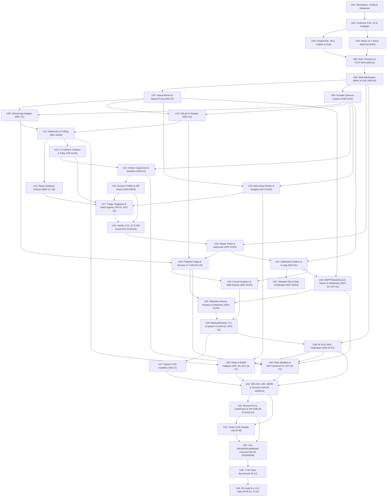

# Red2PR 1.0.0 — Official Master Implementation Plan

**Plan version:** `PLAN-2026-10-27-v1` · **Specification baseline:** `SPEC-2026-10-27-v5` (`9688499`) · **Status:** `APPROVED_FOR_P4` (Owner approved on 2026-10-27 via [ADR-039](20_DECISIONS_ADR.md)) · **Governing ADR:** [ADR-027](20_DECISIONS_ADR.md), [ADR-038](20_DECISIONS_ADR.md), [ADR-039](20_DECISIONS_ADR.md).

> **Path note:** Because `docs/36_CANONICAL_CONTRACTS.md` through `docs/39_SPEC_AUDIT.md` already occupy slots `36`–`39` in the specification index, this single authoritative Master Implementation Plan is recorded at `docs/40_EXECUTION_MASTER_PLAN.md` without overwriting existing canonical contracts.

---

## 1. Purpose, Non-Negotiable Scope & Governance

This document is the **single, unified Master Implementation Plan** to build, verify, harden, certify, and ship **Red2PR 1.0.0** from the current documentation-only repository (`0` product source files) to an evidence-backed production release across the certified support matrix ([27_SUPPORT_MATRIX.md](27_SUPPORT_MATRIX.md)).

1. **Full Production Scope — No MVP Reduction:** All **46 feature IDs** in [02_FEATURE_CATALOG.md](02_FEATURE_CATALOG.md) (`41 P0` mandatory `v1.0.0` release features, `4 P1` extensions, and `1 P2` extension), all **21 UI screens** (`UI-S01`..`UI-S21`), all **24 API families** (`A-01`..`A-24`), all **22 canonical schemas** (`S-01`..`S-22`), all **10 workflows** (`W-01`..`W-10`), all **40 adversarial security scenarios** (`SEC-001`..`SEC-040`), all **16 measurable NFR targets** (`NFR-01`..`NFR-16`), and all **15 release gates** (`R-01`..`R-15`) are accounted for in one integrated DAG.
2. **Proof Over Prose & Non-Waivable Invariants:** LLMs propose hypotheses and patches only; deterministic executors and verifiers certify outcomes. No baseline reproduction means `repro_unconfirmed` termination with diagnosis and human handoff only — zero draft PR/MR publication ([ADR-031](20_DECISIONS_ADR.md)). Auto-merge and branch-protection bypass are permanently prohibited ([ADR-010](20_DECISIONS_ADR.md)). All Critical and invariant security findings block release ([ADR-032](20_DECISIONS_ADR.md)).
3. **Mandatory Verification Inside Every Unit:** No Execution Unit may be marked `DONE` or relied upon by downstream units until its automated unit, contract, integration, UI, and negative security tests pass with recorded command output and exit code `0` in [23_PROGRESS.md](23_PROGRESS.md). Simulated/hermetic tests are strictly separated from owner-authorized live provider certification.
4. **No Unauthorized Execution:** Preparing or approving this document does **not** authorize live Meta API spend, GitHub/GitLab account mutations, sending external notifications, installing host virtualization/container runtimes without consent, pushing commits, or claiming production readiness before gates `R-01`..`R-15` pass.

---

## 2. Locked Technology Stack & Dependency Pinning Strategy

| Layer | Locked / Proposed Selection | Pinning, Compatibility & Safety Policy | Governing Status |
|---|---|---|---|
| **Frontend UI** | **React 19** (`19.x` exact), **TypeScript** (`strict: true`, `noUncheckedIndexedAccess: true`), **Vite**, **Meta Astryx Design System** (`@astryxdesign/core` `0.7.5` baseline, `@astryxdesign/theme-neutral`, `@stylexjs/stylex` `^0.19.0`) | Static SPA assets only; **no Next.js or Node.js production server**. `@astryxdesign/cli` is dev-only and **must never run `init` in repo root** (`AGENTS.md` SHA-256 enforced in CI). All Astryx imports are isolated behind `apps/web/src/shared/ui/` wrappers. | **ACCEPTED** (`ADR-025`) |
| **Frontend Libraries & Build** | Node.js `22.x LTS` build toolchain (`>=22.12.0` pinned via `.nvmrc`), `pnpm 9.x` (`pnpm-lock.yaml` `--frozen-lockfile`), `react-router` `7.x` (SPA), `@tanstack/react-query` `5.x`, `openapi-typescript` + `openapi-fetch`, `zod` `3.x`, `@tanstack/react-virtual` | Generated OpenAPI client prevents manual DTO drift. Virtualized log/table viewers include non-virtual paged keyboard fallback and strip raw HTML/unsafe ANSI (`SEC-040`). | **PROPOSED** (`ADR-038`) |
| **Backend & AI Plane** | **Python `3.12.x`** (`>=3.12,<3.13`), **FastAPI**, **Pydantic v2** (`extra="forbid"`), **Uvicorn**, managed as a `uv` workspace with committed `uv.lock` | Backend and AI orchestration remain **100% Python** (`ADR-025`). No opaque third-party agent swarm frameworks; deterministic state transitions live in Python orchestrator code. | **ACCEPTED** (`ADR-025`) / `uv` **PROPOSED** (`ADR-038`) |
| **Meta Muse AI** | Direct async `httpx` adapter against Meta Model API (`https://api.meta.ai/v1`), default `muse-spark-1.3`, optional `muse-wonder-1.0` | Live capability probe required before enabling; outbound consent + redaction + atomic DB budget reservation required before every request; **zero silent fallback to non-Meta vendors**. | **ACCEPTED** (`ADR-008`) / Profiles **PROPOSED** (`ADR-020`) |
| **Primary Database & Migrations** | **PostgreSQL `16.x`** (pinned image digest), **SQLAlchemy `2.0`** (async `psycopg` v3), **Alembic** | Single source of truth for repair state, `webhook_inbox`, `task_jobs`, `outbox_events`, budgets, and hash-chained `audit_log`. Non-superuser app role with transaction-local `workspace_id` RLS defense-in-depth and expand/backfill/validate/contract migrations. | **PROPOSED** (`ADR-013`, `ADR-035`) |
| **Queue Transport** | **Redis `7.x`** + **Dramatiq** backed by authoritative PostgreSQL `task_jobs` | Transport wakeup only; deterministic recovery sweeper rebuilds queue state from PostgreSQL on Redis wipe/restart (`0` lost acknowledged jobs). Temporal is not required for `v1.0.0`. | **PROPOSED** (`ADR-013`, `ADR-035`) |
| **Artifact & Secret Storage** | Local AES-256-GCM content-addressed store (`local` mode) or **S3-compatible / MinIO** (`server`/`distributed`); envelope-encrypted secret broker with external master key | Staged upload → SHA-256 check → DB commit → finalize. Short-lived reauthorized download streams; secrets referenced by opaque ID only, never exposed to UI, logs, LLMs, or workers. | **PROPOSED** (`ADR-013`, `ADR-035`) |
| **Sandbox & Runner Profiles** | Standalone `red2pr-worker` supervisor (`mTLS` + `Ed25519` signing outside guest) driving rootless **Docker / Podman** OCI containers (plus `gVisor` `runsc` / ephemeral VM driver on hostile workloads) | Pinned `@sha256` runner images for `python-pytest-linux` (Python 3.12) and `node-jest-linux` / `node-vitest-linux` (Node 22 LTS). Non-root, read-only rootfs, dropped capabilities, `no-new-privileges`, seccomp, quotas, `network=none` during test execution, **never fallback to host shell**. | **PROPOSED** (`ADR-016`, `ADR-018`, `ADR-034`) |
| **Ingress, CLI & Installers** | **Caddy `2.x`** reverse proxy (same-origin SPA + `/api/v1/*`, automatic/custom TLS); `red2pr` CLI (`typer`); POSIX `install.sh` + PowerShell `install.ps1` | Installers verify detached `Ed25519` release manifest signatures against an embedded offline trust root before executing any binary/image pull. | **ACCEPTED** (`ADR-004`) / Signing **PROPOSED** (`ADR-019`) |
| **Telemetry, QA & Supply Chain** | OpenTelemetry SDK + optional Prometheus exporter; `ruff`, `mypy --strict`, `import-linter`, `pytest`, `hypothesis`, `schemathesis`, `vitest`, `playwright`, `@axe-core/playwright`, `syft`, `grype`, `pip-audit`, `pnpm audit`, `gitleaks` | Every dependency and container image is lockfile/digest-pinned. Pre-release gate requires CycloneDX SBOM, vulnerability triage (`ADR-032`), secret scan, and detached artifact signatures. | **PROPOSED** (`ADR-038`) |

---

## 3. Contract-First Monorepo Layout & Trust Boundaries

```text
red2pr/
├── AGENTS.md                             # Immutable agent operating contract (SHA-256 checked in CI)
├── README.md
├── pyproject.toml                        # Root uv workspace + ruff / mypy / import-linter / pytest config
├── uv.lock                               # Frozen Python dependency lockfile
├── pnpm-workspace.yaml                   # Frontend + TS client workspace
├── package.json                          # Root frontend scripts (build, typecheck, lint, test)
├── pnpm-lock.yaml                        # Frozen frontend lockfile
├── docs/                                 # 00..40 specifications, ADRs, progress & release ledger
├── contracts/
│   ├── openapi/openapi.v1.json           # Deterministically exported FastAPI v1 contract
│   ├── schemas/                          # Canonical JSON Schemas: S-19 events, S-20 tools, S-21 worker, S-22 manifest
│   └── fixtures/                         # Sanitized GitHub/GitLab/Telegram/Meta & SEC-001..040 fixtures
├── packages/
│   ├── py-contracts/                     # Pure Pydantic v2 S-01..S-22, canonical JSON, Ed25519/AES-GCM/HMAC primitives
│   └── ts-client/                        # Generated OpenAPI TypeScript types, fetch wrapper & SSE cursor reconciler
├── apps/
│   ├── control-plane/                    # Python/FastAPI modular monolith (Z1 control + Z2 isolated brokers)
│   │   ├── alembic/                      # Expand/contract PostgreSQL migrations + N/N-1 validators
│   │   ├── src/red2pr_control/
│   │   │   ├── core/                     # Config (doc25), Problem+JSON, redaction v1, OTel, ADR-037 egress proxy
│   │   │   ├── db/                       # SQLAlchemy 2.0 models, RLS context guard, outbox, idempotency, audit chain
│   │   │   ├── secrets/                  # Z2 Secret Broker (write-only refs, key rotation, external master key)
│   │   │   ├── iam/                      # Bootstrap, Argon2id, sessions, CSRF, TOTP MFA/step-up, workspaces, RBAC
│   │   │   ├── integrations/             # Endpoint registry, GitHub App adapter, GitLab adapter, hooks, polling
│   │   │   ├── repositories/             # Catalog, versioned policies, glob rules, historical dry-run simulator
│   │   │   ├── triage_evidence/          # Log/diff collector, safe archive guard, ArtifactStore, flaky analyzer
│   │   │   ├── orchestrator/             # Repair state machine (doc08), checkpoints, Dramatiq+DB queue, leases/DLQ
│   │   │   ├── inference/                # Z2 Meta Muse broker, outbound consent, atomic budget reservations, S-20 tools
│   │   │   ├── verification/             # Diff semantic guard, V-01..V-07 deterministic verifier, S-22 validator
│   │   │   ├── approvals/                # Patch/base/policy-bound approvals, separation-of-duties, step-up checks
│   │   │   ├── publisher/                # Z2 Isolated Publisher, publish_intent saga, draft PR/MR, V-08 remote CI
│   │   │   ├── notifications/            # Outbox dispatcher, in-app, Telegram, SMTP, Slack, Discord, signed webhooks
│   │   │   ├── analytics_audit/          # Audit search, 8-stage funnel, cost ledger, formula-safe CSV/JSON exports
│   │   │   ├── operations/               # 10-phase setup wizard, health/doctor, backup/restore, exception ledger
│   │   │   ├── extensions/               # W-10 capability negotiation + P1/P2 modules (OIDC, Relay, Fallback, Fleet, MCP)
│   │   │   └── api/                      # Public routers /api/v1/* (A-01..A-24) + mTLS /internal/v1/jobs/*
│   │   └── tests/
│   ├── worker-supervisor/                # Standalone Z2/Z3 boundary package (ZERO imports from red2pr_control!)
│   │   ├── src/red2pr_worker/            # mTLS client, lease heartbeats, archive materializer, OCI/VM runner, Ed25519 signer
│   │   ├── profiles/                     # Immutable Dockerfiles & manifests (pytest, jest, vitest, custom-declared)
│   │   └── tests/
│   ├── cli/                              # Cross-platform `red2pr` CLI (`typer`) over A-18 + offline recovery helpers
│   └── web/                              # React 19 + TS strict + Vite + Astryx SPA (21 screens UI-S01..UI-S21)
│       ├── src/
│       │   ├── app/                      # Router, session/CSRF guard, error/offline boundaries
│       │   ├── shared/ui/                # Thin Astryx 0.7.5 wrappers, tokens, virtualized safe log/diff/table/chart
│       │   ├── shared/api/               # TanStack Query + SSE cursor resync hooks
│       │   └── features/                 # Domain route modules for UI-S01..UI-S21
│       └── e2e/                          # Playwright E2E, WCAG 2.2 AA a11y & responsive suites
├── deploy/
│   ├── compose/                          # local, server (Caddy HTTPS), and distributed compose/systemd definitions
│   ├── install/                          # Signed-manifest-verifying install.sh & install.ps1 + public trust root
│   └── security/                         # Seccomp, AppArmor, network policies, SBOM & release-signing scripts
└── benchmarks/                           # >=20 curated CI failure fixtures & deterministic evaluation harness (R-12)
```

### Compile-Time & Runtime Ownership Rules
1. **Shared Wire Truth:** `packages/py-contracts` owns `S-01`..`S-22` and exports JSON Schemas; `apps/control-plane` exports `contracts/openapi/openapi.v1.json`; `packages/ts-client` is generated strictly from `openapi.v1.json`. Hand-written duplicate DTOs in `apps/web` or `apps/worker-supervisor` fail CI.
2. **Enforced Trust Zones (`import-linter`):**
   - `red2pr_worker` may import `py_contracts` only — **never** `red2pr_control`, `sqlalchemy`, `secrets`, `publisher`, or `inference`.
   - Within `red2pr_control`, only `secrets` resolves raw secret material; `inference` obtains only Meta credentials; `publisher` obtains only JIT repository write tokens after verifying a sealed `publish_intent`; `orchestrator` and `verification` have zero access to raw provider write keys or Meta keys.
3. **Canonical Pre-Code Alignments (`ADR-033`, `ADR-038`):** `S-07` `Membership.role` enumerates `admin|maintainer|reviewer|viewer|auditor`; `A-01` wizard phases use the canonical 10-phase enum from [15_INSTALL_DEPLOY_ONBOARDING.md](15_INSTALL_DEPLOY_ONBOARDING.md); all REST, SSE (`GET /api/v1/workspaces/{ws}/events`), and webhook (`POST /api/v1/hooks/...`) routes reside under `/api/v1`; `triaging` and `policy_gate` permit explicit transitions to `needs_human`; responsive administration (`320/768/1280px`) governs UX testing; `v1.0.0` ships complete `en` copy over externalized i18n keys.

---

## 4. Master Unit Index (`ID → Scope → Acceptance → Dependencies`)

Each Execution Unit (`U01`–`U36`) has an **immutable ID** and is sized (`M`, ~4–8 cohesive implementation/test paths) to be delivered and verified end-to-end in **one focused coding-agent session**.

| Unit ID | Wave | Unit Name | Primary Feature / Gate IDs | Primary Acceptance Summary | Direct Dependencies | External Side-Effect Gate |
|---|---|---|---|---|---|---|
| `U01` | W0 | Monorepo Workspace, Boundary Linters, Config & Redaction | Foundation (`OPS-01/03`, `NFR-13`) | `uv`+`pnpm` workspaces, `import-linter`, `doc25` config validator, redaction v1 & OTel JSON logs pass unit/property tests; `AGENTS.md` hash intact | None (Owner approves plan + `ADR-033..038`) | None |
| `U02` | W0 | Canonical Contracts (`S-06..S-22`), Crypto & OpenAPI Codegen | `S-01..S-22`, `A-18` (health) | `py-contracts`, Ed25519/AES-GCM/HMAC primitives, `/api/v1/system/health`, `openapi.v1.json` → `@red2pr/ts-client` round-trip clean | `U01` | None |
| `U03` | W0 | PostgreSQL Spine, RLS Context, Outbox, Idempotency & Audit Chain | Spine (`JOB-01`, `OPS-01/03`, `NFR-01`) | Alembic up/down, RLS pool-reset guard, `S-05` idempotency/tombstones, `outbox_events`, encrypted secret broker & hash-chained `audit_log` pass Postgres integration tests | `U02` | None (local disposable container) |
| `U04` | W0 | Frontend Shell: React 19, Vite, Pinned Astryx Kit & SSE Client | **`UI-01`**, **`UI-02`** | Pinned Astryx `0.7.5` wrappers, dark/light tokens, 12 UX states, safe virtualized log/diff viewers & SSE reconciler pass `T-UI-01/02-P/N`, `FE-01/04/05`, `SEC-040` | `U02` | None |
| `U05` | W1 | Local Bootstrap, Sessions, CSRF, TOTP MFA/Step-Up & Auth UI | **`IAM-01`** (`UI-S02`, `UI-S21`) | One-use bootstrap claim, Argon2id, CSRF, login rate-limit, TOTP MFA + recovery + `5m` step-up & `/login`, `/account` pass `T-IAM-01-P/N`, `SEC-026` | `U03`, `U04` | None |
| `U06` | W1 | Multi-Workspace RBAC, Repo Grants, Invitations, SSE & Members UI | **`IAM-02`** (`UI-S19`, `A-21`) | Independent workspaces, local invites, last-admin guard, `repo_grants` BOLA/IDOR defense, break-glass grant, SSE auth/revocation & `/w/:ws/members` pass `T-IAM-02-P/N`, `SEC-010/022/032` | `U05` | None |
| `U07` | W1 | 10-Phase Setup Wizard, Outbound Consent & Egress Proxy | **`INS-02`** (`UI-S01`, `ADR-037`) | Resumable 10-phase `/setup/*` wizard, `ready_monitor` vs `ready_repair` gate, `consents` & DNS-pinned endpoint registry/proxy pass `T-INS-02-P/N`, `SEC-018/033` | `U06` | None |
| `U08` | W1 | Durable Task Queue, Redis+Dramatiq, Leases, Fairness & Queue UI | **`JOB-01`**, **`JOB-02`** (`UI-S14`) | PostgreSQL `task_jobs`/DLQ, `lease_epoch` fencing, orphan sweeper, workspace fairness, Redis-wipe DB rebuild & `/w/:ws/queues` pass `T-JOB-01/02-P/N`, `T-NFR-01/02/05`, `SEC-021` | `U06` | None |
| `U09` | W2 | GitHub App Adapter, JIT Scoped Tokens, Hazard Scan & GH UI | **`SRC-01`** (`UI-S15` GH, `A-23`) | GitHub App JWT/JIT installation tokens (`2026-03-10`), OAuth nonce, repo discovery, fork/workflow hazard checks & GH UI pass `T-SRC-01-P/N`, `SEC-011` against HTTP fixtures | `U07`, `U08` | None (hermetic mock server) |
| `U10` | W2 | GitLab Cloud/Self-Managed Adapter, Pinned Auth & GL UI | **`SRC-02`** (`UI-S15` GL) | GitLab v4 over `ADR-037` proxy, version snapshot, pinned `19.0+/19.1` signed vs legacy auth (zero downgrade), retry-job mapping & GL UI pass `T-SRC-02-P/N`, `SEC-003/027` | `U07`, `U08` | None (hermetic mock server) |
| `U11` | W2 | Authenticated Webhook Ingress & Local Polling Reconciler | **`SRC-03`**, **`SRC-04`** (`A-22`) | Raw-body HMAC/token auth before inbox commit, semantic `(repo,run,attempt_key)` dedup, `5m`-overlap polling cursor & `429` backoff pass `T-SRC-03/04-P/N`, `SEC-001/002` | `U09`, `U10` | None |
| `U12` | W2 | Repository Catalog, Versioned Policy Engine & Repo Screens | **`REP-01`**, **`REP-02`**, **`REP-03`** (`UI-S04/05`) | Scoped repo catalog, `monitor`/`approval`/`auto_repair`+`paused`, `deny wins` branch/path/sensitive rules, dry-run simulator & repo screens pass `T-REP-01..03-P/N`, `SEC-009` | `U11` | None |
| `U13` | W2 | CI Run/Artifact Collector, Encrypted Store, Flaky & Pipelines UI | **`TRI-01`**, **`TRI-03`** (`UI-S06`) | Attempt/matrix log collector, zip-bomb/symlink archive guard, staged local+S3 encrypted `ArtifactStore`, flaky analyzer & `/w/:ws/pipelines` pass `T-TRI-01/03-P/N`, `SEC-007/025/036` | `U11` | None |
| `U14` | W3 | Isolated Worker Supervisor, mTLS Enrollment, OCI/VM & Workers UI | **`SAN-01`** (`UI-S13`, `S-21`) | Zero-control-import `red2pr_worker`, mTLS enrollment, rootless OCI/VM confinement (`network=none` test phase, quotas), Ed25519 `ResultV1` signing, cleanup quarantine & `/w/:ws/workers` pass `T-SAN-01-P/N`, `SEC-006/013/014/029` | `U08`, `U13` | None (local container runtime only if approved) |
| `U15` | W3 | Certified Runner Profiles (`pytest`, `Jest`, `Vitest`) & A/B Repro | **`SAN-02`**, **`SAN-03`** (`ADR-031`) | Pinned Linux profiles, `.git`-stripped archive materializer, tenant read-only cache, Sandbox A repro, zero-test guard, `F1..FX` fidelity & `ADR-031` unconfirmed stop pass `T-SAN-02/03-P/N` | `U14` | None |
| `U16` | W3 | Meta Muse Inference Broker, Model Registry, Budgets & Models UI | **`AGT-01`**, **`AGT-03`** (`UI-S12`) | Meta API client (`muse-spark-1.3`/`muse-wonder-1.0`), consented probes, redaction/consent gate, atomic row-locked `budget_reservations` (`NFR-06`) & `/w/:ws/models` pass `T-AGT-01/03-P/N`, `SEC-023/033` | `U07`, `U08` | None (hermetic Meta mock server) |
| `U17` | W3 | Triage/Abstention, Diagnosis & Patch Agents, `S-20` Tools & UI | **`TRI-02`**, **`AGT-02`** (`UI-S11`) | Hybrid triage/abstention, 8-tool `S-20` broker, `UNTRUSTED DATA` prompt-injection defense, bounded Diagnosis/Patch loops, canonical `doc08` state machine & `/w/:ws/agents` pass `T-TRI-02/AGT-02-P/N`, `SEC-005/012/028` | `U12`, `U13`, `U15`, `U16` | None |
| `U18` | W3 | Diff Integrity Guard, Deterministic Verifier `V-01..V-07` & `FIX-04` | **`FIX-01`**, **`FIX-02`**, **`FIX-04`** (`S-22`) | Skipped/deleted-test & gate-weakening blocker, Sandbox B regression run, `V-01..V-07` evaluator, Ed25519 `EvidenceManifestV1` check, `FIX-04` non-waivable stop & redacted PR body generator pass `T-FIX-01/02/04-P/N`, `SEC-008/030` | `U15`, `U17` | None |
| `U19` | W3 | Repair Timeline, Evidence Viewer & Step-Up Approvals Slice | **`APP-01`**, **`APP-02`** (`UI-S07/08/10`) | `A-09`/`A-10` repair & timeline endpoints, separation-of-duties step-up `approval_requests` (`A-11`) & `/w/:ws/repairs`, `/w/:ws/repairs/:id` (7 tabs), `/w/:ws/approvals` pass `T-APP-01/02-P/N`, `UX-04` | `U06`, `U18` | None |
| `U20` | W3 | Isolated Publisher Saga, Draft PR/MR, Remote CI `V-08` & PRs UI | **`FIX-03`** (`UI-S09`, `A-12`) | Isolated write identity, `publish_intent` saga, Draft PR/MR push + marker timeout reconciliation (zero duplicates, zero auto-merge), `V-08` exact-SHA check-set observer & `/w/:ws/prs` pass `T-FIX-03-P/N`, `UX-03`, `SEC-015/016/031` | `U09`, `U10`, `U19` | None (hermetic provider mocks) |
| `U21` | W4 | Notification Outbox Dispatcher, In-App Inbox & Notifications UI | **`NOT-01`** (`UI-S16`, `NFR-16`) | Outbox dispatcher, `accepted`/`unknown`/`possible_duplicate` states, redacted templates, quiet hours, non-removable security inbox & `/w/:ws/notifications` pass `T-NOT-01-P/N`, `T-NFR-16`, `SEC-034` | `U08`, `U19` | None |
| `U22` | W4 | Telegram Bot (Poll/Webhook), Account Link & Web Challenges | **`NOT-02`**, **`NOT-03`** (`UI-S21` TG) | Mutually exclusive `getUpdates`/`setWebhook`, `10m` one-use account link, scoped read commands & `/pause`/`/resume`/`/retry`/`/unlink` web step-up challenges pass `T-NOT-02/03-P/N`, `SEC-004` | `U21` | None (hermetic Telegram mock) |
| `U23` | W4 | SMTP/Slack/Discord Adapters, API Tokens & Signed Webhooks v1 | **`NOT-04`**, **`EXT-01`** (`A-19`) | Scoped hashed expiring API tokens (`A-19`), pluggable SMTP/Slack/Discord adapters & `Red2PR-Signature` v1 outgoing webhooks over `ADR-037` proxy pass `T-NOT-04-P/N`, `T-EXT-01-P/N`, `SEC-014/017/034` | `U07`, `U21` | None (local sink/SMTP test servers) |
| `U24` | W4 | Repair Funnel Analytics, Cost Ledger, Overview & Safe Exports | **`ANL-01`**, **`ANL-02`** (`UI-S03/17`) | Authoritative funnel denominators/watermarks, cost ledger, formula-escaped expiring CSV/JSON & Proof Report exports (`A-17`) & `/w/:ws/overview`, `/w/:ws/analytics` pass `T-ANL-01/02-P/N`, `SEC-040` | `U20`, `U21` | None |
| `U25` | W4 | Telemetry Alarms, Key Rotation, Retention Purge & Security UI | **`OPS-01`**, **`OPS-03`** (`UI-S18`) | End-to-end OTel spans, SLI alarms (`<5m`), live secret key rotation, retention purge (`7d/30d/90d/365d`), `ADR-032` exception ledger & `/w/:ws/security` pass `T-OPS-01/03-P/N`, `T-NFR-07/13`, `SEC-037/039` | `U20`, `U23` | None |
| `U26` | W5 | Backup/Restore, Upgrade Preflight, `red2pr` CLI & System UI | **`INS-03`**, **`OPS-02`** (`UI-S20`) | Consistent DB+blob+key-ref backup, fenced dry-run/restore (zero blind replay), `N/N-1` upgrade preflight, 11-command `red2pr` CLI (exits `0,2..8`), safe uninstall & `/system` pass `T-INS-03/OPS-02-P/N`, `SEC-020/035` | `U24`, `U25` | None (isolated temp directories) |
| `U27` | W5 | One-Command Signed OS Installers (`Linux/macOS/Windows`) | **`INS-01`** | `local`/`server`/`distributed` compose/systemd manifests + `install.sh` & `install.ps1` with offline Ed25519 manifest verification, OS prereq/reboot checkpoints & `doctor` pass `T-INS-01-P/N`, `SEC-019` | `U26` | None (container/mock-OS dry-run) |
| `U28` | W5 | Extension Negotiation (`W-10`) & OIDC/SSO Federation (`[P1]`) | **`IAM-03`** (`P1`), `W-10` | `W-10` explicit `unsupported`/`not_configured` boundary for all disabled extensions + OIDC PKCE federation, claim→role mapping, deprovisioning & break-glass pass `T-IAM-03-P/N`, `SEC-038` | `U06`, `U26` | None (local OIDC test IdP) |
| `U29` | W5 | Opt-In Encrypted Relay (`[P1]`) & Multi-Model Fallback (`[P1]`) | **`SRC-05`** (`P1`), **`AGT-04`** (`P1`) | Outbound mTLS/WSS relay preserving provider HMAC/tenant scope + consented capability-probed secondary model router (zero silent vendor switch) pass `T-SRC-05-P/N`, `T-AGT-04-P/N` | `U11`, `U16`, `U28` | None |
| `U30` | W5 | Fleet Sandbox Driver (`[P1]`) & Scoped MCP Adapter (`[P2]`) | **`SAN-04`** (`P1`), **`EXT-02`** (`P2`) | `gVisor`/microVM attestation driver + trust-domain scheduler & scoped MCP adapter over `A-19` tokens (delegating actions to core policy/approvals) pass `T-SAN-04-P/N`, `T-EXT-02-P/N` | `U14`, `U20`, `U23`, `U28` | None |
| `U31` | W6 | Adversarial Security Suite (`SEC-001..040`), SBOM & Audit | **`R-05`**, **`R-06`**, **`R-14`** | All 40 `SEC-*` fixtures, worker escape/egress tests, CycloneDX SBOM, `grype`/`pip-audit`/`pnpm audit`/`gitleaks`, artifact signing & fresh-context security audit pass (`0` Critical/invariant) | `U27`, `U28`, `U29`, `U30` | Isolated security VM/runtime approval |
| `U32` | W6 | Cross-Browser UI/A11y, Load/Chaos & Disaster Recovery Drills | **`R-07`**, **`R-10`**, **`R-11`**, **`R-13`** | Chromium/Firefox/WebKit 21-screen E2E + WCAG 2.2 AA (`FE-01..05`), 60m reference load/`100/s` burst, kill/Redis chaos & timed `100GB` backup/restore + rollback drills pass `T-NFR-01..14` | `U31` | Local/lab compute allocation approval |
| `U33` | W6 | Clean-Machine OS Installer & Topology Certification Lab | **`R-09`** (`CERT-LINUX/WIN/MAC/DIST`) | Clean VM/host install, rerun, prereq/reboot checkpoint, wizard, upgrade, rollback & uninstall certified on Ubuntu 24.04, Windows 11/WSL2, macOS 15+ ARM64 & distributed mTLS workers (`ADR-022`) | `U31`, `U32` | **Owner approval:** clean OS lab VMs/hosts |
| `U34` | W6 | Authorized Live Provider & 6-Channel E2E Certification | **`R-02`**, **`R-03`**, **`R-04`**, **`R-08`** | Live E2E repair → proof → Draft PR/MR → remote CI on test GitHub & GitLab repos, live Meta Muse capability/budget checks, and consented test sends on all 6 notification channels pass | `U32`, `U33` | **Owner approval:** test repos, API keys, channel sinks & spend cap |
| `U35` | W6 | Independent `>=20`-Case Repair Quality & Cost Benchmark | **`R-12`** (`NFR-06`, `NFR-15`) | Frozen `>=20`-case corpus executed with fixed budgets; `0` unconfirmed publications (`ADR-031`), `0` false-greens; raw denominators, abstention accuracy, latency & settled USD cost recorded | `U34` | **Owner approval:** bounded Meta API benchmark budget |
| `U36` | W6 | Release Candidate Audit, Support Matrix Lock & `v1.0.0` Sign-Off | **`R-01`**, **`R-15`** | 100% trace audit (`R-01`), exact versions/digests locked in `doc27`, `doc33` evidence ledger populated, operator/privacy/changelog docs verified & Owner `v1.0.0` sign-off completed | `U35` | **Owner approval:** formal `v1.0.0` release sign-off |

---

## 5. Dependency DAG, Parallelism & Critical Path



- **Acyclicity Guarantee:** Every edge `Ui -> Uj` satisfies `i < j`; `U01`..`U36` is a strict topological order with **zero circular dependencies**.
- **Critical Path (26 sequential nodes / 25 edges on full 46-feature DAG):** `U01 → U02 → U03 → U05 → U06 → U07 → U09 → U11 → U13 → U14 → U15 → U17 → U18 → U19 → U21 → U23 → U25 → U26 → U28 → U29 → U31 → U32 → U33 → U34 → U35 → U36` (with an equal-length `P1/P2` branch `U28 → U30 → U31`, `U09`/`U10` tied after `U07`, and **25 sequential nodes / 24 edges** on the `P0`-only critical path via `U26 → U27 → U31` while `U20` runs concurrently with `U21 → U23` into `U25`).
- **Safe Parallelism:** Once `U02` freezes schemas/OpenAPI, `U03` (DB spine) and `U04` (Astryx shell) can build concurrently; after `U07`+`U08`, `U09` (GitHub), `U10` (GitLab), and `U16` (Meta broker) can run concurrently; after `U11`, `U12` (Policies) and `U13` (Artifacts) + `U14`/`U15` (Sandbox) run concurrently; in Wave 4, `U22`, `U23`, and `U24` run concurrently after `U20`/`U21`.

---

## 6. Execution Unit Specifications (`U01`–`U36`)

### Wave 0 — Contract Lock, Persistence Spine & Astryx Design Shell

#### `U01` — Monorepo Workspace, Boundary Linters, Config & Redaction Primitives
- **Objective:** Establish the reproducible Python (`uv`) and TypeScript (`pnpm`) monorepo skeleton, compile-time trust-boundary import guards, `AGENTS.md` integrity check, canonical configuration parser ([25_CONFIG_SCHEMA.md](25_CONFIG_SCHEMA.md)), `S-01`..`S-05` base types, deterministic secret redaction engine v1, and structured JSON/OpenTelemetry logging foundation.
- **Requirement IDs Covered:** Foundation for `OPS-01`, `OPS-03`, `NFR-13`, `SEC-017` (redaction canaries); enforces [ADR-025](20_DECISIONS_ADR.md), [ADR-031](20_DECISIONS_ADR.md) (`require_baseline=true` invariant).
- **Dependencies:** Owner approval of Master Plan and `ADR-033`..`038`.
- **Expected Files / Modules:** `pyproject.toml`, `uv.lock`, `pnpm-workspace.yaml`, `package.json`, `packages/py-contracts/src/py_contracts/primitives.py`, `apps/control-plane/src/red2pr_control/core/{config.py,redaction.py,logging.py,errors.py}`, `apps/control-plane/tests/unit/test_config_and_redaction.py`.
- **Contracts (API / Event / DB / UI):** Wire primitives `S-01` (UUIDv7, opaque provider IDs, RFC3339 UTC, SHA-256 hex, decimal `Money`), `S-02` resource base, `S-03` `application/problem+json`, `S-04` `Page<T>`, `S-05` `ActionReceipt`; config namespaces `instance.*`, `security.*`, `runtime.*`, `providers.*`, `ai.*`, `notifications.*`, `repository_defaults.*`.
- **Core Behavior & Negative Cases:** Parse layered config with code-enforced hard invariants (`require_baseline=true`, `auto_merge=false`); reject retired keys (`provisional_pr_allowed`, `allow_provisional_pr`) with `CONFIG_RETIRED_KEY` and `require_baseline=false` with `CONFIG_INVARIANT`; scrub bearer tokens, PEM blocks, GitHub/GitLab/Slack/Telegram token patterns, and registered secret canaries before log/trace emission; fail CI if `red2pr_worker` imports `red2pr_control` or if `AGENTS.md` SHA-256 changes.
- **Security & Privacy:** Redaction runs at logger/tracer ingress; unknown config keys rejected (`extra="forbid"`); secrets resolved only via opaque secret references, never plaintext config strings.
- **Test Commands & Expected Evidence:** `uv run ruff check . && uv run mypy --strict packages/ apps/ && uv run lint-imports && uv run pytest apps/control-plane/tests/unit/test_config_and_redaction.py -q` (all exit `0`; property tests via `hypothesis` on redaction & budget bounds; `AGENTS.md` checksum check exit `0`).
- **Acceptance Checklist:**
  - [ ] Retired provisional-PR keys and `require_baseline=false` deterministically fail validation.
  - [ ] Secret canary strings never appear in captured JSON logs or OTel span attributes.
  - [ ] `import-linter` enforces `Z1`/`Z2`/`Z3` package boundaries.
- **Definition of Done:** All lint/type/unit/property checks green in clean `uv` environment; progress recorded in `docs/23_PROGRESS.md`.
- **Estimated Risk & Rollback:** Low; revert `U01` commit cleanly (`0` external state or migrations).
- **External Side-Effects Requiring Owner Approval:** `NONE` (local package lock resolution only when `U01` execution is authorized).

#### `U02` — Canonical Domain Contracts (`S-06`..`S-22`), Crypto Primitives & OpenAPI/TS Codegen
- **Objective:** Implement the complete canonical contract library (`S-06`..`S-22`) in `packages/py-contracts`, cryptographic primitives (AES-256-GCM envelope encryption, Ed25519 canonical-JSON manifest signing/verification, constant-time HMAC-SHA256), FastAPI `/api/v1` app shell with `/api/v1/system/health`, deterministic `contracts/openapi/openapi.v1.json` export, and `@red2pr/ts-client` TypeScript generation.
- **Requirement IDs Covered:** `S-01`..`S-22`, `A-18` (public minimal liveness), cryptographic foundation for `OPS-03`, `FIX-02`, `SEC-030`.
- **Dependencies:** `U01`.
- **Expected Files / Modules:** `packages/py-contracts/src/py_contracts/{iam.py,integrations.py,repairs.py,events.py,tools.py,worker.py,evidence.py,crypto.py}`, `contracts/schemas/*.json`, `contracts/openapi/openapi.v1.json`, `apps/control-plane/src/red2pr_control/api/app.py`, `packages/ts-client/src/{schema.d.ts,client.ts}`, `packages/py-contracts/tests/test_schemas_and_crypto.py`.
- **Contracts (API / Event / DB / UI):** Full DTOs `S-06`..`S-18`, event envelope `S-19`, agent tool protocol `S-20`, `SandboxJobV1`/`ResultV1` `S-21`, `EvidenceManifestV1` `S-22`; `GET /api/v1/system/health` (`200` minimal liveness); `Problem` (`S-03`) exception handlers (`400/401/403/404/409/410/412/422/429/503`).
- **Core Behavior & Negative Cases:** Enforce `extra="forbid"`, text/body size bounds, non-coerced string provider IDs, `auditor` in `S-07` `Membership.role`, 10-phase wizard enum in `S-18`; verify domain-separated Ed25519 signatures over canonical JSON; reject unknown key IDs, revoked-at-signing keys, tampered payloads, extra fields (`422`), and oversized JSON (`>1 MiB`).
- **Security & Privacy:** Constant-time HMAC comparison; key version tags on AES-256-GCM ciphertexts; `Problem` responses strip Python tracebacks and internal paths.
- **Test Commands & Expected Evidence:** `uv run pytest packages/py-contracts/tests/ apps/control-plane/tests/contract/test_openapi_roundtrip.py -q && pnpm --filter @red2pr/ts-client build && pnpm --filter @red2pr/ts-client typecheck` (all exit `0`; `openapi.v1.json` git-diff clean check exit `0`).
- **Acceptance Checklist:**
  - [ ] Every `S-01`..`S-22` schema validates positive fixtures and rejects unknown properties/enums.
  - [ ] Tampering 1 byte of `EvidenceManifestV1` or `ResultV1` fails Ed25519 verification (`SEC-030`).
  - [ ] `@red2pr/ts-client` compiles cleanly in TypeScript strict mode from exported `openapi.v1.json`.
- **Definition of Done:** Python + TS strict typechecks, JSON Schema exports, and OpenAPI round-trip tests pass with `0` drift.
- **Estimated Risk & Rollback:** Low-Medium (contract lock affects all downstream slices); rollback reverts `packages/py-contracts`, `contracts/`, and `packages/ts-client` atomically.
- **External Side-Effects Requiring Owner Approval:** `NONE`.

#### `U03` — PostgreSQL Schema Spine, RLS Context, Outbox, Idempotency & Audit Hash Chain
- **Objective:** Implement the PostgreSQL persistence layer, Alembic expand/contract framework, non-superuser RLS `workspace_id` context guard, atomic `S-05` idempotency/tombstone store, transactional `outbox_events`, Z2 encrypted secret store, and append-only hash-chained `audit_log` with external checkpoint verification.
- **Requirement IDs Covered:** Persistence spine for `JOB-01`, `OPS-01`, `OPS-03`, `NFR-01` (`fsync` durable commit), `NFR-07` (tombstone retention), `SEC-032` (pooled connection context leak defense), `SEC-037` (audit tail/rewrite detection).
- **Dependencies:** `U02`.
- **Expected Files / Modules:** `apps/control-plane/alembic/`, `apps/control-plane/src/red2pr_control/db/{engine.py,rls.py,base.py,idempotency.py,outbox.py}`, `apps/control-plane/src/red2pr_control/secrets/broker.py`, `apps/control-plane/src/red2pr_control/analytics_audit/audit_chain.py`, `apps/control-plane/tests/integration/test_db_rls_outbox_audit.py`.
- **Contracts (API / Event / DB / UI):** Migration `0001_foundation_spine`: `instances`, `workspaces`, `secret_entries`, `idempotency_records`, `effect_tombstones`, `outbox_events`, `outbox_claims`, `audit_log`, `audit_checkpoints`, `schema_migrations`; composite `(workspace_id, id)` unique keys for tenant FK integrity.
- **Core Behavior & Negative Cases:** Enforce `SET LOCAL red2pr.workspace_id` per transaction under a non-`BYPASSRLS` DB role and clear on pool checkin/checkout; commit domain mutation + `outbox_events` + `audit_log` atomically; enforce `Idempotency-Key` UUIDv7 (`<=7d` age, `<=5m` future skew): same key + different payload → `409`, running duplicate → `202` same receipt, expired key beyond tombstone window → `409 key_expired`; detect deleted audit tail or mutated row via `prev_hash`/`entry_hash` against externally stored signed `audit_checkpoints`.
- **Security & Privacy:** Master encryption key loaded from external file/vault env pointer, never stored in PostgreSQL; secret broker returns decrypted bytes only to authorized internal capability callers (`Z2`), never to DTOs.
- **Test Commands & Expected Evidence:** `uv run pytest apps/control-plane/tests/integration/test_db_rls_outbox_audit.py -q` against disposable PostgreSQL 16 test instance (exit `0`; includes Alembic upgrade → downgrade → upgrade check, pooled-session cross-tenant leak test `SEC-032`, and audit tamper canary `SEC-037`).
- **Acceptance Checklist:**
  - [ ] Pooled connection reused across Workspace A then Workspace B returns `0` rows from A without explicit context (`SEC-032`).
  - [ ] Concurrent identical `Idempotency-Key` requests produce exactly one committed side effect.
  - [ ] Deleting or modifying any `audit_log` entry triggers deterministic checkpoint verification failure (`SEC-037`).
- **Definition of Done:** Migrations reversible in expand phase, integration suite passes on real PostgreSQL 16 (not SQLite mocks), `mypy --strict` clean.
- **Estimated Risk & Rollback:** Medium (RLS + connection pooling subtleties); rollback via `alembic downgrade base` and commit revert.
- **External Side-Effects Requiring Owner Approval:** Local disposable PostgreSQL container/process for integration tests (no external cloud DB).

#### `U04` — Frontend Foundation: React 19 + Vite + Pinned Astryx Wrappers, Theme Tokens & SSE Client
- **Objective:** Build `apps/web` using React 19, TypeScript strict mode, Vite, and pinned `@astryxdesign/core` (`0.7.5`) + `@astryxdesign/theme-neutral`, creating thin Red2PR design wrappers, dark/light/system tokens, unified 12 UX state components, sanitized virtualized log/diff/table/chart primitives, EN i18n layer, and the SSE cursor + REST snapshot reconciler.
- **Requirement IDs Covered:** **`UI-01` (`P0`)**, **`UI-02` (`P0`)**; `FE-01`, `FE-04`, `FE-05`, `NFR-11`, `NFR-12`, `SEC-040`; tests `T-UI-01-P`, `T-UI-01-N`, `T-UI-02-P`, `T-UI-02-N`.
- **Dependencies:** `U02`.
- **Expected Files / Modules:** `apps/web/{package.json,vite.config.ts,tsconfig.json,index.html}`, `apps/web/src/shared/theme/{tokens.css,ThemeProvider.tsx}`, `apps/web/src/shared/ui/{Button.tsx,Dialog.tsx,Table.tsx,AppShell.tsx,StateViews.tsx,SafeLogViewer.tsx,SafeDiffViewer.tsx,ChartWithTableFallback.tsx}`, `apps/web/src/shared/events/useWorkspaceSse.ts`, `apps/web/src/shared/i18n/`, `apps/web/src/shared/ui/__tests__/`.
- **Contracts (API / Event / DB / UI):** Source-verified Astryx component adapters (`Button` `label`/`isDisabled`/`isLoading`/`onClick`, `Dialog` `isOpen`/`onOpenChange`/`purpose`, `Table` `plugins` record + paged non-virtual fallback); SSE client handling `Last-Event-ID`, `15s` heartbeat timeout, `410` cursor expiry → authoritative REST refetch, and `aggregate_version` gap detection (`S-19`).
- **Core Behavior & Negative Cases:** Render all 12 standard UX states (`loading`, `empty`, `ready`, `stale`, `degraded`, `error`, `unauthorized`, `forbidden`, `offline`, etc.) with text + icon (never color alone); strip unsafe ANSI escapes, block `javascript:`/`data:` URLs, and render logs/diffs as inert plain text (`SEC-040`) virtualized to `50,000` lines within `<=2s` (`NFR-12`); verify `AGENTS.md` is untouched (`OQ-20`).
- **Security & Privacy:** Strict CSP compatibility (no `unsafe-eval`), zero secrets in Vite `import.meta.env` bundle, sourcemaps excluded from public prod bundle or stripped of config.
- **Test Commands & Expected Evidence:** `pnpm --filter @red2pr/web typecheck && pnpm --filter @red2pr/web lint && pnpm --filter @red2pr/web test --run && pnpm --filter @red2pr/web build` (all exit `0`; includes `axe-core` contrast/focus/ARIA checks in dark & light themes and `SEC-040` XSS/ANSI payload tests).
- **Acceptance Checklist:**
  - [ ] Production Vite + StyleX + Astryx `0.7.5` bundle builds cleanly with zero unverified Astryx prop aliases (`FE-01`, `FE-05`).
  - [ ] Keyboard focus trap, Escape handling, live-region throttling, and dark/light contrast pass automated `axe` + interaction tests (`FE-04`, `T-UI-01/02-P`).
  - [ ] Embedded `<script>`, `javascript:` markdown links, and malicious ANSI sequences in `SafeLogViewer`/`SafeDiffViewer` render inertly (`T-UI-01-N`, `SEC-040`).
- **Definition of Done:** `UI-01` and `UI-02` wrapper contracts frozen and documented; all tests green; `AGENTS.md` byte-identical.
- **Estimated Risk & Rollback:** Medium (Astryx `0.7.5` CSS/StyleX Vite bundler wiring — if a missing primitive requires a scoped Red2PR accessible fallback, record an ADR note per `doc29` without replacing Astryx tokens); rollback reverts `apps/web/`.
- **External Side-Effects Requiring Owner Approval:** `NONE` (npm registry package fetch only when `U04` coding is authorized; **never** run `npx astryx init` in repo root).

> **Integration Gate `IG-01` (End of Wave 0):** `openapi.v1.json` ↔ `@red2pr/ts-client` verified; Alembic baseline + RLS + Outbox + Audit hash chain green on PostgreSQL 16; `apps/web` Astryx shell builds cleanly; `AGENTS.md` SHA-256 unchanged.

---

### Wave 1 — Identity, Multi-Workspace RBAC, Setup Wizard & Durable Queue

#### `U05` — Local Admin Bootstrap, Sessions, CSRF, TOTP MFA/Step-Up & Auth Screens
- **Objective:** Deliver the complete vertical slice for local authentication, session lifecycle, CSRF protection, TOTP MFA + single-use recovery codes, `5m` privileged step-up, and the `/login` (`UI-S02`) and `/account` (`UI-S21`) screens.
- **Requirement IDs Covered:** **`IAM-01` (`P0`)**; `A-01` (bootstrap claim), `A-02`, `A-03`, `S-06`, `UI-S02`, `UI-S21`, `W-01`, `NFR-05` (login rate limit `5 failed / 15m`); `T-IAM-01-P`, `T-IAM-01-N`, `UX-LOGIN-001`, `SEC-026`, `SEC-038`.
- **Dependencies:** `U03`, `U04`.
- **Expected Files / Modules:** `apps/control-plane/alembic/versions/0002_iam_users_sessions_mfa.py`, `apps/control-plane/src/red2pr_control/iam/{passwords.py,sessions.py,csrf.py,mfa.py,router.py}`, `apps/web/src/features/auth/{LoginPage.tsx,AccountPage.tsx}`, `apps/control-plane/tests/integration/test_iam_auth_mfa.py`, `apps/web/src/features/auth/__tests__/`.
- **Contracts (API / Event / DB / UI):** Tables `users`, `sessions`, `mfa_credentials`, `recovery_codes`; endpoints `POST /api/v1/setup/claim` (`A-01` claim), `POST /api/v1/auth/{login,logout,step-up,recovery}` (`A-02`), `GET /api/v1/me`, `GET/DELETE /api/v1/me/sessions/{id}`, `POST/DELETE /api/v1/me/mfa` (`A-03`); screens `UI-S02` (`/login`) and `UI-S21` (`/account`).
- **Core Behavior & Negative Cases:** Enforce one-use expiring bootstrap claim (`409 already_claimed` on replay); Argon2id password hashing; 256-bit opaque cookie (`HttpOnly`, `Secure` on HTTPS, `SameSite=Lax`, `30m` idle / `12h` absolute, session rotation on login/privilege change); double-submit/synchronizer CSRF + `Origin` validation on all cookie writes including login; TOTP enrollment secret shown once, 10 hashed single-use recovery codes, mandatory `5m` `step_up_at` window for privileged mutations; reject cross-origin POST, extra role/proof body fields (`422`), brute-force attempts (`429` with `Retry-After`), and replayed recovery codes (`SEC-026`, `SEC-038`).
- **Security & Privacy:** Generic `invalid_credentials` prevents account enumeration; MFA-pending state never issues a full session cookie; recovery usage emits high-severity audit + in-app security event.
- **Test Commands & Expected Evidence:** `uv run pytest apps/control-plane/tests/integration/test_iam_auth_mfa.py -q && pnpm --filter @red2pr/web test src/features/auth --run` (exit `0`).
- **Acceptance Checklist:**
  - [ ] Login, MFA enrollment, step-up, recovery, and session revocation work end-to-end with audit entries (`T-IAM-01-P`).
  - [ ] Cross-origin POST with valid cookie, stale step-up (`>5m`), brute-force login, and recovery-code replay are denied (`T-IAM-01-N`, `SEC-026`, `SEC-038`).
  - [ ] `/login` and `/account` pass keyboard/ARIA and generic-error anti-enumeration checks (`UX-LOGIN-001`).
- **Definition of Done:** Migration `0002` reversible; backend + UI tests pass; zero tokens in `localStorage` or URLs.
- **Estimated Risk & Rollback:** Medium (cookie/CSRF/step-up edge cases); rollback `0002` migration and `U05` commits.
- **External Side-Effects Requiring Owner Approval:** `NONE`.

#### `U06` — Multi-Workspace Tenancy, RBAC, Repo Grants, SSE Auth & Members Screen
- **Objective:** Deliver multi-workspace lifecycle, workspace-scoped memberships (`admin`, `maintainer`, `reviewer`, `viewer`, `auditor`), email-bound single-use local invitations, deny-by-default `repo_grants` authorization, owner break-glass temporary grants, live SSE stream authorization/revocation (`A-21`), and `/w/:ws/members` (`UI-S19`).
- **Requirement IDs Covered:** **`IAM-02` (`P0`)**; `A-04`, `A-05`, `A-21`, `S-07`, `S-19` (SSE transport), `UI-S19`, `W-01`, `NFR-04` (`<=2s` SSE visibility, `<=5s` revocation cutoff), [ADR-030](20_DECISIONS_ADR.md), [ADR-034](20_DECISIONS_ADR.md); `T-IAM-02-P`, `T-IAM-02-N`, `UX-ACCESS-001`, `FE-02`, `SEC-010`, `SEC-022`, `SEC-032`, `SEC-038`.
- **Dependencies:** `U05`.
- **Expected Files / Modules:** `apps/control-plane/alembic/versions/0003_workspaces_memberships_grants.py`, `apps/control-plane/src/red2pr_control/iam/{workspaces.py,rbac.py,invitations.py,sse.py}`, `apps/web/src/features/members/MembersPage.tsx`, `apps/control-plane/tests/integration/test_multi_workspace_rbac.py`, `apps/web/src/features/members/__tests__/`.
- **Contracts (API / Event / DB / UI):** Tables `memberships`, `invitations`, `repo_grants`, `break_glass_grants`; endpoints `GET/POST /api/v1/workspaces`, `GET/PATCH/DELETE /api/v1/workspaces/{ws}` (`A-04` owner-only create/delete), `GET /api/v1/workspaces/{ws}/members`, `POST /api/v1/workspaces/{ws}/invitations`, `PATCH/DELETE .../members/{id}`, `POST /api/v1/invitations/accept` (`A-05`), `GET /api/v1/workspaces/{ws}/events` (`A-21`); screen `UI-S19` (`/w/:ws/members`).
- **Core Behavior & Negative Cases:** Enforce `installation ∩ workspace_membership ∩ repo_grant ∩ policy` on every route and cursor (`S-04` cursor binds `workspace_id` + `grant_epoch`); prevent `instance_owner` from reading workspace repo contents without explicit grant or time-bounded audited break-glass grant; block deleting/demoting the last workspace admin (`409 last_admin`); return consistent `404` on cross-tenant IDs (anti-enumeration); bump `grant_epoch` on role downgrade/removal to sever active SSE streams within `<=5s` (`NFR-04`).
- **Security & Privacy:** Invitation redemption requires authenticated account matching invited normalized email + atomic single-use check (`SEC-038`); SSE carries zero bearer tokens in query strings and emits `identity.permission_revoked` to audit.
- **Test Commands & Expected Evidence:** `uv run pytest apps/control-plane/tests/integration/test_multi_workspace_rbac.py -q && pnpm --filter @red2pr/web test src/features/members --run` (exit `0`).
- **Acceptance Checklist:**
  - [ ] Two workspaces operate with completely isolated memberships, grants, cursors, and SSE event sequences (`T-IAM-02-P`).
  - [ ] Cross-workspace IDOR/FK/cursor/SSE attempts, wrong-email invite redemption, simultaneous invite race, and last-admin removal all fail deterministically (`T-IAM-02-N`, `SEC-010`, `SEC-032`, `SEC-038`).
  - [ ] Protected routes in `apps/web` block anonymous/unauthorized direct navigation (`FE-02`, `UX-ACCESS-001`).
- **Definition of Done:** Server-side RBAC dependency decorator mandatory on all workspace routes; `0` cross-tenant leaks across integration matrix.
- **Estimated Risk & Rollback:** High (foundational tenant isolation); mitigate via exhaustive BOLA/RLS matrix; rollback `0003` migration and `U06`.
- **External Side-Effects Requiring Owner Approval:** `NONE`.

#### `U07` — Resumable 10-Phase Setup Wizard, Outbound Consent & Egress Endpoint Registry
- **Objective:** Implement the durable 10-phase Setup Wizard (`A-01`), `ready_monitor` vs `ready_repair` readiness calculator, explicit data-sharing `consents` ledger, owner-registered private endpoint registry + DNS-pinning egress proxy ([ADR-037](20_DECISIONS_ADR.md)), and the `/setup/*` (`UI-S01`) UI flow.
- **Requirement IDs Covered:** **`INS-02` (`P0`)**; `A-01`, `S-18`, `UI-S01`, `W-01`, [ADR-037](20_DECISIONS_ADR.md); `T-INS-02-P`, `T-INS-02-N`, `UX-SETUP-001`, `UX-01`, `SEC-014` (control egress), `SEC-018`, `SEC-033` (DNS rebinding / cross-host redirect).
- **Dependencies:** `U06`.
- **Expected Files / Modules:** `apps/control-plane/alembic/versions/0004_setup_consents_endpoints.py`, `apps/control-plane/src/red2pr_control/operations/setup_wizard.py`, `apps/control-plane/src/red2pr_control/core/egress.py`, `apps/web/src/features/setup/SetupWizardPage.tsx`, `apps/control-plane/tests/integration/test_setup_and_egress.py`, `apps/web/src/features/setup/__tests__/`.
- **Contracts (API / Event / DB / UI):** Tables `setup_checkpoints`, `consents`, `endpoint_registrations`; endpoints `GET /api/v1/setup`, `POST /api/v1/setup/steps/{phase}` (`phase` in `owner_claim`, `topology_tls`, `storage_keys`, `workspace_admin`, `provider_connect`, `model_consent`, `worker_readiness`, `repo_policy`, `notifications`, `readiness_review`); typed `SetupStepRegistry` slots for downstream provider/model/worker/notification probes; screen `UI-S01` (`/setup/*`).
- **Core Behavior & Negative Cases:** Persist each wizard step with `expected_checkpoint` optimistic locking, safe draft redaction, back/resume across server restarts, and explicit `not_configured` status when optional steps are skipped; compute `ready_monitor` (identity + provider ingestion ready) separately from `ready_repair` (requires active outbound consent + verified model + budget + isolated worker self-test + policy); egress proxy denies loopback, link-local, cloud metadata (`169.254.169.254`), and private CIDRs by default, permitting private hosts **only** when matching an owner step-up-registered `(adapter, scheme, host, port, cidr, ca_ref)` entry with all resolved `A`/`AAAA` records validated and pinned through the socket connection, stripping credentials on any cross-host redirect.
- **Security & Privacy:** Separate `consents` records by purpose (`inference`, `notification`, `telemetry`, `provider`); bootstrap secret valid `15m` max on loopback or trusted HTTPS only, never logged or placed in query URLs.
- **Test Commands & Expected Evidence:** `uv run pytest apps/control-plane/tests/integration/test_setup_and_egress.py -q && pnpm --filter @red2pr/web test src/features/setup --run` (exit `0`).
- **Acceptance Checklist:**
  - [ ] First-run wizard completes without editing `.env` files, survives mid-wizard refresh/restart, and distinguishes `ready_monitor` from `ready_repair` (`T-INS-02-P`, `UX-01`).
  - [ ] Expired/replayed bootstrap tokens, skipped model/worker checks claiming `ready_repair`, SSRF metadata IPs, DNS flip public→`169.254.169.254`, and credential-carrying redirects are blocked (`T-INS-02-N`, `SEC-018`, `SEC-033`).
- **Definition of Done:** Wizard state machine + UI + `ADR-037` egress proxy tested and enforced for all outbound HTTP adapters.
- **Estimated Risk & Rollback:** Medium (DNS-pinned custom `httpx` transport); rollback `0004` migration and `U07`.
- **External Side-Effects Requiring Owner Approval:** `NONE`.

#### `U08` — Durable Task Queue, Redis+Dramatiq Transport, Leases, Fairness & Queue Screen
- **Objective:** Deliver the authoritative PostgreSQL task scheduler, `lease_epoch` fencing, heartbeat/orphan sweeper, per-workspace concurrency fairness, Redis+Dramatiq transport with zero-loss DB rebuild on Redis failure, job control APIs (`A-14`, `A-24`), and `/w/:ws/queues` (`UI-S14`).
- **Requirement IDs Covered:** **`JOB-01` (`P0`)**, **`JOB-02` (`P0`)**; `A-14`, `A-24` (`/operations/{id}`), `S-15`, `UI-S14`, `W-08`, `NFR-01`, `NFR-02`, `NFR-05`; `T-JOB-01-P`, `T-JOB-01-N`, `T-JOB-02-P`, `T-JOB-02-N`, `T-NFR-01`, `T-NFR-02`, `T-NFR-05`, `SEC-021`.
- **Dependencies:** `U06`.
- **Expected Files / Modules:** `apps/control-plane/alembic/versions/0005_task_jobs_leases_dlq.py`, `apps/control-plane/src/red2pr_control/orchestrator/{queue.py,dramatiq_broker.py,sweeper.py,operations_router.py}`, `apps/web/src/features/queues/QueuesPage.tsx`, `apps/control-plane/tests/integration/test_durable_queue_recovery.py`, `apps/web/src/features/queues/__tests__/`.
- **Contracts (API / Event / DB / UI):** Tables `task_jobs`, `task_attempts`, `dead_letter_jobs`, `operation_receipts`; endpoints `GET /api/v1/workspaces/{ws}/task-jobs`, `GET .../{id}`, `POST .../{id}/actions` (`cancel|requeue|reconcile`, `A-14`), `GET /api/v1/operations/{id}` (`A-24`); screen `UI-S14` (`/w/:ws/queues`).
- **Core Behavior & Negative Cases:** Schedule eligible jobs with per-workspace running repair cap (`2` default) and round-robin deficit fairness (`<=120s` max starvation after capacity frees `NFR-05`); enforce monotonic `lease_epoch` (`15s` heartbeat, `60s` expiry, `<=90s` orphan detection `NFR-02`); reject late worker completions carrying stale `lease_epoch` (`409`, `SEC-021`); rebuild dispatch queue deterministically from PostgreSQL `task_jobs` when Redis restarts empty; DLQ requeue re-evaluates live policy/grants without resetting logical effect IDs or session spend budgets.
- **Security & Privacy:** Queue list/actions strictly workspace-scoped; `GET /operations/{id}` enforces originating workspace/principal scope (`404` across scopes).
- **Test Commands & Expected Evidence:** `uv run pytest apps/control-plane/tests/integration/test_durable_queue_recovery.py -q && pnpm --filter @red2pr/web test src/features/queues --run` (exit `0` against disposable PostgreSQL 16 + Redis 7).
- **Acceptance Checklist:**
  - [ ] Killing worker or wiping Redis mid-flight loses `0` acknowledged jobs and produces `0` duplicate side effects (`T-JOB-01-P/N`, `T-NFR-01`, `T-NFR-02`).
  - [ ] Stale lease completions are rejected by fencing epoch (`SEC-021`), and DLQ replay preserves original effect keys and budget caps (`T-JOB-02-P/N`).
  - [ ] Noisy Workspace A (`50` queued jobs) cannot starve Workspace B beyond bounds (`T-NFR-05`).
- **Definition of Done:** Queue + sweeper + UI verified with fault injection; `mypy --strict` and UI tests pass.
- **Estimated Risk & Rollback:** Medium-High (concurrency locking & `SELECT ... FOR UPDATE SKIP LOCKED` fairness); rollback `0005` migration and `U08`.
- **External Side-Effects Requiring Owner Approval:** Local disposable Redis 7 container/process for integration tests.

> **Integration Gate `IG-02` (End of Wave 1):** End-to-end local bootstrap → MFA login → multi-workspace creation → invite/RBAC enforcement → Setup Wizard checkpointing → durable job scheduling & Redis-loss recovery all pass integration & browser component suites.

---

### Wave 2 — Source Providers, Event Ingestion, Repo Policies & CI Triage

#### `U09` — GitHub App Adapter, JIT Scoped Tokens, Hazard Checks & GitHub Integrations UI
- **Objective:** Implement the unified `SourceProviderAdapter` interface and the GitHub App integration slice (`SRC-01`), including App JWT signing, JIT scoped installation tokens, single-use OAuth/installation binding nonces (`A-23`), paginated repository discovery, workflow hazard scanning, and the GitHub connection UI in `/w/:ws/integrations` (`UI-S15`).
- **Requirement IDs Covered:** **`SRC-01` (`P0`)**; `A-06` (GitHub), `A-23`, `S-08`, `UI-S15` (GitHub), `W-02`; `T-SRC-01-P`, `T-SRC-01-N`, `SEC-011`, `SEC-031` (fork/downstream workflow hazard check).
- **Dependencies:** `U07`, `U08`.
- **Expected Files / Modules:** `apps/control-plane/alembic/versions/0006_provider_connections_repos.py`, `apps/control-plane/src/red2pr_control/integrations/{base.py,github_app.py,router.py}`, `apps/web/src/features/integrations/GitHubIntegrationPanel.tsx`, `contracts/fixtures/github/`, `apps/control-plane/tests/integration/test_github_adapter.py`.
- **Contracts (API / Event / DB / UI):** Tables `provider_connections`, `capability_snapshots`, `repositories` (discovery core); endpoints `GET/POST /api/v1/workspaces/{ws}/integrations`, `GET/PATCH/DELETE .../{id}`, `POST .../{id}/probes`, `POST .../{id}/sync` (`A-06`), `GET /api/v1/integrations/github/callback`, `POST .../installations/confirm` (`A-23`); registers `provider_connect` slot in `SetupStepRegistry`; screen `UI-S15` (GitHub tab).
- **Core Behavior & Negative Cases:** Separate App JWT, user OAuth token, and JIT installation access token (minted per repository/permission subset, cached encrypted in broker memory, honoring expiry, pinned header `X-GitHub-Api-Version: 2026-03-10`); bind OAuth/install callback via single-use `10m` state nonce (`installation_id` query param alone rejected); paginate repository discovery without treating a transient page error as revocation; inspect `.github/workflows` for `pull_request_target` / privileged deploy triggers and block `auto_repair` activation unless policy explicitly approves safe downstream scope (`SEC-031`); suspend active work immediately on `401/403` revocation (`SEC-011`).
- **Security & Privacy:** App private key resides exclusively in `Z2` secret broker; no fixed token-length assumptions; fork PRs never inherit base-repo execution grants automatically.
- **Test Commands & Expected Evidence:** `uv run pytest apps/control-plane/tests/integration/test_github_adapter.py -q && pnpm --filter @red2pr/web test src/features/integrations --run` against hermetic local ASGI mock GitHub API server (exit `0`).
- **Acceptance Checklist:**
  - [ ] Installation flow verifies selected repositories, granted vs requested permissions, and paginated sync (`T-SRC-01-P`).
  - [ ] Forged `installation_id` callbacks, revoked installation grants, untrusted fork heads, and dangerous `pull_request_target` workflows are rejected or gated (`T-SRC-01-N`, `SEC-011`, `SEC-031`).
- **Definition of Done:** Hermetic contract + integration + UI tests green; live GitHub App certification deferred cleanly to `U34` (`R-02`).
- **Estimated Risk & Rollback:** Medium (GitHub permission subset edge cases); rollback `0006` migration and `U09`.
- **External Side-Effects Requiring Owner Approval:** `NONE` (hermetic fixtures only; no live GitHub App creation in `U09`).

#### `U10` — GitLab Cloud/Self-Managed Adapter, Pinned Auth Modes & GitLab Integrations UI
- **Objective:** Deliver the GitLab integration slice (`SRC-02`) for `GitLab.com` and owner-registered self-managed GitLab instances over the `ADR-037` egress proxy, including server capability negotiation, pinned webhook auth modes (zero downgrade), pipeline/retried-job normalization, and the GitLab connection UI in `/w/:ws/integrations` (`UI-S15`).
- **Requirement IDs Covered:** **`SRC-02` (`P0`)**; `A-06` (GitLab), `S-08`, `UI-S15` (GitLab), `W-02`; `T-SRC-02-P`, `T-SRC-02-N`, `SEC-003`, `SEC-018`, `SEC-027`.
- **Dependencies:** `U07`, `U08`.
- **Expected Files / Modules:** `apps/control-plane/src/red2pr_control/integrations/gitlab_client.py`, `apps/web/src/features/integrations/GitLabIntegrationPanel.tsx`, `contracts/fixtures/gitlab/`, `apps/control-plane/tests/integration/test_gitlab_adapter.py`.
- **Contracts (API / Event / DB / UI):** Extends `provider_connections` (`auth_mode=gitlab_signed_v19|gitlab_legacy_token`, `vendor_version`, `api_version`) and `A-06` probes/sync; screen `UI-S15` (GitLab tab).
- **Core Behavior & Negative Cases:** Route all self-managed GitLab HTTP traffic through `U07` `ADR-037` DNS-pinned egress proxy (`SEC-018`); negotiate server version, edition, token scopes, and draft MR field syntax (never assuming `read_api` can create MRs or deprecated `wip` flags); pin `auth_mode` at connection registration (`19.0+/19.1` HMAC over `webhook-id` + `webhook-timestamp` + raw body vs constant-time `X-Gitlab-Token` over TLS) and **never downgrade** signed connections to legacy token when signature headers are missing (`SEC-003`, `SEC-027`); attach `Idempotency-Key` on `17.4+` writes; preserve pipeline/child-pipeline/retry-job lineage without inventing synthetic GitHub `run_attempt` integers.
- **Security & Privacy:** Short-lived/rotatable project-scoped tokens stored in `Z2` secret broker; polling fallback offered honestly when project webhook admin scope is absent.
- **Test Commands & Expected Evidence:** `uv run pytest apps/control-plane/tests/integration/test_gitlab_adapter.py -q && pnpm --filter @red2pr/web test src/features/integrations --run` against hermetic mock GitLab v4 server (exit `0`).
- **Acceptance Checklist:**
  - [ ] GitLab.com and owner-registered self-managed fixtures negotiate capabilities, trace jobs, and target correct project/branch Draft MRs (`T-SRC-02-P`).
  - [ ] Missing/invalid HMAC on a signed-mode connection with a valid legacy token is rejected (`SEC-027`), and unregistered private GitLab URLs are blocked by SSRF policy (`T-SRC-02-N`, `SEC-018`).
- **Definition of Done:** Hermetic GitLab v4 contract + SSRF + auth-downgrade negative suites green; live certification queued for `U34` (`R-03`).
- **Estimated Risk & Rollback:** Medium (self-managed GitLab version differences); rollback `U10` adapter commits.
- **External Side-Effects Requiring Owner Approval:** `NONE` (hermetic fixtures only).

#### `U11` — Authenticated Webhook Ingress & Resumable Local Polling Reconciler
- **Objective:** Implement raw-body webhook authentication, durable transactional inbox deduplication, overlapping local polling cursors, and missed-event periodic reconciliation across GitHub and GitLab (`SRC-03`, `SRC-04`).
- **Requirement IDs Covered:** **`SRC-03` (`P0`)**, **`SRC-04` (`P0`)**; `A-22` (GitHub/GitLab), `S-10` (run trigger), `W-03`, `NFR-01`, `NFR-03` (`<=1s` p95 webhook ack), `NFR-04` (`60s` poll + jitter, `<=5m` missed-event catchup); `T-SRC-03-P`, `T-SRC-03-N`, `T-SRC-04-P`, `T-SRC-04-N`, `SEC-001`, `SEC-002`, `SEC-027`.
- **Dependencies:** `U09`, `U10`.
- **Expected Files / Modules:** `apps/control-plane/alembic/versions/0007_webhook_inbox_sync_cursors.py`, `apps/control-plane/src/red2pr_control/integrations/{webhooks.py,poller.py,reconciler.py}`, `apps/control-plane/tests/integration/test_webhook_and_polling_reconcile.py`.
- **Contracts (API / Event / DB / UI):** Tables `webhook_inbox` (`unique(connection_id, provider_delivery_id)` + `payload_digest`), `provider_sync_cursors`; endpoints `POST /api/v1/hooks/github/{connection}` and `POST /api/v1/hooks/gitlab/{connection}` (`202` new durable receipt, `200` duplicate, `400` malformed, `401` invalid signature, `503` DB unavailable — never ack `2xx` before `fsync` commit).
- **Core Behavior & Negative Cases:** Verify raw bytes against pinned GitHub `X-Hub-Signature-256` or pinned GitLab mode before parsing JSON; deduplicate both delivery IDs and semantic `(workspace_id, repository_id, provider_run_id, attempt_key)` triggers while preserving genuine reruns (`SEC-002`); ignore bot-authored repair loops; advance polling cursor (`ETag`, `updated_at` high-water mark + `5m` overlap window) only after durable inbox commit; honor `429 Retry-After` and explicitly surface offline history-TTL gaps rather than claiming full recovery.
- **Security & Privacy:** Bounded raw webhook body (`<=1 MiB`); no browser cookies accepted on `/hooks/*`; replay beyond delivery window neutralized by tombstones and live provider state fetch.
- **Test Commands & Expected Evidence:** `uv run pytest apps/control-plane/tests/integration/test_webhook_and_polling_reconcile.py -q` (exit `0`; includes out-of-order/duplicate webhook + overlapping poller race property tests).
- **Acceptance Checklist:**
  - [ ] Concurrent duplicate/reordered webhooks + polling produce exactly one normalized logical failure trigger while preserving distinct `run_attempt` reruns (`T-SRC-03-P`, `SEC-002`).
  - [ ] Forged signatures, body mutations, uncommitted DB failures (`503`), `429` throttling, and >TTL offline gaps behave deterministically without false success (`T-SRC-03-N`, `T-SRC-04-P/N`, `SEC-001`).
- **Definition of Done:** Migration `0007` reversible; webhook + poller + reconciler pass concurrency and fault-injection suites.
- **Estimated Risk & Rollback:** Medium (race between webhook arrival and overlap poller); mitigated via DB unique semantic constraint; rollback `0007` and `U11`.
- **External Side-Effects Requiring Owner Approval:** `NONE`.

#### `U12` — Repository Catalog, Versioned Policy Engine, Dry-Run Simulator & Repo Screens
- **Objective:** Deliver the authorized repository catalog (`REP-01`), immutable versioned policy engine (`REP-02`), branch/path/sensitive-file guards (`REP-03`), historical policy dry-run simulator (`A-07`), and screens `/w/:ws/repositories` (`UI-S04`) and `/w/:ws/repositories/:id` (`UI-S05`).
- **Requirement IDs Covered:** **`REP-01` (`P0`)**, **`REP-02` (`P0`)**, **`REP-03` (`P0`)**; `A-07`, `S-09`, `UI-S04`, `UI-S05`, `W-02`, `W-04`, `W-05`, `W-06`, [ADR-015](20_DECISIONS_ADR.md), [ADR-031](20_DECISIONS_ADR.md), [ADR-033](20_DECISIONS_ADR.md); `T-REP-01-P/N`, `T-REP-02-P/N`, `T-REP-03-P/N`, `UX-REPO-001`, `UX-POLICY-001`, `UX-02`, `SEC-007`, `SEC-009`, `SEC-022`.
- **Dependencies:** `U11`.
- **Expected Files / Modules:** `apps/control-plane/alembic/versions/0008_repository_policies.py`, `apps/control-plane/src/red2pr_control/repositories/{catalog.py,policy_engine.py,glob_guard.py,router.py}`, `apps/web/src/features/repositories/{RepositoriesPage.tsx,RepositoryDetailPage.tsx,PolicyEditor.tsx}`, `apps/control-plane/tests/integration/test_repo_catalog_and_policies.py`, `apps/web/src/features/repositories/__tests__/`.
- **Contracts (API / Event / DB / UI):** Table `repository_policies` (immutable `revision` snapshots, `mode=monitor|approval|auto_repair`, `paused` boolean override, branch allow/deny, canonical path globs, sensitive file rules, budgets); endpoints `GET /api/v1/workspaces/{ws}/repositories`, `GET/PATCH .../{id}`, `GET/PATCH .../{id}/policy` (`ETag`/`If-Match`), `POST .../{id}/policy/previews` (`A-07`); screens `UI-S04` and `UI-S05` (7 tabs).
- **Core Behavior & Negative Cases:** Default newly discovered repos to `monitor` (`ADR-015`); enforce `monitor` = ingest/diagnose only with **zero sandbox execution** (`ADR-033`); evaluate precedence `hard_invariants > instance > workspace > repo` where `deny` always wins; protect `.github/workflows/**`, `.gitlab-ci.yml`, lockfiles, auth, deploy, and migration paths by forcing human approval even in `auto_repair` mode (`SEC-009`); canonicalize paths to reject `../` traversal and case-folding tricks (`SEC-007`); dry-run preview simulates candidate policy against historical runs and lists affected in-flight sessions without saving; block enabling `auto_repair` unless worker isolation readiness passes.
- **Security & Privacy:** Search, counts, tags, and autocomplete filter strictly by `repo_grants` (`UX-02`: Repo A viewer cannot infer Repo B existence); sensitive policy edits require `5m` step-up + audit diff.
- **Test Commands & Expected Evidence:** `uv run pytest apps/control-plane/tests/integration/test_repo_catalog_and_policies.py -q && pnpm --filter @red2pr/web test src/features/repositories --run` (exit `0`; includes `hypothesis` path/glob canonicalization fuzzing).
- **Acceptance Checklist:**
  - [ ] Scoped repo pagination/tags/filters leak `0` unauthorized repo names or counts (`T-REP-01-P/N`, `UX-02`).
  - [ ] `monitor` mode blocks sandbox dispatch, `paused` overrides all modes, and stale `If-Match` revisions fail `412`/`409` (`T-REP-02-P/N`).
  - [ ] Deny rules override allows, path traversal is blocked, and workflow/sensitive edits cannot auto-publish (`T-REP-03-P/N`, `SEC-009`).
- **Definition of Done:** Policy engine, dry-run preview, and `UI-S04`/`UI-S05` tested end-to-end; `SetupStepRegistry` `repo_policy` slot wired.
- **Estimated Risk & Rollback:** Medium (glob edge cases across POSIX/Windows repo paths); rollback `0008` and `U12`.
- **External Side-Effects Requiring Owner Approval:** `NONE`.

#### `U13` — CI Run/Artifact Collector, Encrypted Artifact Store, Flaky Analyzer & Pipelines Screen
- **Objective:** Deliver attempt-pinned CI run/job/matrix/log ingestion (`TRI-01`), bomb-safe archive extraction, staged encrypted `ArtifactStore` (local AES-GCM + S3-compatible), historical failure fingerprinting & bounded flaky-test classification (`TRI-03`), and `/w/:ws/pipelines` (`UI-S06`).
- **Requirement IDs Covered:** **`TRI-01` (`P0`)**, **`TRI-03` (`P0`)**; `A-08`, `A-10` (`GET .../artifacts/{id}/download`), `S-10`, `S-14`, `UI-S06`, `W-03`, `W-04`, `W-09`, `NFR-14` (`<=20MiB` log, `<=100MiB` compressed / `<=500MiB` expanded / `<=10k` files); `T-TRI-01-P/N`, `T-TRI-03-P/N`, `SEC-007`, `SEC-016`, `SEC-024`, `SEC-025`, `SEC-032`, `SEC-036`.
- **Dependencies:** `U11`.
- **Expected Files / Modules:** `apps/control-plane/alembic/versions/0009_ci_runs_jobs_artifacts.py`, `apps/control-plane/src/red2pr_control/triage_evidence/{collector.py,archive_guard.py,artifact_store.py,flaky.py,router.py}`, `apps/web/src/features/pipelines/PipelinesPage.tsx`, `apps/control-plane/tests/integration/test_ci_collector_artifacts_flaky.py`, `apps/web/src/features/pipelines/__tests__/`.
- **Contracts (API / Event / DB / UI):** Tables `ci_runs`, `ci_jobs`, `artifacts`, `failure_fingerprints`; endpoints `GET /api/v1/workspaces/{ws}/runs`, `GET .../{id}`, `GET .../{id}/jobs`, `GET /api/v1/workspaces/{ws}/jobs/{id}/log` (`max_bytes<=65536`, `410 log_expired`, `A-08`), `GET /api/v1/workspaces/{ws}/artifacts/{id}/download` (`A-10`); screen `UI-S06` (`/w/:ws/pipelines`).
- **Core Behavior & Negative Cases:** Fetch attempt-specific jobs, matrix dimensions, and redirected log archives through `ADR-037` proxy (stripping auth headers on provider CDN redirects, never storing temporary redirect URLs as durable proof); enforce `NFR-14` streaming decompression caps and reject zip-slip `../`, absolute paths, symlinks, hardlinks, and device nodes (`SEC-007`, `SEC-036`); commit objects via `staged upload -> SHA-256 verify -> DB row -> finalize` (quarantining hash mismatches `SEC-025`, deduplicating digests strictly within `workspace_id` to prevent cross-tenant oracle leaks); classify flaky vs `unknown` only via evidence-backed historical fingerprint + bounded repeated observations (never labeling a single green rerun "fixed" or "flaky").
- **Security & Privacy:** Redact logs before indexing excerpts; reauthorize live `repo_grants` and retention (`410`) on every artifact stream; orphan sweeper purges only unreferenced expired staged blobs.
- **Test Commands & Expected Evidence:** `uv run pytest apps/control-plane/tests/integration/test_ci_collector_artifacts_flaky.py -q && pnpm --filter @red2pr/web test src/features/pipelines --run` (exit `0` against PostgreSQL 16 + local store + disposable MinIO S3).
- **Acceptance Checklist:**
  - [ ] Matrix jobs, reruns, truncated logs, and `410` expired logs map accurately to exact `head_sha` and `attempt_key` (`T-TRI-01-P/N`).
  - [ ] Zip bombs (`>500MiB` / `>10k` files), symlink escapes, corrupted blob digests, and cross-workspace artifact guesses fail safely (`SEC-007`, `SEC-025`, `SEC-032`, `SEC-036`).
  - [ ] Single green rerun cannot mark a failure fixed or proven flaky (`T-TRI-03-P/N`).
- **Definition of Done:** Both local encrypted store and S3-compatible store pass identical contract suite; `UI-S06` renders 50k-line logs smoothly.
- **Estimated Risk & Rollback:** Medium (streaming archive bomb & S3 staging consistency); rollback `0009` and `U13`.
- **External Side-Effects Requiring Owner Approval:** Local disposable MinIO container for S3 integration tests.

> **Integration Gate `IG-03` (End of Wave 2):** Simulated GitHub & GitLab failure events flow through webhook/polling → dedup → repo policy check (`monitor` stops cleanly) → safe log/artifact collection → encrypted storage → `/w/:ws/pipelines` & `/w/:ws/repositories` UI with `0` cross-tenant or archive-escape vulnerabilities.

---

### Wave 3 — Isolated Sandbox, Meta Muse Agents, Deterministic Proof & Draft PR Publishing

#### `U14` — Isolated Worker Supervisor, mTLS Enrollment, OCI/VM Sandbox & Workers Screen
- **Objective:** Build the standalone `apps/worker-supervisor` (`red2pr_worker`) security boundary, mTLS worker enrollment & capability-ticket broker (`A-13`, `S-21`), rootless OCI/VM sandbox runner, external Ed25519 `ResultV1` signer, crash/cleanup quarantine, and `/w/:ws/workers` (`UI-S13`).
- **Requirement IDs Covered:** **`SAN-01` (`P0`)**; `A-13`, `S-15` (workers), `S-21`, `UI-S13`, `W-04`, `W-08`, `NFR-02`, `NFR-14` (`40GiB` disk, `512` PIDs, `100MiB` output), [ADR-016](20_DECISIONS_ADR.md), [ADR-034](20_DECISIONS_ADR.md), [ADR-035](20_DECISIONS_ADR.md); `T-SAN-01-P`, `T-SAN-01-N`, `SEC-006`, `SEC-013`, `SEC-014` (worker egress), `SEC-021`, `SEC-029`, `SEC-030`.
- **Dependencies:** `U08`, `U13`.
- **Expected Files / Modules:** `apps/control-plane/alembic/versions/0010_workers_and_sandbox_leases.py`, `apps/control-plane/src/red2pr_control/orchestrator/worker_broker.py`, `apps/worker-supervisor/src/red2pr_worker/{enroll.py,supervisor.py,oci_runner.py,signer.py,cleanup.py}`, `apps/web/src/features/workers/WorkersPage.tsx`, `apps/worker-supervisor/tests/test_sandbox_isolation.py`, `apps/control-plane/tests/integration/test_worker_protocol.py`.
- **Contracts (API / Event / DB / UI):** Tables `workers`, `signing_keys`, `sandbox_leases`; public endpoints `GET /api/v1/system/workers`, `POST /api/v1/system/workers/enrollments`, `POST .../workers/{id}/actions` (`drain|quarantine|revoke`, `A-13`); internal mTLS endpoints `/internal/v1/jobs/{id}/{heartbeat,result,upload,cancel-ack}` (`S-21`); screen `UI-S13` (`/w/:ws/workers`).
- **Core Behavior & Negative Cases:** Enforce **hard fail-closed preflight**: if rootless OCI/VM isolation is unavailable, refuse execution (never fallback to host shell!); launch ephemeral guests with `--network=none` during test execution, `--read-only` rootfs, `--cap-drop=ALL`, `--security-opt=no-new-privileges`, seccomp profile, no Docker socket mount, zero control-plane/Meta/provider credentials, and hard cgroup CPU/RAM/PIDs/disk/walltime caps (`SEC-013`, `SEC-029`); supervisor outside guest signs `ResultV1` (`Ed25519`); control plane verifies mTLS identity, `lease_epoch`, `capability_nonce`, signature, and `trust_domain` (quarantining worker on mismatched duplicate result or failed post-job cleanup `SEC-021`, `SEC-030`).
- **Security & Privacy:** `red2pr_worker` has zero DB/broker credentials; upload ticket allows write-only append to assigned job artifact slots only (cannot list/read other jobs).
- **Test Commands & Expected Evidence:** `uv run lint-imports && uv run pytest apps/worker-supervisor/tests/ apps/control-plane/tests/integration/test_worker_protocol.py -q && pnpm --filter @red2pr/web test src/features/workers --run` (exit `0`).
- **Acceptance Checklist:**
  - [ ] Adversarial guest fixtures attempting Docker-socket read, control-plane/metadata SSRF, fork-bomb (`>512` PIDs), disk flood, and env-secret dump are blocked and terminated cleanly (`T-SAN-01-P/N`, `SEC-006`, `SEC-013`, `SEC-014`, `SEC-029`).
  - [ ] Stale lease results (`409`), tampered `ResultV1` signatures, and failed-cleanup workers are rejected/quarantined (`SEC-021`, `SEC-030`).
- **Definition of Done:** Worker supervisor + mTLS internal API + `UI-S13` + `SetupStepRegistry` `worker_readiness` self-test wired and passing.
- **Estimated Risk & Rollback:** High (container/OS runtime security boundary); fail closed whenever runtime capabilities are absent; rollback `0010` and `U14`.
- **External Side-Effects Requiring Owner Approval:** Requires owner approval before installing or starting a local container/WSL2 runtime on the developer host if not yet present (unit/protocol tests also support a hermetic fake OCI driver when no container daemon is installed, while marking real runtime gate `BLOCKED` until `U31`/`U33`).

#### `U15` — Certified Runner Profiles (`pytest`, `Jest`, `Vitest`), A/B Reproducer & `ADR-031` Gate
- **Objective:** Implement the reviewed runner profile registry (`SAN-03`), `.git`-sanitized source archive materializer, tenant-scoped read-only dependency cache, deterministic Sandbox A baseline reproduction engine (`SAN-02`), fidelity grader (`F1`..`F3`, `FX`), and non-waivable `ADR-031` stop-on-unconfirmed-baseline enforcement.
- **Requirement IDs Covered:** **`SAN-02` (`P0`)**, **`SAN-03` (`P0`)**; `W-04`, [ADR-018](20_DECISIONS_ADR.md), [ADR-031](20_DECISIONS_ADR.md); `T-SAN-02-P`, `T-SAN-02-N`, `T-SAN-03-P`, `T-SAN-03-N`, `SEC-024`, `SEC-036`.
- **Dependencies:** `U14`.
- **Expected Files / Modules:** `apps/control-plane/alembic/versions/0011_profiles_and_reproduction_runs.py`, `apps/worker-supervisor/profiles/{python_pytest_linux,node_jest_linux,node_vitest_linux,custom_linux_declared}/`, `apps/control-plane/src/red2pr_control/orchestrator/reproducer.py`, `apps/worker-supervisor/src/red2pr_worker/materializer.py`, `apps/control-plane/tests/integration/test_profiles_and_reproducer.py`.
- **Contracts (API / Event / DB / UI):** Tables `profile_revisions`, `reproduction_runs` (immutable once finished); profile command IDs resolved strictly from reviewed manifests (never interpolated from webhook/LLM strings).
- **Core Behavior & Negative Cases:** Materialize source snapshot at exact `base_sha` in trusted broker, stripping `.git/hooks`, submodules pointing to private IPs, and auth configs before handing archive digest to worker; run dependency restore in constrained bootstrap phase with lockfile digest verification and mount dependency cache read-only keyed by `(workspace_id, profile_id, lock_digest)` (`SEC-036`); execute Sandbox A baseline and verify matching failure fingerprint with `>0` executed tests; assign `F1_TARGETED`, `F2_APPROX`, `F3_VALIDATED`, or `FX_UNSUPPORTED`; if baseline passes, times out, runs `0` tests, or fails with an unrelated install/infra error, record `repro_unconfirmed` and **terminate session into diagnosis/human handoff with zero patching or PR creation (`ADR-031`)**.
- **Security & Privacy:** Never reuse mutated Sandbox A container for Sandbox B; malicious `npm postinstall` / `setup.py` hooks run inside unprivileged guest without secrets or control-plane reach (`SEC-006`, `SEC-036`).
- **Test Commands & Expected Evidence:** `uv run pytest apps/control-plane/tests/integration/test_profiles_and_reproducer.py -q` (exit `0` across Python `pytest`, Node `Jest`, Node `Vitest`, zero-test trap, and `repro_unconfirmed` fixtures).
- **Acceptance Checklist:**
  - [ ] `python-pytest-linux`, `node-jest-linux`, and `node-vitest-linux` profiles deterministically capture baseline failure fingerprints and image/env digests (`T-SAN-02-P`, `T-SAN-03-P`).
  - [ ] Zero-test exit `0`, timeouts, unrelated install errors, macOS/GPU/DinD unsupported jobs, and malicious install hooks never produce `repro_confirmed` or host leaks (`T-SAN-02-N`, `T-SAN-03-N`).
- **Definition of Done:** Profiles pinned by digest; `reproduction_runs` immutable DB trigger/guard verified; `ADR-031` invariant enforced.
- **Estimated Risk & Rollback:** Medium (lockfile & environment divergence grading); rollback `0011` and `U15`.
- **External Side-Effects Requiring Owner Approval:** Building/pulling pinned base runner images requires container runtime approval when executed outside hermetic unit mode.

#### `U16` — Meta Muse Inference Broker, Capability Probes, Atomic Budgets & Models Screen
- **Objective:** Implement the `Z2` Meta Model API adapter (`AGT-01`), outbound consent & pre-send redaction enforcement, atomic row-locked budget reservation & settlement ledger (`AGT-03`, `NFR-06`), model availability probes (`A-20`), and `/w/:ws/models` (`UI-S12`).
- **Requirement IDs Covered:** **`AGT-01` (`P0`)**, **`AGT-03` (`P0`)**; `A-20` (models & probes), `S-17` (usage), `UI-S12`, `W-04`, `NFR-06` (`30` calls, `120k` tokens, `2` attempts, `1800s`, `USD 5.00` cap), [ADR-008](20_DECISIONS_ADR.md), [ADR-020](20_DECISIONS_ADR.md); `T-AGT-01-P/N`, `T-AGT-03-P/N`, `T-NFR-06`, `SEC-023`, `SEC-033`.
- **Dependencies:** `U07`, `U08`.
- **Expected Files / Modules:** `apps/control-plane/alembic/versions/0012_models_budgets_usage.py`, `apps/control-plane/src/red2pr_control/inference/{meta_client.py,budgets.py,router.py}`, `apps/web/src/features/models/ModelsPage.tsx`, `contracts/fixtures/meta/`, `apps/control-plane/tests/integration/test_meta_broker_and_budgets.py`, `apps/web/src/features/models/__tests__/`.
- **Contracts (API / Event / DB / UI):** Tables `budget_accounts`, `budget_reservations`, `usage_ledger`; endpoints `GET /api/v1/workspaces/{ws}/models`, `POST /api/v1/workspaces/{ws}/model-probes` (`max_cost`, `consent_id`, `A-20`); registers `model_consent` slot in `SetupStepRegistry`; screen `UI-S12` (`/w/:ws/models`).
- **Core Behavior & Negative Cases:** Connect to `https://api.meta.ai/v1` (`muse-spark-1.3` default, `muse-wonder-1.0` optional only when probe confirms tenant access; **never silently switch to non-Meta providers**); before every outbound request, verify active repo/workspace `inference` consent, scrub secrets via `U01` redaction v1, verify known `pricing_revision` (unknown price blocks spend-governed calls), and atomically lock `budget_accounts` to reserve worst-case `input_estimate + max_output_tokens`; settle actual usage on response or retain worst-case `unknown` reservation on network timeout (never recording `0` on ambiguous bill `SEC-033`); on `429`/outage set `suspension.reason=model_unavailable` without faking diagnosis (`SEC-023`).
- **Security & Privacy:** Persist redacted prompt/response SHA-256 digests and provider request IDs only — never require or store hidden chain-of-thought; Meta API key never leaves `Z2` broker.
- **Test Commands & Expected Evidence:** `uv run pytest apps/control-plane/tests/integration/test_meta_broker_and_budgets.py -q && pnpm --filter @red2pr/web test src/features/models --run` against hermetic local ASGI mock Meta API server (exit `0`; includes 20-way parallel reservation race test `T-NFR-06` / `SEC-033`).
- **Acceptance Checklist:**
  - [ ] Consented capability probe records observed model support, limits, and timestamp; missing quota/auth blocks `ready_repair` (`T-AGT-01-P/N`).
  - [ ] Parallel requests cannot exceed session/workspace/daily caps, timeouts reserve worst-case spend, and cancellation stops subsequent calls immediately (`T-AGT-03-P/N`, `T-NFR-06`, `SEC-033`).
- **Definition of Done:** Meta broker, atomic budget ledger, and `UI-S12` green on hermetic suites; live Meta key probe deferred to `U34` (`R-04`).
- **Estimated Risk & Rollback:** Medium (accounting precision under timeouts/retries); use `NUMERIC` decimal math only (zero binary float); rollback `0012` and `U16`.
- **External Side-Effects Requiring Owner Approval:** `NONE` (`0` live calls to `api.meta.ai` in `U16`).

#### `U17` — Classification/Abstention, Diagnosis & Bounded Patch Agents, `S-20` Tool Broker & Agents Screen
- **Objective:** Deliver hybrid failure classification & abstention (`TRI-02`), the 8-tool `S-20` capability broker, `UNTRUSTED DATA` prompt-injection defenses, Diagnosis & Bounded Patch agent loops (`AGT-02`) driven by the canonical `doc08` repair state machine, and `/w/:ws/agents` (`UI-S11`).
- **Requirement IDs Covered:** **`TRI-02` (`P0`)**, **`AGT-02` (`P0`)**; `A-20` (agent profiles), `S-11`, `S-20`, `UI-S11`, `W-04`, `W-05`; `T-TRI-02-P/N`, `T-AGT-02-P/N`, `SEC-005`, `SEC-012`, `SEC-024`, `SEC-028`.
- **Dependencies:** `U12`, `U13`, `U15`, `U16`.
- **Expected Files / Modules:** `apps/control-plane/alembic/versions/0013_repair_sessions_diagnostics_steps.py`, `apps/control-plane/src/red2pr_control/orchestrator/state_machine.py`, `apps/control-plane/src/red2pr_control/inference/{tool_broker.py,diagnosis_agent.py,patch_agent.py}`, `apps/web/src/features/agents/AgentsPage.tsx`, `apps/control-plane/tests/integration/test_agents_and_state_machine.py`, `apps/web/src/features/agents/__tests__/`.
- **Contracts (API / Event / DB / UI):** Tables `repair_sessions` (`state`, `proof_grade`, `remote_status`, `suspension`, `policy_revision`, `version`), `diagnostics`, `context_manifests`, `agent_steps`, `patch_attempts`; endpoints `GET/PATCH /api/v1/workspaces/{ws}/agent-profiles/{id}` (`A-20`); `S-20` tools (`read_file`, `search_repo`, `read_log_excerpt`, `read_commit_diff`, `request_reproduction`, `apply_patch`, `run_targeted_test`, `get_execution_result`); screen `UI-S11` (`/w/:ws/agents`).
- **Core Behavior & Negative Cases:** Enforce deterministic `lower_snake_case` state transitions (`received -> authorized -> collecting -> triaging -> diagnosed_only | unsupported | needs_human | reproducing -> repro_confirmed | repro_unconfirmed | blocked`, `repro_confirmed -> patching -> verifying`, plus `suspension` and `cancel_requested -> cancelled`); abstain (`diagnosed_only`/`unsupported`/`needs_human`) on `infra`, `network`, `auth`, `unsupported`, or `flaky` classes without spawning patches (`TRI-02`, `SEC-024`); wrap all repo source/logs in non-authoritative `UNTRUSTED DATA` envelopes (`SEC-005`); reject unknown tool names, extra JSON keys, symlink/secret paths, cross-session artifact IDs, and malformed model JSON (allowing max `2` schema-repair retries within the same budget before abstaining `SEC-012`, `SEC-028`).
- **Security & Privacy:** `publish`, `merge`, `approve`, `rotate_secret`, `edit_policy`, `send_network_request`, and `run_host_shell` do **not** exist in the tool registry; context caches are strictly keyed by `(workspace_id, repository_id, sha, policy_revision, redaction_version)`.
- **Test Commands & Expected Evidence:** `uv run pytest apps/control-plane/tests/integration/test_agents_and_state_machine.py -q && pnpm --filter @red2pr/web test src/features/agents --run` (exit `0`).
- **Acceptance Checklist:**
  - [ ] Infra/auth/network/unsupported failures abstain with cited immutable evidence refs and `0` patch attempts (`T-TRI-02-P/N`, `SEC-024`).
  - [ ] Prompt-injected logs/comments demanding secret exfiltration, policy edits, extra tool args, or fake pass statuses are deterministically denied (`T-AGT-02-P/N`, `SEC-005`, `SEC-012`, `SEC-028`).
- **Definition of Done:** Canonical `doc08` state machine, `S-20` tool broker, Diagnosis/Patch loops, and `UI-S11` verified end-to-end.
- **Estimated Risk & Rollback:** High (state machine transitions & untrusted prompt handling); mitigate via `hypothesis` state-machine transition fuzzing; rollback `0013` and `U17`.
- **External Side-Effects Requiring Owner Approval:** `NONE`.

#### `U18` — Diff Integrity Guard, Deterministic Verifier (`V-01`..`V-07`) & Unconfirmed/Human Gate
- **Objective:** Implement the independent patch integrity analyzer (`FIX-01`), clean Sandbox B verification + regression orchestrator and `V-01`..`V-07` gate engine (`FIX-02`), non-waivable unconfirmed/blocked human-handoff rules (`FIX-04`), Ed25519 `EvidenceManifestV1` (`S-22`) validator, and manifest-derived redacted PR summary renderer.
- **Requirement IDs Covered:** **`FIX-01` (`P0`)**, **`FIX-02` (`P0`)**, **`FIX-04` (`P0`)**; `S-12` (patch/verification), `S-22`, `W-05`, `NFR-15`, [ADR-009](20_DECISIONS_ADR.md), [ADR-031](20_DECISIONS_ADR.md); `T-FIX-01-P/N`, `T-FIX-02-P/N`, `T-FIX-04-P/N`, `T-NFR-15`, `SEC-008`, `SEC-009`, `SEC-017`, `SEC-025`, `SEC-028`, `SEC-030`.
- **Dependencies:** `U15`, `U17`.
- **Expected Files / Modules:** `apps/control-plane/alembic/versions/0014_verification_runs_and_manifests.py`, `apps/control-plane/src/red2pr_control/verification/{diff_integrity.py,verifier.py,pr_reporter.py}`, `apps/control-plane/tests/integration/test_deterministic_verifier.py`.
- **Contracts (API / Event / DB / UI):** Tables `verification_runs`, `evidence_manifests`; gates `V-01` (Baseline red), `V-02` (Patched green), `V-03` (Regression + skipped-test count check), `V-04` (Diff path/size/test-semantics integrity), `V-05` (Secret/security scan on diff), `V-06` (Approved minimum fidelity), `V-07` (Auth/Policy/Budget); `EvidenceManifestV1` (`S-22`).
- **Core Behavior & Negative Cases:** Inspect unified diff AST/patterns for Python (`@pytest.mark.skip`, `xfail`, deleted `test_*`, weakened `ruff`/`mypy`/CI configs) and JS/TS (`.skip`, `.todo`, `it.only`, deleted assertions/test files, weakened `eslint`/`tsconfig` gates) — automatically rejecting test-tampering patches (`SEC-008`) and routing legitimate behavior-driven test/config updates to mandatory human review (`REP-03`); run Sandbox B from identical baseline image/lock/env + patch; verify Ed25519 supervisor signatures, blob SHA-256 digests, and non-zero executed test counts (`SEC-025`, `SEC-030`); upgrade `proof_grade` to `locally_verified` **only** when `V-01`..`V-07` deterministically pass; enforce `FIX-04` / `ADR-031` so `repro_unconfirmed` or missing `V-01` can **never** enter `awaiting_approval` or `publishing`.
- **Security & Privacy:** LLM prose cannot set any `V-*` gate outcome; PR body renderer builds strictly from verified `EvidenceManifestV1` fields and redacts tracebacks/tokens (`SEC-017`), linking only to authenticated dashboard URLs.
- **Test Commands & Expected Evidence:** `uv run pytest apps/control-plane/tests/integration/test_deterministic_verifier.py -q` (exit `0`; includes 15 adversarial false-green / test-skip / tampered-manifest / missing-blob fixtures `T-NFR-15`).
- **Acceptance Checklist:**
  - [ ] Valid red→green patch with intact regressions produces a signed, verified `EvidenceManifestV1` and `locally_verified` grade (`T-FIX-01-P`, `T-FIX-02-P`).
  - [ ] Deleted/skipped/`xfail`/`.only` tests, weakened CI configs, tampered blobs/signatures, and unconfirmed baselines produce `0` `locally_verified` verdicts and `0` publish intents (`T-FIX-01-N`, `T-FIX-02-N`, `T-FIX-04-P/N`, `SEC-008`, `SEC-030`).
- **Definition of Done:** `V-01`..`V-07` verifier + `EvidenceManifestV1` check + `pr_reporter` pass 100% of positive and adversarial false-green tests.
- **Estimated Risk & Rollback:** High (false-green prevention is a release-blocking invariant); rollback `0014` and `U18`.
- **External Side-Effects Requiring Owner Approval:** `NONE`.

#### `U19` — Repair Session Timeline, Evidence Viewer & Step-Up Approvals Slice
- **Objective:** Deliver the repair session management APIs (`A-09`, `A-10`), patch/base/policy-bound web step-up approval workflow with separation-of-duties (`APP-02`, `A-11`), and the interactive `/w/:ws/repairs` (`UI-S07`), `/w/:ws/repairs/:id` (`UI-S08` 7 tabs), and `/w/:ws/approvals` (`UI-S10`) screens (`APP-01`).
- **Requirement IDs Covered:** **`APP-01` (`P0`)**, **`APP-02` (`P0`)**; `A-09`, `A-10` (diagnosis/patches/verification/timeline), `A-11`, `S-11`, `S-12` (approvals), `UI-S07`, `UI-S08`, `UI-S10`, `W-06`, `W-09`; `T-APP-01-P/N`, `T-APP-02-P/N`, `UX-REPAIR-001`, `UX-APPROVAL-001`, `UX-04`, `SEC-022`, `SEC-026`, `SEC-040`.
- **Dependencies:** `U06`, `U18`.
- **Expected Files / Modules:** `apps/control-plane/alembic/versions/0015_approval_requests_and_votes.py`, `apps/control-plane/src/red2pr_control/approvals/{service.py,router.py}`, `apps/control-plane/src/red2pr_control/orchestrator/repairs_router.py`, `apps/web/src/features/repairs/{RepairsListPage.tsx,RepairDetailPage.tsx}`, `apps/web/src/features/approvals/ApprovalsInboxPage.tsx`, `apps/control-plane/tests/integration/test_repairs_and_approvals.py`, `apps/web/src/features/repairs/__tests__/`.
- **Contracts (API / Event / DB / UI):** Tables `approval_requests`, `approval_votes`; endpoints `GET/POST /api/v1/workspaces/{ws}/repairs`, `GET .../{id}`, `POST .../{id}/actions` (`pause|resume|cancel|retry` with `expected_version`, `A-09`), `GET .../repairs/{id}/{diagnosis,patches,verification,timeline}` (`A-10`), `GET /api/v1/workspaces/{ws}/approvals`, `GET .../{id}`, `POST .../{id}/decisions` (`expected_patch_digest`, `expected_policy_revision`, `A-11`); screens `UI-S07`, `UI-S08` (`Cause`, `Repro`, `Diff`, `Verification`, `PR`, `Logs`, `Audit` tabs), and `UI-S10`.
- **Core Behavior & Negative Cases:** Bind every `approval_request` cryptographically to `(workspace_id, repository_id, repair_id, patch_digest, base_sha, target_ref, policy_revision, expires_at)`; require live authenticated web cookie session + CSRF + `5m` MFA `step_up` (API tokens and chat callbacks explicitly rejected); enforce separation-of-duties on test/config-sensitive patches (requester cannot self-approve); invalidate pending approval automatically if diff, target branch, policy revision, or user role changes (`SEC-022`); render separate `proof_grade` and `remote_status` badges (never conflated into a generic "Fixed" label) with SSE live updates + seamless REST resync on disconnect.
- **Security & Privacy:** Non-optimistic UI submission for approvals with `Idempotency-Key` (`UX-04`: network retry never submits duplicate vote); `410` on expired approvals/artifacts.
- **Test Commands & Expected Evidence:** `uv run pytest apps/control-plane/tests/integration/test_repairs_and_approvals.py -q && pnpm --filter @red2pr/web test src/features/repairs src/features/approvals --run` (exit `0`).
- **Acceptance Checklist:**
  - [ ] 7-tab Repair Detail view accurately displays baseline vs patched commands, digests, log ranges, diffs, model steps, and SSE resync (`T-APP-01-P/N`, `UX-REPAIR-001`).
  - [ ] Double-clicks, replay, API-token approval attempts, stale `patch_digest`/`policy_revision`, expired approvals, self-approval of sensitive diffs, and downgraded reviewer roles are denied (`T-APP-02-P/N`, `UX-04`, `SEC-022`, `SEC-026`).
- **Definition of Done:** `A-09`/`A-10`/`A-11` and `UI-S07`/`UI-S08`/`UI-S10` pass full integration, accessibility, and negative RBAC suites.
- **Estimated Risk & Rollback:** Medium (complex 7-tab evidence UI & live SSE state reconciliation); rollback `0015` and `U19`.
- **External Side-Effects Requiring Owner Approval:** `NONE`.

#### `U20` — Isolated Publisher Saga, Draft PR/MR Reconciliation, Remote CI (`V-08`) & PRs Screen
- **Objective:** Deliver the isolated `Z2` `Publisher` service (`FIX-03`), idempotent `publish_intent` saga, Draft PR (GitHub) / Draft MR (GitLab) creation with marker-based timeout reconciliation, `V-08` Remote CI required-check observer at exact pushed SHA, and `/w/:ws/prs` (`UI-S09`).
- **Requirement IDs Covered:** **`FIX-03` (`P0`)**; `A-12`, `S-13`, `UI-S09`, `W-06`, [ADR-009](20_DECISIONS_ADR.md), [ADR-010](20_DECISIONS_ADR.md), [ADR-031](20_DECISIONS_ADR.md); `T-FIX-03-P`, `T-FIX-03-N`, `UX-03`, `SEC-011`, `SEC-015`, `SEC-016`, `SEC-031`.
- **Dependencies:** `U09`, `U10`, `U19`.
- **Expected Files / Modules:** `apps/control-plane/alembic/versions/0016_publications_and_remote_checks.py`, `apps/control-plane/src/red2pr_control/publisher/{saga.py,remote_observer.py,router.py}`, `apps/web/src/features/prs/PullRequestsPage.tsx`, `apps/control-plane/tests/integration/test_publisher_and_remote_ci.py`, `apps/web/src/features/prs/__tests__/`.
- **Contracts (API / Event / DB / UI):** Tables `publication_records` (`unique(session_id, provider, operation)`), `remote_ci_checks`, `required_check_sets`; endpoints `GET /api/v1/workspaces/{ws}/publications`, `GET .../{id}`, `POST .../{id}/reconciliations` (`A-12`); screen `UI-S09` (`/w/:ws/prs`).
- **Core Behavior & Negative Cases:** Publisher accepts **only** sealed internal intents (no public raw create-PR endpoint, no LLM tool access), re-verifies `V-01`..`V-07`, valid `EvidenceManifestV1`, live installation/project write scope, current policy revision, valid approval, and unchanged target branch / `base_sha` (blocking on force-push/stale SHA `SEC-016`); persists `publish_intent` before network I/O, pushes deterministic branch `red2pr/<run-id>/<attempt-hash>`, and creates **Draft** PR/MR with embedded correlation marker; on HTTP `500`/timeout enters `publish_reconcile` to query existing branch/PR by marker + commit digest before any retry (**zero duplicate PRs** `SEC-015`); if `cancel_requested` arrives mid-publish, reconciles actual remote state without blindly closing an already-created PR; `V-08` Remote CI observer requires every configured required check on the **exact pushed commit SHA** to pass before setting `proof_grade=remotely_verified` (missing, skipped, neutral, or wrong-SHA checks stay `pending`/`failed`/`unknown` `SEC-031`, `UX-03`). **Zero auto-merge code paths exist.**
- **Security & Privacy:** JIT repository write credential scoped strictly to target repo inside `publisher` (`Z2`); revoked grant mid-publish halts safely (`SEC-011`).
- **Test Commands & Expected Evidence:** `uv run pytest apps/control-plane/tests/integration/test_publisher_and_remote_ci.py -q && pnpm --filter @red2pr/web test src/features/prs --run` (exit `0`).
- **Acceptance Checklist:**
  - [ ] Validated intent creates exactly one Draft PR/MR at expected SHA and upgrades to `remotely_verified` only when the full required remote check set passes (`T-FIX-03-P`).
  - [ ] Post-create API timeout + retry creates `0` duplicate PRs (`SEC-015`); force-pushed base (`SEC-016`), skipped/missing required remote checks (`SEC-031`), and failed remote CI (`UX-03`) never report `remotely_verified` (`T-FIX-03-N`).
- **Definition of Done:** Full `CI -> diagnosis -> repro -> patch -> local proof -> approval -> Draft PR/MR -> remote CI` pipeline complete and green in hermetic integration tests.
- **Estimated Risk & Rollback:** High (ambiguous external write reconciliation); mitigate via deterministic marker + SHA check saga tests; rollback `0016` and `U20`.
- **External Side-Effects Requiring Owner Approval:** `NONE` (hermetic GitHub/GitLab mock servers; live PR/MR test deferred to `U34`).

> **Integration Gate `IG-04` (End of Wave 3 — Core Repair-with-Proof Loop):** Complete vertical loop from ingested CI failure through Sandbox A baseline, Muse mock/fixture patch, Sandbox B verification, Ed25519 manifest, web step-up approval, idempotent Draft PR/MR publication, and Remote CI check-set verification passes with `100%` of `ADR-010` and `ADR-031` negative invariants enforced.

---

### Wave 4 — Notifications, Telegram, External Channels, Analytics & Security Ops

#### `U21` — Outbox Notification Dispatcher, In-App Inbox, Preferences & Notifications Screen
- **Objective:** Deliver the committed-outbox notification dispatcher (`NOT-01`), at-least-once delivery state machine with explicit `unknown` / `possible_duplicate` tracking ([32_NOTIFICATION_EVENT_MATRIX.md](32_NOTIFICATION_EVENT_MATRIX.md)), redacted allowlisted templates, quiet hours, non-removable security inbox, and `/w/:ws/notifications` (`UI-S16`).
- **Requirement IDs Covered:** **`NOT-01` (`P0`)**; `A-15` (core CRUD/test), `A-16` (inbox & preferences), `A-24` (`notification-deliveries`), `S-16`, `UI-S16`, `W-07`, `NFR-16` (`<=30s` p95 first attempt, `8` attempts/`24h`, `<=5s` revoke suppression); `T-NOT-01-P`, `T-NOT-01-N`, `T-NFR-16`, `UX-NOTIFY-001`, `SEC-032`, `SEC-034`.
- **Dependencies:** `U08`, `U19`.
- **Expected Files / Modules:** `apps/control-plane/alembic/versions/0017_notifications_inbox_deliveries.py`, `apps/control-plane/src/red2pr_control/notifications/{dispatcher.py,templates.py,router.py}`, `apps/web/src/features/notifications/NotificationsPage.tsx`, `apps/control-plane/tests/integration/test_notifications_dispatcher.py`, `apps/web/src/features/notifications/__tests__/`.
- **Contracts (API / Event / DB / UI):** Tables `notification_destinations`, `notification_events`, `user_inbox_items`, `notification_deliveries`, `delivery_attempts`, `user_notification_preferences`; endpoints `GET/POST/PATCH/DELETE /api/v1/workspaces/{ws}/notification-destinations`, `POST .../{id}/tests` (`confirmed: true`, `A-15`), `GET/PATCH /api/v1/workspaces/{ws}/notifications/{id}`, `GET/PATCH /api/v1/me/notification-preferences` (`A-16`), `GET /api/v1/workspaces/{ws}/notification-deliveries` (`A-24`); screen `UI-S16` (`/w/:ws/notifications`).
- **Core Behavior & Negative Cases:** Consume committed `outbox_events` (`doc08` registry v1); persist one logical record per `(event_id, destination_id, template_revision)`; recheck live recipient `repo_grants` and destination `consent_id` immediately before dispatch (`<=5s` suppression after membership revocation `SEC-034`); transition `pending -> sending -> accepted | retry_wait | unknown | failed_final | suppressed` (network timeout after send stays `unknown` / `possible_duplicate`, never falsely `accepted`); enforce quiet hours while keeping critical security/audit events permanently visible in the in-app inbox regardless of mute/unsubscribe settings; isolate channel failures so repair sessions never fail due to broken notifications.
- **Security & Privacy:** Render allowlisted variables only (no raw logs, diffs, emails, internal hostnames, or bearer/presigned URLs); redact before enqueue and again before dispatch.
- **Test Commands & Expected Evidence:** `uv run pytest apps/control-plane/tests/integration/test_notifications_dispatcher.py -q && pnpm --filter @red2pr/web test src/features/notifications --run` (exit `0`).
- **Acceptance Checklist:**
  - [ ] Scoped in-app inbox, unread/read state, quiet hours, and `8/24h` exponential retry work without duplicating logical inbox items (`T-NOT-01-P`, `T-NFR-16`).
  - [ ] Unsubscribing cannot erase security/audit inbox records, revoked members receive `0` queued payloads, and transport timeouts surface `unknown` (`T-NOT-01-N`, `SEC-034`).
- **Definition of Done:** Outbox dispatcher, template redaction, `UI-S16`, and `SetupStepRegistry` `notifications` slot wired and tested.
- **Estimated Risk & Rollback:** Low-Medium; rollback `0017` and `U21`.
- **External Side-Effects Requiring Owner Approval:** `NONE`.

#### `U22` — Telegram Bot Adapter (Polling/Webhook), Account Linking & Web-Confirmed Actions
- **Objective:** Implement the Telegram Bot adapter (`NOT-02`, `NOT-03`) supporting mutually exclusive `getUpdates` long polling and `setWebhook` (`X-Telegram-Bot-Api-Secret-Token`), `10m` one-use personal account linking, scoped read-only commands, and one-use web confirmation challenges for `/pause`, `/resume`, `/retry`, and `/unlink`.
- **Requirement IDs Covered:** **`NOT-02` (`P0`)**, **`NOT-03` (`P0`)**; `A-16` (`telegram-link-challenges`, `DELETE /me/telegram-link`), `A-22` (`/hooks/telegram/{bot}`), `UI-S21` (Telegram link completion), `W-06`, `W-07`, [ADR-017](20_DECISIONS_ADR.md); `T-NOT-02-P/N`, `T-NOT-03-P/N`, `SEC-004`, `SEC-022`, `SEC-034`, `SEC-038`.
- **Dependencies:** `U21`.
- **Expected Files / Modules:** `apps/control-plane/alembic/versions/0018_telegram_links_and_challenges.py`, `apps/control-plane/src/red2pr_control/notifications/telegram/{adapter.py,commands.py,poller.py}`, `apps/web/src/features/auth/TelegramLinkCard.tsx`, `apps/web/src/features/approvals/TelegramIntentConfirmPage.tsx`, `contracts/fixtures/telegram/`, `apps/control-plane/tests/integration/test_telegram_bot.py`.
- **Contracts (API / Event / DB / UI):** Tables `telegram_links`, `link_challenges`, `telegram_update_offsets`; endpoints `POST /api/v1/me/telegram-link-challenges`, `DELETE /api/v1/me/telegram-link` (`A-16`), `POST /api/v1/hooks/telegram/{bot}` (`A-22`); Telegram commands `/start`, `/help`, `/status`, `/repos`, `/repairs`, `/repair <id>`, `/approvals`, `/settings`, `/pause <repo>`, `/resume <repo>`, `/retry <id>`, `/unlink`.
- **Core Behavior & Negative Cases:** Enforce strict mutual exclusion per bot (`polling` with leased durable `update_id` offset vs `webhook` verifying `X-Telegram-Bot-Api-Secret-Token` over TLS); bind `/start <challenge>` back on authenticated web (`10m` single-use); scope all read commands to live `repo_grants` and suppress private repo names in unconsented group chats (`migrate_to_chat_id` forces re-verification); `/pause`, `/resume`, `/retry`, and `/unlink` **never mutate state in Telegram** — they emit an opaque short-lived web URL whose POST handler verifies the same linked user's web session, live RBAC, CSRF, and `5m` step-up (`GET` link previews and scanner prefetches are 100% side-effect free `SEC-004`, `SEC-034`).
- **Security & Privacy:** Escape Telegram MarkdownV2/HTML entities and untrusted URLs; numeric chat/user IDs stored as strings; bot token rotation invalidates open link challenges without halting repair jobs.
- **Test Commands & Expected Evidence:** `uv run pytest apps/control-plane/tests/integration/test_telegram_bot.py -q && pnpm --filter @red2pr/web test src/features/auth src/features/approvals --run` against hermetic mock Telegram Bot API 10.3 server (exit `0`).
- **Acceptance Checklist:**
  - [ ] One-use linking and read commands return only currently granted repos/repairs with distinct local vs remote badges (`T-NOT-02-P`).
  - [ ] Forged `chat_id`, forwarded `/pause`, group spoofing, link-preview `GET` requests, replayed nonces, and downgraded roles perform `0` mutations (`T-NOT-02-N`, `T-NOT-03-P/N`, `SEC-004`, `SEC-034`).
- **Definition of Done:** Both `getUpdates` and `setWebhook` modes + web challenge confirmation UI pass hermetic suites; live bot check deferred to `U34` (`R-08`).
- **Estimated Risk & Rollback:** Medium (group chat privacy & mode-switch offset gaps); rollback `0018` and `U22`.
- **External Side-Effects Requiring Owner Approval:** `NONE` (no live Telegram API calls in `U22`).

#### `U23` — SMTP, Slack, Discord Adapters, Scoped API Tokens & Signed Outgoing Webhooks v1
- **Objective:** Deliver the four remaining `P0` external notification adapters (`NOT-04`: SMTP/Email, Slack, Discord, and Signed Outgoing HTTPS Webhooks v1) alongside scoped expiring API tokens and signed event subscriptions (`EXT-01`).
- **Requirement IDs Covered:** **`NOT-04` (`P0`)**, **`EXT-01` (`P0`)**; `A-15` (channel adapters), `A-19` (`api-tokens`), `S-16`, `S-19`, `W-07`, `W-09`, [ADR-029](20_DECISIONS_ADR.md), [ADR-037](20_DECISIONS_ADR.md); `T-NOT-04-P/N`, `T-EXT-01-P/N`, `SEC-014`, `SEC-017`, `SEC-022`, `SEC-034`.
- **Dependencies:** `U07`, `U21`.
- **Expected Files / Modules:** `apps/control-plane/alembic/versions/0019_api_tokens_and_webhook_keys.py`, `apps/control-plane/src/red2pr_control/iam/api_tokens.py`, `apps/control-plane/src/red2pr_control/notifications/channels/{smtp_adapter.py,slack_adapter.py,discord_adapter.py,webhook_signer.py}`, `apps/control-plane/tests/integration/test_external_channels_and_tokens.py`.
- **Contracts (API / Event / DB / UI):** Tables `api_tokens` (`secret_hash`, `scopes`, `repository_ids`, `expires_at`, `revoked_at`, `grant_epoch`), `webhook_signing_keys`; endpoints `GET/POST /api/v1/workspaces/{ws}/api-tokens`, `DELETE .../{id}` (`A-19`); outgoing headers `Red2PR-Event-Id`, `Red2PR-Delivery-Id`, `Red2PR-Timestamp`, `Red2PR-Key-Id`, `Red2PR-Signature: v1,<base64 HMAC-SHA256>` over `timestamp.delivery_id.raw_utf8_json_body`.
- **Core Behavior & Negative Cases:** Enforce `A-19` token ceiling (`token_rights <= issuer_live_rights` — revoking/downgrading issuer immediately curtails token, and API tokens can **never** satisfy MFA step-up or approve `A-11` decisions `SEC-022`); **SMTP:** TLS submission via `ADR-037` registered host, CRLF header injection guard, HTML/text escaping, `250` mapped to `accepted` (not human read) with DSN bounce suppression; **Slack:** incoming webhook with `@everyone`/`@channel`/`<!here>` neutralization and `429 Retry-After`; **Discord:** `wait=true` receipt check + `allowed_mentions: {"parse": []}`; **Signed Outgoing Webhook:** proof-of-control test, `ADR-037` SSRF/no-redirect enforcement, key-ID overlap rotation, and reference receiver verifier rejecting `>300s` clock skew or replayed `delivery_id`.
- **Security & Privacy:** Token secret displayed once at creation and stored hashed; disabling any adapter leaves repair engine unaffected (`not_configured`).
- **Test Commands & Expected Evidence:** `uv run pytest apps/control-plane/tests/integration/test_external_channels_and_tokens.py -q` against local in-process SMTP sink and mock Slack/Discord/webhook HTTPS receivers (exit `0`).
- **Acceptance Checklist:**
  - [ ] All 4 external adapters verify consent, redaction, rate-limit backoff, receipts, and signature rotation (`T-NOT-04-P`, `T-EXT-01-P`).
  - [ ] SSRF targets, cross-host redirects, `@everyone` injections, CRLF headers, over-scoped/revoked-issuer API tokens, and token-based approval attempts are blocked (`T-NOT-04-N`, `T-EXT-01-N`, `SEC-014`, `SEC-022`, `SEC-034`).
- **Definition of Done:** All 6 `P0` channels and `EXT-01` token/webhook contracts implemented and deterministically verified.
- **Estimated Risk & Rollback:** Medium (channel-specific rate-limit & timeout edge cases); rollback `0019` and `U23`.
- **External Side-Effects Requiring Owner Approval:** `NONE` (local test sinks only; real external destinations deferred to `U34`).

#### `U24` — Repair Funnel Analytics, Cost Ledger, Overview Dashboard & Safe Exports
- **Objective:** Deliver truthful 8-stage repair funnel analytics and cost reporting (`ANL-01`), RBAC-scoped expiring CSV/JSON & Proof Report exports with formula-injection protection (`ANL-02`), and screens `/w/:ws/overview` (`UI-S03`) and `/w/:ws/analytics` (`UI-S17`).
- **Requirement IDs Covered:** **`ANL-01` (`P0`)**, **`ANL-02` (`P0`)**; `A-17` (`analytics`, `usage`, `exports`), `S-17`, `UI-S03`, `UI-S17`, `W-09`; `T-ANL-01-P/N`, `T-ANL-02-P/N`, `SEC-010`, `SEC-032`, `SEC-040`.
- **Dependencies:** `U20`, `U21`.
- **Expected Files / Modules:** `apps/control-plane/alembic/versions/0020_reporting_projections_and_exports.py`, `apps/control-plane/src/red2pr_control/analytics_audit/{projections.py,exporter.py,router.py}`, `apps/web/src/features/overview/OverviewPage.tsx`, `apps/web/src/features/analytics/AnalyticsPage.tsx`, `apps/control-plane/tests/integration/test_analytics_and_exports.py`, `apps/web/src/features/analytics/__tests__/`.
- **Contracts (API / Event / DB / UI):** Tables `reporting_projections` (with watermark & deterministic rebuild from authoritative ledgers), `report_exports` (`expires_at`); endpoints `GET /api/v1/workspaces/{ws}/analytics`, `GET /api/v1/workspaces/{ws}/usage`, `POST /api/v1/workspaces/{ws}/exports` (`range<=366d`, `format=csv|json`, `A-17`); screens `UI-S03` (`/w/:ws/overview`) and `UI-S17` (`/w/:ws/analytics`).
- **Core Behavior & Negative Cases:** Compute exact denominators (`eligible/ingested`, `reproduced/eligible_executed`, `locally_verified/repro_confirmed`, `published/locally_verified_eligible`, `remotely_verified/published_observed`) alongside explicit `unknown`/`pending`/`abstained` counts and projection watermark; include failed/abstained/retried session costs in total spend; never relabel `locally_verified` as remote success; aggregate **only** currently granted repositories (`SEC-010`, `SEC-032`); escape leading `=`, `+`, `-`, `@`, `\t`, `\r` cells in CSV exports (`SEC-040`); expire export artifacts and revoke access immediately on membership downgrade.
- **Security & Privacy:** Proof Report export references restricted artifact digests rather than dumping raw private CI logs; accessible text/table fallback rendered alongside every chart (`UI-01`).
- **Test Commands & Expected Evidence:** `uv run pytest apps/control-plane/tests/integration/test_analytics_and_exports.py -q && pnpm --filter @red2pr/web test src/features/overview src/features/analytics --run` (exit `0`).
- **Acceptance Checklist:**
  - [ ] Funnel denominators reconcile 1:1 with authoritative DB ledgers under event replays and include failed-attempt spend (`T-ANL-01-P`).
  - [ ] Partial repo grants cannot infer ungranted repo metrics via totals/filters, and `=CMD|...` CSV payloads are neutralized (`T-ANL-01-N`, `T-ANL-02-P/N`, `SEC-032`, `SEC-040`).
- **Definition of Done:** `UI-S03`, `UI-S17`, projections, and safe exports pass integration and a11y suites.
- **Estimated Risk & Rollback:** Low-Medium; projections can always be truncated and rebuilt from ledgers; rollback `0020` and `U24`.
- **External Side-Effects Requiring Owner Approval:** `NONE`.

#### `U25` — Telemetry Alarms, Secret Rotation, Retention Purge, Exception Gate & Security Screen
- **Objective:** Complete end-to-end OpenTelemetry tracing, SLI metrics, and `<5m` operational alarms (`OPS-01`), live secret rotation with in-flight drain, scheduled retention purge jobs, `ADR-032` release-exception enforcement (`OPS-03`), and `/w/:ws/security` (`UI-S18`).
- **Requirement IDs Covered:** **`OPS-01` (`P0`)**, **`OPS-03` (`P0`)**; `A-17` (`audit`), `S-17` (audit), `UI-S18`, `W-08`, `W-09`, `NFR-07` (`7d/30d/90d/365d` retention), `NFR-13` (`100%` state/privileged correlation & `<5m` alarms), `NFR-14` (`80%/90%` storage watermarks), [ADR-032](20_DECISIONS_ADR.md), [ADR-036](20_DECISIONS_ADR.md); `T-OPS-01-P/N`, `T-OPS-03-P/N`, `T-NFR-07`, `T-NFR-13`, `UX-SECURITY-001`, `SEC-017`, `SEC-037`, `SEC-039`.
- **Dependencies:** `U20`, `U23`.
- **Expected Files / Modules:** `apps/control-plane/alembic/versions/0021_retention_jobs_and_exceptions.py`, `apps/control-plane/src/red2pr_control/core/{telemetry.py,alarms.py}`, `apps/control-plane/src/red2pr_control/secrets/rotation.py`, `apps/control-plane/src/red2pr_control/operations/{retention.py,exceptions.py}`, `apps/web/src/features/security/SecurityPage.tsx`, `apps/control-plane/tests/integration/test_observability_rotation_retention.py`, `apps/web/src/features/security/__tests__/`.
- **Contracts (API / Event / DB / UI):** Tables `artifact_deletion_jobs`, `release_exceptions` (`severity=high` check constraint, `artifact_digest`, `owner`, `security_reviewer`, `mitigation`, `expires_at <= created_at + 30 days`); endpoints `GET /api/v1/workspaces/{ws}/audit` (`A-17`), secret rotation & token management actions in `UI-S18` (`/w/:ws/security`).
- **Core Behavior & Negative Cases:** Propagate `correlation_id` across `API -> outbox -> task_job -> S-20 tool -> S-21 worker -> verifier -> publisher -> remote_observer` (`100%` unsampled security/audit transitions `NFR-13`); evaluate alarms within `<5m` on queue lag, failed backup, quarantined worker, `80%/90%` storage watermarks (halting new sandbox admission at `90%` without deleting active proof), and audit-chain mismatch (`SEC-037`); rotate secret/master key versions while draining in-flight broker operations; purge expired raw logs (`7d`), artifacts (`30d`), and tombstones (`90d`) while retaining pseudonymous `365d` audit proofs and preventing expired replays (`NFR-07`); enforce `ADR-032` in code so **Critical findings, invariant violations, expired High waivers, or changed build digests automatically fail release readiness regardless of flags (`SEC-039`)**.
- **Security & Privacy:** Never use unbounded repo/secret strings as Prometheus metric labels; `UI-S18` displays secret presence/version/last-rotated metadata only — never secret values.
- **Test Commands & Expected Evidence:** `uv run pytest apps/control-plane/tests/integration/test_observability_rotation_retention.py -q && pnpm --filter @red2pr/web test src/features/security --run` (exit `0`).
- **Acceptance Checklist:**
  - [ ] End-to-end correlation IDs, incident alarms, key rotation, and retention purge jobs pass synthetic fault injection (`T-OPS-01-P`, `T-OPS-03-P`, `T-NFR-07`, `T-NFR-13`).
  - [ ] Telemetry canary secrets, audit-tail deletion (`SEC-037`), and attempted Critical/expired/mismatched-digest release waivers (`SEC-039`) are deterministically caught/blocked (`T-OPS-01-N`, `T-OPS-03-N`).
- **Definition of Done:** Telemetry, alarms, secret rotation, retention, exception gate, and `UI-S18` complete and verified.
- **Estimated Risk & Rollback:** Medium (retention purge ordering vs live FK references — enforce `FK RESTRICT` on live evidence); rollback `0021` and `U25`.
- **External Side-Effects Requiring Owner Approval:** `NONE`.

> **Integration Gate `IG-05` (End of Wave 4):** All 6 notification channels, Telegram web-challenge flows, API tokens, analytics/exports, OTel alarms, secret rotation, retention purges, and 20 of 21 UI screens (`UI-S01`..`UI-S19`, `UI-S21`) pass integrated regression suites.


---

### Wave 5 — Self-Hosted Platform Operations, Signed Installers & Extensions (`P1`/`P2`)

#### `U26` — Consistent Backup/Restore, Upgrade Preflight, `red2pr` CLI & System Screen
- **Objective:** Deliver the self-hosted operations lifecycle: coherent DB + encrypted artifact + key-reference backup/restore with fencing (`OPS-02`, `INS-03`), `N/N-1` schema/worker upgrade preflight and rollback guard, redacted support-bundle preview/generator, safe data-preserving uninstall, the 11-command `red2pr` operator CLI, and `/system` (`UI-S20`, completing 21/21 screens).
- **Requirement IDs Covered:** **`INS-03` (`P0`)**, **`OPS-02` (`P0`)**; `A-18`, `A-24`, `S-18`, `UI-S20`, `W-08`, `NFR-08`, `NFR-10`; `T-INS-03-P`, `T-INS-03-N`, `T-OPS-02-P`, `T-OPS-02-N`, `UX-SYS-001`, `SEC-019`, `SEC-020`, `SEC-035`.
- **Dependencies:** `U24`, `U25`.
- **Expected Files / Modules:** `apps/control-plane/alembic/versions/0013_backups_migrations_ops.py`, `apps/control-plane/src/red2pr_control/operations/{doctor.py,backup_restore.py,upgrade_preflight.py,support_bundle.py,uninstall.py,router.py}`, `apps/cli/src/red2pr_cli/{main.py,commands.py,exit_codes.py}`, `apps/web/src/features/system/SystemPage.tsx`, `apps/control-plane/tests/integration/test_backup_restore_upgrade_cli.py`, `apps/web/src/features/system/__tests__/`.
- **Contracts (API / Event / DB / UI):** Tables `backup_records`, `migration_runs`, `support_bundles`, `operation_receipts`; endpoints `GET /api/v1/system/{health,status,doctor}`, `POST /api/v1/system/{maintenance,backups,restore/dry-run,restore,support-bundles,upgrade-preflight}` (`A-18`), `GET/POST /api/v1/operations/{id}/cancel` (`A-24`); CLI commands `red2pr {install,setup,status,doctor,logs,worker,update,backup,restore,rotate-secrets,uninstall}` with deterministic exit codes (`0` ok, `2` usage/config, `3` prereq/signature, `4` auth/step-up, `5` migration/compat, `6` backup/restore integrity, `7` runtime degraded, `8` external dependency blocked); screen `UI-S20` (`/system`).
- **Core Behavior & Negative Cases:** Bind every backup manifest (`Ed25519`-signed) to PostgreSQL snapshot LSN, immutable artifact inventory + SHA-256 digests, schema version, build digest, workspace inventory, and external key-reference inventory under an active deletion hold (`NFR-08`); run restore in isolated fenced maintenance mode (`outbound_egress=disabled`), rotating `recovery_epoch`, fencing prior worker leases/tokens, re-applying retention tombstones so deleted data is never resurrected, and requiring explicit reconciliation rather than blind replay of in-flight PR/notification intents (`SEC-020`); block upgrade/rollback when DB schema or active worker protocol is incompatible (`NFR-10`); preserve data/backups/keys on default uninstall and block `--purge` paths resolving outside owned Red2PR directories (`SEC-035`).
- **Security & Privacy:** Master encryption keys are never bundled inside data backups; support bundles exclude secrets and repository source code by default and require explicit file-manifest preview + step-up consent before export.
- **Test Commands & Expected Evidence:** `uv run pytest apps/control-plane/tests/integration/test_backup_restore_upgrade_cli.py apps/cli/tests/ -q && pnpm --filter @red2pr/web test src/features/system --run` (exit `0`; includes missing-blob/missing-key restore block, symlink/parent-dir `--purge` block `SEC-035`, incompatible rollback block, and replay-fenced restore check `SEC-020`).
- **Acceptance Checklist:**
  - [ ] Coherent backup → dry-run → fenced restore verifies digests, rotates `recovery_epoch`, and prevents blind replay of stale publish/notification intents (`T-INS-03-P`, `T-OPS-02-P`, `SEC-020`).
  - [ ] Missing encryption key, missing artifact blob, incompatible `N-2` downgrade, or `--purge` targeting `/`/`$HOME`/parent paths deterministically aborts before mutating state (`T-INS-03-N`, `T-OPS-02-N`, `SEC-035`).
  - [ ] `/system` (`UI-S20`) renders health, doctor diagnostics, maintenance toggle, backup/restore controls, and support-bundle preview with step-up confirmation (`UX-SYS-001`).
- **Definition of Done:** All 21 UI screens (`UI-S01`..`UI-S21`) implemented and unit/integration tested; CLI exit-code contract verified; migration `0013` reversible.
- **Estimated Risk & Rollback:** Medium-High (fenced restore & epoch rotation coordination); rollback reverts `0013` migration and `U26` commits.
- **External Side-Effects Requiring Owner Approval:** `NONE` (all backup/restore/uninstall tests execute inside ephemeral temporary directories and disposable test DBs).

#### `U27` — Deployment Topologies & Signed One-Command OS Installers (`Linux`, `macOS`, `Windows`)
- **Objective:** Deliver production deployment manifests (`local`, `server` with Caddy TLS, and `distributed` control + remote mTLS worker) alongside idempotent, signed-manifest-verifying one-command installers (`install.sh` for Ubuntu/Debian Linux & macOS 15+ ARM64; `install.ps1` for Windows 11 PowerShell + WSL2) and offline release-verification tooling.
- **Requirement IDs Covered:** **`INS-01` (`P0`)**; `W-01`, `W-08`, `NFR-10`, [ADR-004](20_DECISIONS_ADR.md), [ADR-016](20_DECISIONS_ADR.md), [ADR-019](20_DECISIONS_ADR.md); `T-INS-01-P`, `T-INS-01-N`, `SEC-019`, `SEC-035`.
- **Dependencies:** `U26`.
- **Expected Files / Modules:** `deploy/compose/{compose.local.yml,compose.server.yml,compose.distributed-worker.yml,Caddyfile}`, `deploy/systemd/{red2pr-control.service,red2pr-worker.service}`, `deploy/install/{install.sh,install.ps1,release-manifest.schema.json,trust-root.pub}`, `deploy/security/sign_release.py`, `apps/cli/tests/test_installer_contracts.py`.
- **Contracts (API / Event / DB / UI):** Signed `ReleaseManifestV1` (artifact URLs, `@sha256` OCI digests, CLI checksums, minimum OS/CPU/RAM/disk rules, `Ed25519` detached signature); non-interactive flags (`--mode local|server|worker`, `--data-dir`, `--dry-run`, `--verify-only`, `--resume`) and resumable checkpoint file `install-state.json`.
- **Core Behavior & Negative Cases:** Verify detached `Ed25519` signature and SHA-256 digests against the pinned offline trust root **before** unpacking binaries or starting containers (`SEC-019`); validate OS version, CPU architecture, available RAM/disk, port conflicts, container runtime readiness, and Windows WSL2/virtualization state; halt cleanly at a resumable checkpoint (`exit 3`) when WSL2 installation or kernel update requires a host reboot, never claiming background completion or deleting existing data; print single-use bootstrap claim URL upon healthy `/api/v1/system/health` startup and remain idempotent on rerun.
- **Security & Privacy:** Never pipe unverified remote scripts into `sudo sh`; never mount `/var/run/docker.sock` into control-plane or untrusted containers; bind `local` mode strictly to `127.0.0.1` by default and require TLS in `server`/`distributed` modes.
- **Test Commands & Expected Evidence:** `uv run pytest apps/cli/tests/test_installer_contracts.py -q` plus POSIX `shellcheck` / PowerShell AST & dry-run harness tests simulating clean install, rerun, port conflict, missing WSL2 reboot checkpoint, and tampered manifest/image digest (`SEC-019`) (all exit `0`).
- **Acceptance Checklist:**
  - [ ] `install.sh --dry-run` and `install.ps1 -DryRun` validate prerequisites, compose rendering, and checkpoint resumption deterministically (`T-INS-01-P`).
  - [ ] Tampered `ReleaseManifestV1`, revoked signing key, mismatched SHA-256 digest, or missing prerequisite/reboot requirement stops immediately with zero partial secret/data corruption (`T-INS-01-N`, `SEC-019`).
  - [ ] Compose/systemd manifests enforce non-root UIDs, read-only rootfs where applicable, internal DB/Redis networks, and `127.0.0.1` local binding.
- **Definition of Done:** Hermetic installer contract & signature tests green on CI; compose topologies pass `docker compose config` schema validation. (Real clean-VM OS execution is gated separately in `U33`.)
- **Estimated Risk & Rollback:** Medium (OS shell portability across bash/zsh/PowerShell 5.1+); rollback reverts `deploy/` artifacts without affecting core packages.
- **External Side-Effects Requiring Owner Approval:** `NONE` in `U27` (uses `--dry-run` and mock OS probes; live host/VM installation requires explicit approval in `U33`).

#### `U28` — Extension Capability Negotiation (`W-10`) & OIDC/SSO Federation (`IAM-03` `[P1]`)
- **Objective:** Implement the unified `W-10` extension capability negotiation boundary (ensuring any disabled or unconfigured `P1`/`P2` extension returns explicit `not_configured` or `unsupported` states rather than broken UI or fake success) and deliver the `IAM-03` (`P1`) OIDC Authorization Code + PKCE federation module with verified claim-to-workspace-role mapping, deprovisioning, and local owner break-glass login.
- **Requirement IDs Covered:** **`IAM-03` (`P1`)**, `W-10` capability boundary; `A-02`, `A-05`, `S-06`, `S-07`, `UI-S02` (SSO login option), `UI-S19` (IdP group mapping); `T-IAM-03-P`, `T-IAM-03-N`, `SEC-038`.
- **Dependencies:** `U06`, `U26`.
- **Expected Files / Modules:** `apps/control-plane/alembic/versions/0014_extensions_and_oidc.py`, `apps/control-plane/src/red2pr_control/extensions/{registry.py,router.py}`, `apps/control-plane/src/red2pr_control/iam/oidc.py`, `apps/web/src/features/auth/OidcCallbackPage.tsx`, `apps/web/src/features/members/OidcMappingPanel.tsx`, `apps/control-plane/tests/integration/test_w10_and_oidc.py`.
- **Contracts (API / Event / DB / UI):** Tables `extension_capabilities`, `oidc_providers`, `oidc_identities`, `oidc_group_mappings`; endpoints `GET /api/v1/system/capabilities` (`W-10`), `GET/POST /api/v1/auth/oidc/{provider}/{authorize,callback}`, `POST /api/v1/workspaces/{ws}/oidc-mappings`; `UI-S02` renders SSO button only when an OIDC provider is probed and enabled.
- **Core Behavior & Negative Cases:** Validate OIDC discovery metadata over `ADR-037` egress proxy, enforce PKCE (`S256`), `state`, `nonce`, exact `iss`, `aud`, `exp`, JWKS signature verification, and explicit `email_verified=true` + verified IdP subject (`sub`) binding; never auto-link accounts or grant workspace roles by unverified email domain alone (`SEC-038`); revoke active sessions within `<=5s` (`NFR-04`) upon IdP deprovisioning/sync removal; preserve local `instance_owner` TOTP break-glass access when IdP is unreachable.
- **Security & Privacy:** OIDC client secrets stored via Z2 secret broker; ID/access tokens never stored in browser storage or logs.
- **Test Commands & Expected Evidence:** `uv run pytest apps/control-plane/tests/integration/test_w10_and_oidc.py -q && pnpm --filter @red2pr/web test src/features/auth --run` against a local ephemeral OIDC JWKS test server (exit `0`).
- **Acceptance Checklist:**
  - [ ] Disabled extensions (`IAM-03`, `SRC-05`, `AGT-04`, `SAN-04`, `EXT-02`) deterministically report `disabled`/`not_configured` via `W-10` without dead UI controls.
  - [ ] OIDC PKCE login, explicit group→role mapping, and deprovisioning session cutoff pass end-to-end (`T-IAM-03-P`).
  - [ ] Wrong `iss`/`aud`, replayed `nonce`, `email_verified=false`, and domain-only takeover attempts are rejected (`T-IAM-03-N`, `SEC-038`).
- **Definition of Done:** Migration `0014` reversible; backend + UI tests pass with `0` regressions on `IAM-01`/`IAM-02`.
- **Estimated Risk & Rollback:** Low-Medium; feature-gated behind `extensions.oidc.enabled=false` by default; rollback `0014` migration cleanly.
- **External Side-Effects Requiring Owner Approval:** `NONE` (uses local mock OIDC IdP; real corporate IdP testing optional upon owner request).

#### `U29` — Opt-In Encrypted Webhook Relay (`SRC-05` `[P1]`) & Consented Model Fallback (`AGT-04` `[P1]`)
- **Objective:** Deliver the opt-in outbound WSS/mTLS webhook relay client/gateway contract (`SRC-05` `[P1]`, enabling NAT-isolated self-hosted instances to receive webhooks without opening inbound ports while preserving end-to-end provider signature verification) and the explicitly consented, capability-probed multi-model fallback router (`AGT-04` `[P1]`, e.g., `muse-wonder-1.0` → `muse-spark-1.3` within approved Meta profiles without silent vendor switching).
- **Requirement IDs Covered:** **`SRC-05` (`P1`)**, **`AGT-04` (`P1`)**; `W-10`, `A-06`, `A-20`, `UI-S12` (fallback policy), `UI-S15` (relay config), [ADR-020](20_DECISIONS_ADR.md), [ADR-024](20_DECISIONS_ADR.md); `T-SRC-05-P`, `T-SRC-05-N`, `T-AGT-04-P`, `T-AGT-04-N`, `SEC-001`, `SEC-002`, `SEC-012`, `SEC-014`, `SEC-023`.
- **Dependencies:** `U11`, `U16`, `U28`.
- **Expected Files / Modules:** `apps/control-plane/alembic/versions/0015_relay_and_model_fallback.py`, `apps/control-plane/src/red2pr_control/extensions/{webhook_relay.py,model_fallback.py}`, `apps/web/src/features/integrations/RelayConfigCard.tsx`, `apps/web/src/features/models/FallbackPolicyCard.tsx`, `apps/control-plane/tests/integration/test_relay_and_model_fallback.py`.
- **Contracts (API / Event / DB / UI):** Tables `relay_subscriptions`, `model_fallback_policies`; relay envelope carrying raw untouched HTTP headers + raw body bytes + monotonic `relay_seq` cursor bound to `workspace_id` and `provider_connection_id`; fallback policy schema binding primary/secondary `model_profile_id`, trigger conditions (`429`, `503`, capability unavailable), shared `budget_reservation_id` ceiling, and explicit owner consent ref.
- **Core Behavior & Negative Cases:** In `SRC-05`, default solely to self-hosted/owner-configured relay URL unless `ADR-024` authorizes a hosted relay; verify original GitHub HMAC / GitLab token over raw bytes inside the control plane before `webhook_inbox` commit — a compromised relay cannot forge, replay, or swap `workspace_id` (`T-SRC-05-N`, `SEC-001/002`); reconnect from `relay_seq` + fall back to `SRC-04` polling on relay gap. In `AGT-04`, route to secondary profile only when pre-probed, owner-consented for the repo's visibility class, and within the existing session's `NFR-06` token/call/USD cap — never silently switch to an unapproved vendor or reset session budgets (`T-AGT-04-N`, `SEC-023`).
- **Security & Privacy:** Relay channel pinned via `ADR-037` TLS/mTLS endpoint registry; secondary model inherits identical `UNTRUSTED DATA` framing, `S-20` tool restrictions, and redaction v1.
- **Test Commands & Expected Evidence:** `uv run pytest apps/control-plane/tests/integration/test_relay_and_model_fallback.py -q && pnpm --filter @red2pr/web test src/features/models src/features/integrations --run` (exit `0`).
- **Acceptance Checklist:**
  - [ ] Opt-in relay delivers signed webhook frames over outbound WSS, survives reconnect via cursor, and feeds `SRC-03` dedup identically (`T-SRC-05-P`).
  - [ ] Tampered relay payload, replayed frame, or cross-tenant relay routing is rejected before DB inbox write (`T-SRC-05-N`).
  - [ ] Consented model fallback preserves session budget caps and tool schemas while blocking unconsented or cross-vendor fallback (`T-AGT-04-P`, `T-AGT-04-N`).
- **Definition of Done:** Disabled by default under `W-10`; migration `0015` reversible; integration + negative security tests green.
- **Estimated Risk & Rollback:** Low-Medium; feature-flagged per workspace; rollback `0015` migration cleanly.
- **External Side-Effects Requiring Owner Approval:** `NONE` (local loopback WSS relay & mock model server; live cloud relay remains blocked unless `ADR-024` is decided by owner).

#### `U30` — Hardened Fleet Sandbox Driver (`SAN-04` `[P1]`) & Scoped MCP Adapter (`EXT-02` `[P2]`)
- **Objective:** Deliver the advanced fleet sandbox runtime driver (`SAN-04` `[P1]`, supporting runtime attestation for `gVisor` `runsc` / ephemeral microVM backends and strict workspace trust-domain scheduling) and the optional scoped Model Context Protocol / IDE status & action adapter (`EXT-02` `[P2]`) operating strictly over `A-19` scoped API tokens and core policy/approval gates.
- **Requirement IDs Covered:** **`SAN-04` (`P1`)**, **`EXT-02` (`P2`)**; `W-10`, `A-06`, `A-13`, `A-19`, `UI-S13` (fleet trust-domain tags & attestation status), `UI-S15` (MCP extension toggle), [ADR-034](20_DECISIONS_ADR.md); `T-SAN-04-P`, `T-SAN-04-N`, `T-EXT-02-P`, `T-EXT-02-N`, `SEC-028`, `SEC-029`, `SEC-032`.
- **Dependencies:** `U14`, `U20`, `U23`, `U28`.
- **Expected Files / Modules:** `apps/control-plane/alembic/versions/0016_fleet_attestation_and_mcp.py`, `apps/worker-supervisor/src/red2pr_worker/backends/{gvisor.py,microvm.py,attestation.py}`, `apps/control-plane/src/red2pr_control/extensions/mcp_adapter.py`, `apps/web/src/features/workers/FleetTrustDomainPanel.tsx`, `apps/control-plane/tests/integration/test_fleet_sandbox_and_mcp.py`.
- **Contracts (API / Event / DB / UI):** Tables `worker_attestations`, `worker_trust_domains`; worker enrollment runtime capability report (`oci_rootless`, `gvisor_runsc`, `ephemeral_vm`, kernel/runtime version, isolation self-test digest); JSON-RPC/HTTP MCP endpoint `/api/v1/extensions/mcp` (`W-10`-gated) exposing read-only tools (`get_repair_status`, `get_diagnosis`, `get_evidence_summary`) and policy-gated intent tools (`request_recheck`, `create_web_approval_link`).
- **Core Behavior & Negative Cases:** In `SAN-04`, schedule hostile/untrusted multi-workspace jobs only onto workers matching the required `trust_domain` and verified isolation backend (`ADR-034`); refuse to advertise `multi_tenant_hardened` if runtime attestation fails or falls back to standard shared-kernel OCI (`T-SAN-04-N`, `SEC-029`). In `EXT-02`, authenticate every MCP call via `A-19` scoped token (`installation ∩ membership ∩ repo_grant`), redact outputs identically to REST DTOs, and route any mutating request to a web step-up approval intent — MCP calls can **never** execute raw sandbox shell commands, waive `V-01..V-07`, or publish/merge PRs directly (`T-EXT-02-N`, `SEC-028/032`).
- **Security & Privacy:** Zero direct worker or secret-broker access from MCP adapter; per-token rate limiting (`NFR-05`) and full `audit_log` correlation on every MCP invocation.
- **Test Commands & Expected Evidence:** `uv run pytest apps/worker-supervisor/tests/test_backends_attestation.py apps/control-plane/tests/integration/test_fleet_sandbox_and_mcp.py -q` (exit `0`).
- **Acceptance Checklist:**
  - [ ] Fleet scheduler enforces `trust_domain` isolation and blocks unverified backends from claiming hostile-tenant jobs (`T-SAN-04-P`, `T-SAN-04-N`).
  - [ ] Scoped MCP adapter negotiates capabilities, honors `repo_grants`, and rejects raw-shell, cross-tenant, or direct-publish bypasses (`T-EXT-02-P`, `T-EXT-02-N`).
  - [ ] When `EXT-02` is disabled (default), `/api/v1/extensions/mcp` returns `404`/`409 extension_disabled` cleanly via `W-10`.
- **Definition of Done:** All **46/46** catalog features (`41 P0 + 4 P1 + 1 P2`) implemented with automated positive + negative tests; migration `0016` reversible.
- **Estimated Risk & Rollback:** Medium (`gVisor`/microVM host availability varies by OS — runtime certification claims remain strictly bounded to tested hosts in `U33`); rollback `0016` migration cleanly.
- **External Side-Effects Requiring Owner Approval:** `NONE` in `U30` (uses hermetic driver harness; live `gVisor`/VM host benchmarks run in `U31`/`U33`).

> **Integration Gate `IG-06` (End of Wave 5 — Full Feature-Complete Freeze):** All **46 features** (`INS-01`..`EXT-02`), all **21 UI screens** (`UI-S01`..`UI-S21`), all **24 API families** (`A-01`..`A-24`), all **22 schemas** (`S-01`..`S-22`), the `red2pr` CLI, and all 3 OS installer scripts pass deterministic unit, contract, DB migration, boundary-linter, and integration suites before entering Wave 6 release certification.

---

### Wave 6 — Adversarial Hardening, System Drills, Live Matrix Certification & `v1.0.0` Release

#### `U31` — Full Adversarial Security Suite (`SEC-001`..`SEC-040`), Supply Chain SBOM & Independent Audit
- **Objective:** Execute the consolidated 40-scenario adversarial security regression suite ([26_SECURITY_TEST_MATRIX.md](26_SECURITY_TEST_MATRIX.md)), container/worker escape & network-egress blackbox tests, supply-chain SBOM/vulnerability/secret/license gates, release artifact signing verification, and a fresh-context independent adversarial security review.
- **Requirement IDs Covered:** Gates **`R-05`**, **`R-06`**, **`R-14`**; `SEC-001`..`SEC-040`, `NFR-15`, [ADR-032](20_DECISIONS_ADR.md), [ADR-036](20_DECISIONS_ADR.md).
- **Dependencies:** `U27`, `U28`, `U29`, `U30`.
- **Expected Files / Modules:** `apps/control-plane/tests/security/test_sec_001_to_040.py`, `apps/worker-supervisor/tests/security/test_sandbox_escape_and_egress.py`, `contracts/fixtures/security/sec_001_040/`, `deploy/security/{generate_sbom.sh,verify_supply_chain.py,license_allowlist.json}`.
- **Contracts (API / Event / DB / UI):** Automated `SEC-001`..`SEC-040` test IDs mapped 1:1 to assertions and audit evidence artifacts; CycloneDX JSON SBOMs for Python (`uv.lock`), frontend (`pnpm-lock.yaml`), and runner OCI images; `ADR-032` exception ledger enforcement.
- **Core Behavior & Negative Cases:** Run hostile fixtures inside isolated sandboxes attempting Docker socket access, `/proc`/`/sys` mounts, capability escalation, symlink/tar traversal, zip bombs, metadata/RFC1918/DNS-rebinding SSRF, prompt injection from logs/diffs/READMEs, test-skipping patches, forged Ed25519 manifests, replay of webhooks/Telegram callbacks/approvals/publisher timeouts, cross-workspace BOLA/RLS/SSE/export leaks, and secret canary exfiltration across logs/traces/PRs/notifications; verify `0` Critical findings and `0` security-invariant failures (`ADR-032`); verify any High dependency exception has compensating control proof, owner + security reviewer signatures, and `<=30d` expiry (`ADR-036`).
- **Security & Privacy:** Hostile repository fixtures contain synthetic canary strings only and execute strictly inside isolated non-privileged worker containers/VMs — **never** on the control host.
- **Test Commands & Expected Evidence:** `uv run pytest apps/control-plane/tests/security/test_sec_001_to_040.py apps/worker-supervisor/tests/security/ -q && schemavalidate sbom && pip-audit --strict && pnpm audit --audit-level=high && gitleaks detect --no-git && grype sbom:artifacts/sbom.cdx.json --fail-on critical` (all exit `0`, plus fresh-context adversarial code/threat audit report archived under release evidence).
- **Acceptance Checklist:**
  - [ ] All 40 scenarios `SEC-001`..`SEC-040` execute deterministically and pass with `0` invariant violations (`R-05`, `R-06`).
  - [ ] `syft` CycloneDX SBOM, `pip-audit`, `pnpm audit`, `grype`, `gitleaks`, license compliance, and `Ed25519` installer/image signature checks pass (`R-14`).
  - [ ] Independent fresh-context security review finds `0` open Critical defects; any remediations re-run the full security suite.
- **Definition of Done:** Gates `R-05`, `R-06`, and `R-14` evidence bundles generated with SHA-256 hashes and recorded in [33_RELEASE_EVIDENCE_LEDGER.md](33_RELEASE_EVIDENCE_LEDGER.md) and [23_PROGRESS.md](23_PROGRESS.md).
- **Estimated Risk & Rollback:** High (adversarial testing is designed to uncover subtle cross-cutting bugs; defects found here are fixed in their owning modules and re-tested before advancing).
- **External Side-Effects Requiring Owner Approval:** Isolated container/VM runtime on test machine to execute sandbox confinement tests safely.

#### `U32` — Cross-Browser E2E & Accessibility (`R-11`), Load/Chaos (`R-07`/`R-13`) & Timed DR Drills (`R-10`)
- **Objective:** Certify the complete integrated application across Chromium, Firefox, and WebKit for all 21 screens and WCAG 2.2 AA accessibility (`R-11`), execute the 60-minute reference load + `100/s` webhook burst + process-kill/Redis-wipe chaos drills (`R-07`, `R-13`), and run timed disaster-recovery backup/restore (`100 GB` object corpus), key-recovery, and `N/N-1` upgrade/rollback drills (`R-10`).
- **Requirement IDs Covered:** Gates **`R-07`**, **`R-10`**, **`R-11`**, **`R-13`**; `FE-01`..`FE-05`, `UX-*` across `UI-S01`..`UI-S21`, `T-NFR-01`..`T-NFR-14` (excluding live provider legs certified in `U34`/`U35`).
- **Dependencies:** `U31`.
- **Expected Files / Modules:** `apps/web/e2e/{journeys.spec.ts,a11y_all_21_screens.spec.ts,responsive_themes.spec.ts}`, `apps/control-plane/tests/chaos/{test_crash_durability.py,test_redis_loss_and_leases.py}`, `apps/control-plane/tests/perf/locust_or_k6_reference_load.py`, `apps/control-plane/tests/dr/test_timed_backup_restore_upgrade.py`.
- **Contracts (API / Event / DB / UI):** Playwright multi-browser matrix (`Chromium`, `Firefox`, `WebKit`) across viewports `320px`, `768px`, and `1280px` in dark + light themes (`200%` zoom reflow); reference dataset seeder (`10` workspaces, `100` repos, `50` concurrent users, `1M` audit/events, `10k` repairs, `100 GB` sparse/chunked encrypted artifacts per `doc37`).
- **Core Behavior & Negative Cases:**
  - **UI & A11y (`R-11`):** Verify keyboard-only navigation, focus management, ARIA announcements, dark/light contrast, `50,000`-line virtualized log/diff responsiveness (`<=2s`, `T-NFR-12`), primary overview load (`<=3s p75` on `4 Mbps / 150ms` profile), and zero critical/serious `axe` violations across all 21 screens (`T-NFR-11`).
  - **Chaos & Queue Durability (`R-07`):** Run `100` `SIGKILL` iterations across API/worker/publisher commit boundaries (`T-NFR-01`), wipe Redis mid-flight (`T-NFR-02`), verify orphan detection `<=90s`, re-lease `<=120s`, workspace fairness (`<=120s` anti-starvation, `T-NFR-05`), and zero duplicate PRs/side effects.
  - **Reference Load & Incident Alarms (`R-13`):** Run 60-minute steady load (`10` reads/s, `2` writes/s, `10` webhooks/s + `60s` burst at `100/s`) verifying `p95`/`p99` targets (`T-NFR-03/04`), storage `80%/90%` watermarks (`T-NFR-14`), and `<5m` SLI alarm firing (`T-NFR-13`); explicitly distinguish synthetic load-test pass from `30-day` live `99.5%` availability observation (`NFR-09`).
  - **Timed DR & Upgrade (`R-10`):** Time full backup → isolated restore + key recovery + reconciliation within `RTO`/`RPO` targets (`T-NFR-08`), retention purge across DB/blobs/exports (`T-NFR-07`), and interrupted upgrade + compatible binary rollback (`<=15m`, `T-NFR-10`).
- **Security & Privacy:** Synthetic benchmark/load datasets use generated non-sensitive fixtures only.
- **Test Commands & Expected Evidence:** `pnpm --filter @red2pr/web exec playwright test --project=chromium --project=firefox --project=webkit && uv run pytest apps/control-plane/tests/chaos/ apps/control-plane/tests/dr/ apps/control-plane/tests/perf/ -q` (all exit `0`; raw percentile histograms, Playwright traces, a11y JSON reports, and DR stopwatch logs archived).
- **Acceptance Checklist:**
  - [ ] All 21 screens pass Chromium/Firefox/WebKit E2E, `320/768/1280px` responsive checks, dark/light contrast, and WCAG 2.2 AA checks (`R-11`).
  - [ ] `100`-iteration crash test and Redis-wipe test produce `0` lost acknowledged jobs and `0` duplicate effects (`R-07`).
  - [ ] 60-minute reference load, `100/s` webhook burst, and `<5m` incident alarms meet `doc37` targets (`R-13`).
  - [ ] Timed `100 GB` DR backup/restore and `N/N-1` upgrade/rollback drills meet `NFR-08`/`NFR-10` targets (`R-10`).
- **Definition of Done:** Evidence artifacts for `R-07`, `R-10`, `R-11`, and `R-13` recorded with exact hardware/OS specs and commit SHA.
- **Estimated Risk & Rollback:** Medium-High (tail-latency `p99` or large-dataset query tuning may require index refinements within `apps/control-plane`); rollback any tuning regression via git + migration check.
- **External Side-Effects Requiring Owner Approval:** Local/lab disk & CPU allocation (`>=100 GiB` temporary disk space and reference compute host) to execute full-scale `doc37` load/DR drills.

#### `U33` — Clean-Machine OS Installer & Distributed Topology Certification Lab (`R-09`)
- **Objective:** Certify `install.sh`, `install.ps1`, the 10-phase web setup wizard (`INS-02`), `red2pr doctor/update/backup/restore/uninstall`, and remote mTLS worker enrollment on clean, uncontaminated operating-system environments matching [27_SUPPORT_MATRIX.md](27_SUPPORT_MATRIX.md), locking empirical minimum CPU/RAM/disk/OS versions for [ADR-022](20_DECISIONS_ADR.md).
- **Requirement IDs Covered:** Gate **`R-09`** (`CERT-LINUX-01`, `CERT-WIN-01`, `CERT-MAC-01`, `CERT-DIST-01`); `INS-01`, `INS-02`, `INS-03`, `NFR-10`, [ADR-022](20_DECISIONS_ADR.md), [ADR-036](20_DECISIONS_ADR.md).
- **Dependencies:** `U31`, `U32`.
- **Expected Files / Modules:** `deploy/cert_lab/{run_os_cert_suite.py,os_matrix_report_schema.json}`, updates to empirical hardware/OS measurements in [27_SUPPORT_MATRIX.md](27_SUPPORT_MATRIX.md) and [33_RELEASE_EVIDENCE_LEDGER.md](33_RELEASE_EVIDENCE_LEDGER.md).
- **Contracts (API / Event / DB / UI):** Clean-OS verification checklist per profile: (1) Ubuntu `24.04 LTS` (`x86_64` & `arm64` if available) `local` + `server` HTTPS; (2) Windows `11` (`23H2`/`24H2`+) PowerShell + WSL2 Ubuntu + Docker Engine/Desktop including reboot-checkpoint resume; (3) macOS `15+` (`arm64` Apple Silicon) + container runtime (`linux/amd64` or multi-arch profile verification); (4) `distributed` Linux control plane + separate Linux mTLS worker VM.
- **Core Behavior & Negative Cases:** On each clean VM/host snapshot: verify detached `Ed25519` installer signature check, fresh one-command install, idempotent rerun, missing-prerequisite/reboot checkpoint halt & resume, bootstrap claim + web setup wizard completion, one end-to-end sandbox reproduction + verification run, `red2pr backup` → `restore`, `red2pr update` + rollback, and data-preserving `red2pr uninstall`; if any OS profile lacks hardware access before release, mark that profile `CANDIDATE / UNCERTIFIED` in `doc27` rather than claiming universal certification (`ADR-028`, `ADR-036`).
- **Security & Privacy:** Ephemeral lab VMs use isolated test networks and synthetic credentials; snapshots destroyed or scrubbed after evidence capture.
- **Test Commands & Expected Evidence:** `python deploy/cert_lab/run_os_cert_suite.py --profile <ubuntu2404|win11-wsl2|macos15-arm64|distributed-linux>` on each authorized target VM/host (exit `0`; captures `uname`/`systeminfo`, CPU/RAM/disk peaks, installer transcripts, `doctor` JSON receipts, and SHA-256 digests).
- **Acceptance Checklist:**
  - [ ] Clean install, rerun, reboot/prereq checkpoint, wizard, backup/restore, update, and uninstall succeed with recorded logs on each certified OS profile (`R-09`).
  - [ ] Distributed Linux control host + remote mTLS worker VM proves zero shared filesystem/socket assumption and enforces worker quarantine on certificate revocation (`CERT-DIST-01`).
  - [ ] Exact measured OS builds, container runtime versions, and minimum RAM/CPU/disk figures are recorded to resolve `ADR-022`.
- **Definition of Done:** Gate `R-09` evidence transcripts and exact certified OS/hardware envelopes recorded in `doc27` and `doc33`.
- **Estimated Risk & Rollback:** High external environment dependency (Windows WSL2 nested virtualization and macOS ARM64 VM availability); if an OS target is unavailable, block unconditional 3-OS claim and report exact lab blocker to Owner.
- **External Side-Effects Requiring Owner Approval:** **MANDATORY OWNER APPROVAL** before provisioning or running installers on clean Ubuntu 24.04, Windows 11/WSL2, macOS 15+ ARM64, or distributed worker VMs/hosts.

#### `U34` — Authorized Live Provider & 6-Channel Notification E2E Certification (`R-02`, `R-03`, `R-04`, `R-08`)
- **Objective:** Execute strictly bounded, owner-authorized live integration certification against dedicated non-production accounts/repositories for GitHub (`R-02`), GitLab.com + selected self-managed GitLab (`R-03`), Meta Muse API (`R-04`), and all 6 notification channels (`R-08`: in-app, Telegram, SMTP email, Slack, Discord, and signed outgoing webhook).
- **Requirement IDs Covered:** Gates **`R-02`**, **`R-03`**, **`R-04`**, **`R-08`**; live verification of `SRC-01`..`04`, `TRI-01`..`02`, `AGT-01`..`03`, `FIX-01`..`04`, `NOT-01`..`04`, `EXT-01`, `NFR-04`, `NFR-06`, `NFR-15`, `NFR-16`.
- **Dependencies:** `U32`, `U33`.
- **Expected Files / Modules:** `apps/control-plane/tests/live_cert/{test_live_github_e2e.py,test_live_gitlab_e2e.py,test_live_meta_muse.py,test_live_notifications_6ch.py}` (all skipped by default unless `RED2PR_LIVE_CERT_APPROVAL_ID` is explicitly set).
- **Contracts (API / Event / DB / UI):** Live vendor version & capability snapshots (`GitHub API 2026-03-10`, `GitLab v4` exact server version & `X-Gitlab-Webhook-UUID`/signature capability, `Meta Muse` `muse-spark-1.3` / `muse-wonder-1.0` live token/tool/rate behavior, `Telegram Bot API` polling + webhook + web-challenge round-trip).
- **Core Behavior & Negative Cases:**
  - **GitHub (`R-02`):** Install dedicated test GitHub App on sandbox test repo → trigger real failing GitHub Actions run (`pytest` & `Vitest`) → verify webhook/polling ingest → Sandbox A baseline red → Meta Muse patch → Sandbox B green (`V-01..V-07`) → step-up approval → single **Draft PR** opened → remote GitHub Actions required checks turn green on exact `head_sha` (`V-08`); verify negative cases (fork PR untrusted block, re-run attempt dedup, branch-protection respect, zero auto-merge).
  - **GitLab (`R-03`):** Connect dedicated GitLab.com project + containerized/staging self-managed GitLab CE/EE instance → trigger real failing GitLab CI pipeline → verify red→green proof → single **Draft MR** (`Draft:` title) + remote pipeline verification (`V-08`) + negative auth-downgrade/insufficient-scope checks.
  - **Meta Muse (`R-04`):** Execute live capability probe, structured `S-20` tool loop, cancellation, `429`/timeout handling, and hard `USD` / token reservation settlement (`NFR-06`).
  - **Notifications (`R-08`):** Deliver real consented test events to in-app inbox, linked test Telegram chat (verifying `/status` read and `/pause` web step-up challenge), test SMTP mailbox, test Slack channel, test Discord channel, and live HTTPS signed webhook receiver; verify redaction, signature validation, unknown-timeout handling, and `<=5s` revocation suppression.
- **Security & Privacy:** Dedicated disposable test accounts/repos/channels only — **zero customer/third-party repositories**, strict pre-configured USD spend ceiling (e.g., `<= USD 10.00`), and full credential redaction in captured evidence artifacts.
- **Test Commands & Expected Evidence:** `RED2PR_LIVE_CERT_APPROVAL_ID=<owner-ticket> uv run pytest apps/control-plane/tests/live_cert/ -q` (exit `0`; records commit SHA, live provider request/correlation IDs, Draft PR/MR URLs in sandbox test repos, settled Meta token/USD ledger, and redacted channel delivery receipts).
- **Acceptance Checklist:**
  - [ ] Live GitHub E2E (`R-02`) and Live GitLab E2E (`R-03`) complete CI failure → Sandbox A/B proof → single Draft PR/MR → `V-08` `remotely_verified` with zero duplicate PRs/MRs and zero auto-merge.
  - [ ] Live Meta Muse (`R-04`) confirms structured tool calling, capability snapshots, and exact atomic budget settlement without quota assumptions.
  - [ ] All 6 notification channels (`R-08`) verify real consented delivery, redaction, and Telegram web-only mutation confirmation.
- **Definition of Done:** Gates `R-02`, `R-03`, `R-04`, and `R-08` move from `NOT RUN` to `PASS` (or explicitly `BLOCKED` with exact missing credential documented if an owner test account is withheld) in `doc33` and `doc23`.
- **Estimated Risk & Rollback:** Medium-High (live vendor header/rate-limit nuances); any adapter discrepancy discovered against live APIs is fixed with a regression fixture in `U09`/`U10`/`U16`/`U22`/`U23` and re-verified. Cleanup closes test Draft PRs/MRs and revokes temporary test tokens after capture.
- **External Side-Effects Requiring Owner Approval:** **MANDATORY EXPLICIT OWNER APPROVAL** specifying exact test GitHub org/repo, GitLab project/instance, Meta API key + hard USD cap, and test Telegram/SMTP/Slack/Discord/webhook destinations before executing a single live request.

#### `U35` — Independent `>=20`-Case Repair Quality, Abstention, Latency & Cost Benchmark (`R-12`)
- **Objective:** Build and execute the frozen, reproducible `>=20`-case CI failure benchmark corpus ([28_BENCHMARK_DEMO.md](28_BENCHMARK_DEMO.md)) across Python (`pytest`) and TypeScript/Node (`Jest`, `Vitest`) failure classes, measuring true repair precision, abstention accuracy, `ADR-031` unconfirmed-baseline non-publication, zero false-greens, wall-clock p50/p95 latency, and settled Meta API cost per session.
- **Requirement IDs Covered:** Gate **`R-12`**; `TRI-02`, `TRI-03`, `AGT-03`, `SAN-02`, `SAN-03`, `FIX-01`, `FIX-02`, `FIX-04`, `NFR-06`, `NFR-15`, [ADR-031](20_DECISIONS_ADR.md).
- **Dependencies:** `U34`.
- **Expected Files / Modules:** `benchmarks/{manifest.v1.json,runner.py,scorer.py}`, `benchmarks/cases/case_01..case_24/` (curated pinned git bundles + expected failure class/abstention/proof oracle), `benchmarks/reports/` (gitignored raw outputs; redacted summary committed to release evidence).
- **Contracts (API / Event / DB / UI):** Frozen `BenchmarkCorpusV1` (`>=20` independent cases — e.g., `24` cases spanning assertion regressions, type/import errors, async/mock bugs, Node Jest/Vitest failures, flaky tests, missing external service/env secrets, unsupported Rust/Go jobs, non-reproducible baseline failures, and adversarial test-deletion traps); fixed per-case budget (`NFR-06` defaults).
- **Core Behavior & Negative Cases:** Run the full unmodified Red2PR pipeline against all frozen cases without per-case prompt tuning or manual hints; compute exact denominators (`total_cases`, `supported_repairable`, `reproduced_f1_f2`, `locally_verified_v01_v07`, `correctly_abstained`, `repro_unconfirmed_stopped`, `false_green_count`, `policy_violation_count`, `p50/p95_duration_sec`, `mean/max_usd_cost`); any single `false_green_count > 0` or `unconfirmed_pr_published > 0` (`ADR-031`) is an **automatic `R-12` FAIL**.
- **Security & Privacy:** Benchmark cases are self-contained clean-room repositories with permissive licenses and synthetic history; zero third-party private code.
- **Test Commands & Expected Evidence:**
  - Hermetic harness dry-run (deterministic replay oracle): `uv run pytest benchmarks/tests/test_benchmark_scorer.py -q` (exit `0`).
  - Live Meta Muse benchmark run (owner-authorized): `RED2PR_BENCHMARK_APPROVAL_ID=<owner-ticket> uv run python benchmarks/runner.py --corpus benchmarks/manifest.v1.json --output artifacts/r12_benchmark_report.json` (exit `0`; `false_green_count == 0`, `unconfirmed_published == 0`).
- **Acceptance Checklist:**
  - [ ] Corpus contains `>=20` version-pinned cases covering supported `pytest`/`Jest`/`Vitest` bugs, flaky runs, non-reproducible baselines, and unsupported/infra abstentions (`R-12`).
  - [ ] Live benchmark achieves `0` false-green verifications, `0` publications without baseline reproduction (`ADR-031`), and `0` budget-cap overruns (`NFR-06`, `NFR-15`).
  - [ ] Published benchmark report states raw numerators/denominators, model profile versions, hardware specs, p50/p95 latency, and actual USD spend honestly without cherry-picking.
- **Definition of Done:** Gate `R-12` signed report and artifact digests recorded in `doc28`, `doc33`, and `doc23`.
- **Estimated Risk & Rollback:** Medium (model output variance across runs — mitigated by deterministic verifier `V-01..V-07` guaranteeing safety invariants even when the LLM fails to solve a hard case).
- **External Side-Effects Requiring Owner Approval:** **MANDATORY EXPLICIT OWNER APPROVAL** for the bounded Meta Muse API token/USD ceiling required to run the `>=20`-case live benchmark (`24 cases × <= USD 5.00 ceiling`, typical actual spend much lower, enforced by hard `NFR-06` cap).

#### `U36` — Release Candidate Audit, Support Matrix Lock, Operator Docs & `v1.0.0` Sign-Off (`R-01`, `R-15`)
- **Objective:** Perform the final end-to-end Release Candidate audit across all 46 requirements and 15 release gates (`R-01`..`R-15`), lock exact certified OS/runtime/provider versions and image digests in [27_SUPPORT_MATRIX.md](27_SUPPORT_MATRIX.md), finalize operator runbooks, privacy/consent/retention disclosures, licensing (`ADR-021`), `CHANGELOG.md`, and complete [33_RELEASE_EVIDENCE_LEDGER.md](33_RELEASE_EVIDENCE_LEDGER.md) for formal Owner `v1.0.0` sign-off (`R-15`).
- **Requirement IDs Covered:** Gates **`R-01`**, **`R-15`** (plus final cross-verification of **`R-02`..`R-14`**); `OPS-03`, [24_RELEASE_READINESS.md](24_RELEASE_READINESS.md), [27_SUPPORT_MATRIX.md](27_SUPPORT_MATRIX.md), [33_RELEASE_EVIDENCE_LEDGER.md](33_RELEASE_EVIDENCE_LEDGER.md), [ADR-028](20_DECISIONS_ADR.md).
- **Dependencies:** `U35`.
- **Expected Files / Modules:** `CHANGELOG.md`, `LICENSE` (per owner `ADR-021` decision), `deploy/security/verify_release_readiness.py`, evidence-backed updates to `docs/{23_PROGRESS.md,24_RELEASE_READINESS.md,27_SUPPORT_MATRIX.md,33_RELEASE_EVIDENCE_LEDGER.md,38_REQUIREMENTS_TRACEABILITY.md}`.
- **Contracts (API / Event / DB / UI):** Automated release-gate auditor verifying that every row `R-01`..`R-15` in `doc33` has `test_case_id`, `commit_sha`, `runner_version`, `environment`, `timestamp_UTC`, `command`, `actual_exit_code == 0`, `artifact_uri_or_path` (with valid SHA-256), `human_reviewer`, `status == PASS`, and zero expired/invalid `exception_approval` entries (`ADR-032`, `ADR-036`).
- **Core Behavior & Negative Cases:** Verify 100% traceability from all `41 P0` features (and any enabled `P1`/`P2` features claimed in the release notes) to code modules, migrations, OpenAPI operations, UI screens, executed positive/negative tests, and passed release gates (`R-01`); explicitly state known limitations (e.g., `NFR-09` 30-day live operational uptime requires 30 days of production observation and is not claimed from pre-release synthetic load tests; any uncertified OS/provider version is listed as `UNSUPPORTED`/`CANDIDATE`); **refuse** to output a `v1.0.0 PRODUCTION READY` badge if any gate `R-01`..`R-15` is `NOT RUN`, `BLOCKED`, or `FAIL` (`ADR-028`).
- **Security & Privacy:** Verify zero test credentials, `.env` files, private signing keys, or workspace paths exist in the git tree, container images, or release archive (`gitleaks` + manifest audit).
- **Test Commands & Expected Evidence:** `uv run python deploy/security/verify_release_readiness.py --strict && git status --short && git diff --check` (exit `0`; confirms `AGENTS.md` SHA-256 intact, all lockfiles frozen, all SBOMs/signatures valid, and all `R-01`..`R-15` ledger entries complete).
- **Acceptance Checklist:**
  - [ ] `R-01` automated audit confirms 46/46 feature mappings, 92/92 `T-*-P/N` results, 40/40 `SEC-*` results, and 16/16 `T-NFR-*` records match the release commit SHA.
  - [ ] [27_SUPPORT_MATRIX.md](27_SUPPORT_MATRIX.md) promotes only empirically verified `CERT-*` rows with exact version numbers and digests, documenting all non-goals and limitations honestly (`R-15`).
  - [ ] [33_RELEASE_EVIDENCE_LEDGER.md](33_RELEASE_EVIDENCE_LEDGER.md) is fully populated and presented to the Owner for final `v1.0.0` tag/release authorization.
- **Definition of Done:** All authorized gates verified, truth-checked release dossier delivered, awaiting explicit Owner approval before tagging `v1.0.0` or publishing artifacts.
- **Estimated Risk & Rollback:** Low (audit and documentation lock); if any gate check fails, halt release sign-off and iterate on the failing unit under Change Control.
- **External Side-Effects Requiring Owner Approval:** **MANDATORY OWNER APPROVAL** to resolve `ADR-021` (license/domain/publisher identity), sign off [33_RELEASE_EVIDENCE_LEDGER.md](33_RELEASE_EVIDENCE_LEDGER.md), create annotated tag `v1.0.0`, or publish any release artifact externally.

---

## 7. Complete Feature & Contract Coverage Matrix

### 7.1 46-Feature Traceability & Ownership Matrix (`0` Orphans, `0` Duplicate Primary Owners)

Every single feature in [02_FEATURE_CATALOG.md](02_FEATURE_CATALOG.md) (`41 P0`, `4 P1`, `1 P2`) has **exactly one Primary Owning Execution Unit** responsible for its end-to-end vertical slice (DB migration + backend domain/API + UI + unit/integration positive & negative tests) and **explicit Wave 6 Certification Units** executing its system/live release gates.

| Feature ID | Priority | Primary Unit | Wave 6 Cert Units | Workflows / Screens / APIs & Schemas | Mandatory Tests (`T-*-P/N`, `SEC-*`, `NFR-*`) | Release Gate(s) |
|---|---|---|---|---|---|---|
| `INS-01` | `P0` | `U27` | `U31`, `U33`, `U36` | `W-01/08` · `UI-S01` · `A-01/18` · `S-18` | `T-INS-01-P`, `T-INS-01-N`, `SEC-019`, `SEC-035`, `T-NFR-10` | `R-09`, `R-14` |
| `INS-02` | `P0` | `U07` | `U31`, `U33` | `W-01` · `UI-S01` · `A-01/06` · `S-08/18` | `T-INS-02-P`, `T-INS-02-N`, `UX-01`, `SEC-018`, `SEC-026`, `SEC-033`, `SEC-038` | `R-06`, `R-09` |
| `INS-03` | `P0` | `U26` | `U32`, `U33` | `W-08` · `UI-S20` · `A-18/24` · `S-05/18` | `T-INS-03-P`, `T-INS-03-N`, `UX-SYS-001`, `SEC-019`, `SEC-035`, `T-NFR-08/10` | `R-09`, `R-10` |
| `IAM-01` | `P0` | `U05` | `U31`, `U32` | `W-01` · `UI-S02/21` · `A-01..03` · `S-06` | `T-IAM-01-P`, `T-IAM-01-N`, `UX-LOGIN-001`, `SEC-026`, `SEC-038`, `T-NFR-05` | `R-06` |
| `IAM-02` | `P0` | `U06` | `U31`, `U32` | `W-01` · `UI-S19` · `A-04/05/21` · `S-07/19` | `T-IAM-02-P`, `T-IAM-02-N`, `UX-ACCESS-001`, `FE-02`, `SEC-010/022/032/038`, `T-NFR-04` | `R-06` |
| `IAM-03` | `P1` | `U28` | `U31` | `W-10` · `UI-S02/19` · `A-02/05` · `S-06/07` | `T-IAM-03-P`, `T-IAM-03-N`, `SEC-038` | `R-06` |
| `SRC-01` | `P0` | `U09` | `U31`, `U34` | `W-02` · `UI-S15` · `A-06/23` · `S-08/09` | `T-SRC-01-P`, `T-SRC-01-N`, `UX-INT-001`, `SEC-001`, `SEC-011`, `SEC-031` | `R-02` |
| `SRC-02` | `P0` | `U10` | `U31`, `U34` | `W-02` · `UI-S15` · `A-06` · `S-08/09/17` | `T-SRC-02-P`, `T-SRC-02-N`, `UX-INT-001`, `SEC-003`, `SEC-027` | `R-03` |
| `SRC-03` | `P0` | `U11` | `U31`, `U32`, `U34` | `W-03` · `UI-S06` · `A-22/08` · `S-11/19` | `T-SRC-03-P`, `T-SRC-03-N`, `SEC-001`, `SEC-002`, `SEC-027`, `T-NFR-01/03` | `R-02`, `R-03`, `R-07` |
| `SRC-04` | `P0` | `U11` | `U34` | `W-03` · `UI-S15` · `A-06/08` · `S-08/11` | `T-SRC-04-P`, `T-SRC-04-N`, `SEC-002`, `SEC-011`, `T-NFR-04` | `R-02`, `R-03` |
| `SRC-05` | `P1` | `U29` | `U31` | `W-10` · `UI-S15` · `A-06` · `S-08/19` | `T-SRC-05-P`, `T-SRC-05-N`, `SEC-001`, `SEC-002`, `SEC-014` | `R-02`, `R-03`, `R-06` |
| `REP-01` | `P0` | `U12` | `U31`, `U32` | `W-02/09` · `UI-S04` · `A-07` · `S-09` | `T-REP-01-P`, `T-REP-01-N`, `UX-02`, `SEC-010`, `SEC-032` | `R-06`, `R-11` |
| `REP-02` | `P0` | `U12` | `U31`, `U32` | `W-04` · `UI-S05` · `A-07/09` · `S-09/10` | `T-REP-02-P`, `T-REP-02-N`, `UX-REPO-001`, `SEC-022`, `SEC-028` | `R-06`, `R-11` |
| `REP-03` | `P0` | `U12` | `U31` | `W-05/06` · `UI-S05` · `A-07` · `S-10` | `T-REP-03-P`, `T-REP-03-N`, `SEC-007`, `SEC-009`, `SEC-031` | `R-06` |
| `TRI-01` | `P0` | `U13` | `U31`, `U32`, `U34` | `W-03/04` · `UI-S06` · `A-08/10` · `S-11` | `T-TRI-01-P`, `T-TRI-01-N`, `UX-PIPE-001`, `SEC-007`, `SEC-016`, `SEC-025`, `SEC-036`, `T-NFR-14` | `R-02`, `R-03` |
| `TRI-02` | `P0` | `U17` | `U31`, `U34`, `U35` | `W-04` · `UI-S08` · `A-09/10` · `S-12` | `T-TRI-02-P`, `T-TRI-02-N`, `SEC-005`, `SEC-024`, `SEC-028` | `R-04`, `R-12` |
| `TRI-03` | `P0` | `U13` | `U35` | `W-04` · `UI-S08` · `A-10` · `S-12` | `T-TRI-03-P`, `T-TRI-03-N`, `SEC-024`, `SEC-028` | `R-12` |
| `AGT-01` | `P0` | `U16` | `U31`, `U34` | `W-04` · `UI-S12` · `A-20` · `S-08/17` | `T-AGT-01-P`, `T-AGT-01-N`, `UX-MOD-001`, `SEC-012`, `SEC-023`, `SEC-033` | `R-04` |
| `AGT-02` | `P0` | `U17` | `U31`, `U34` | `W-04/05` · `UI-S11` · `A-20/10` · `S-17/20` | `T-AGT-02-P`, `T-AGT-02-N`, `UX-AGT-001`, `SEC-005`, `SEC-012`, `SEC-028` | `R-04`, `R-06` |
| `AGT-03` | `P0` | `U16` | `U31`, `U34`, `U35` | `W-04/05` · `UI-S12` · `A-20/17` · `S-16/17` | `T-AGT-03-P`, `T-AGT-03-N`, `SEC-013`, `SEC-033`, `T-NFR-06` | `R-04`, `R-12` |
| `AGT-04` | `P1` | `U29` | `U31`, `U34` | `W-10` · `UI-S12` · `A-20` · `S-17` | `T-AGT-04-P`, `T-AGT-04-N`, `SEC-012`, `SEC-023` | `R-04` |
| `SAN-01` | `P0` | `U14` | `U31`, `U32`, `U33` | `W-04/05` · `UI-S13` · `A-13` · `S-21` | `T-SAN-01-P`, `T-SAN-01-N`, `UX-WRK-001`, `SEC-006/013/014/021/029`, `T-NFR-02/14` | `R-05` |
| `SAN-02` | `P0` | `U15` | `U31`, `U35` | `W-04` · `UI-S08` · `A-10` · `S-21/22` | `T-SAN-02-P`, `T-SAN-02-N`, `SEC-024`, `SEC-025`, `SEC-030` | `R-05`, `R-12` |
| `SAN-03` | `P0` | `U15` | `U31`, `U35` | `W-04/05` · `UI-S13` · `A-13/10` · `S-17/21` | `T-SAN-03-P`, `T-SAN-03-N`, `SEC-006`, `SEC-036` | `R-05`, `R-12` |
| `SAN-04` | `P1` | `U30` | `U31`, `U33` | `W-10` · `UI-S13` · `A-13` · `S-17/21` | `T-SAN-04-P`, `T-SAN-04-N`, `SEC-029`, `SEC-032` | `R-05` |
| `FIX-01` | `P0` | `U18` | `U31`, `U35` | `W-05` · `UI-S08` · `A-10` · `S-12/22` | `T-FIX-01-P`, `T-FIX-01-N`, `SEC-007`, `SEC-008`, `SEC-009`, `SEC-028` | `R-06`, `R-12` |
| `FIX-02` | `P0` | `U18` | `U31`, `U35` | `W-05` · `UI-S08` · `A-10` · `S-12/22` | `T-FIX-02-P`, `T-FIX-02-N`, `SEC-025`, `SEC-030`, `T-NFR-15` | `R-05`, `R-12` |
| `FIX-03` | `P0` | `U20` | `U31`, `U34` | `W-06` · `UI-S09` · `A-12` · `S-14` | `T-FIX-03-P`, `T-FIX-03-N`, `UX-03`, `SEC-011/015/016/031`, `T-NFR-15` | `R-02`, `R-03` |
| `FIX-04` | `P0` | `U18` | `U31`, `U35` | `W-04/06` · `UI-S08` · `A-09/10` · `S-12` | `T-FIX-04-P`, `T-FIX-04-N`, `SEC-024`, `SEC-028` (`ADR-031`) | `R-06`, `R-12` |
| `APP-01` | `P0` | `U19` | `U32` | `W-09` · `UI-S07/08` · `A-09/10/21` · `S-12/19` | `T-APP-01-P`, `T-APP-01-N`, `UX-03`, `FE-03`, `SEC-010/032/040`, `T-NFR-04/12` | `R-11` |
| `UI-01` | `P0` | `U04` | `U32` | `W-09` · `UI-S01..21` · `A-01..24` · `S-01..19` | `T-UI-01-P`, `T-UI-01-N`, `FE-01`, `FE-04`, `FE-05`, `SEC-026/032/040`, `T-NFR-11/12` | `R-11` |
| `UI-02` | `P0` | `U04` | `U32` | `W-09` · `UI-S01..21` · `A-03/16` · `S-06/15` | `T-UI-02-P`, `T-UI-02-N`, `FE-01`, `FE-04`, `SEC-040`, `T-NFR-11` | `R-11` |
| `APP-02` | `P0` | `U19` | `U31`, `U32` | `W-06` · `UI-S10` · `A-11` · `S-13` | `T-APP-02-P`, `T-APP-02-N`, `UX-04`, `SEC-022`, `SEC-026`, `SEC-031` | `R-06`, `R-11` |
| `NOT-01` | `P0` | `U21` | `U32`, `U34` | `W-07` · `UI-S16` · `A-15/16/21` · `S-15/19` | `T-NOT-01-P`, `T-NOT-01-N`, `UX-05`, `SEC-032`, `SEC-034`, `T-NFR-16` | `R-08` |
| `NOT-02` | `P0` | `U22` | `U31`, `U34` | `W-07` · `UI-S16/21` · `A-16/22` · `S-15` | `T-NOT-02-P`, `T-NOT-02-N`, `SEC-004`, `SEC-034`, `SEC-038` | `R-08` |
| `NOT-03` | `P0` | `U22` | `U31`, `U34` | `W-07/06` · `UI-S10/16` · `A-11/16` · `S-13/15` | `T-NOT-03-P`, `T-NOT-03-N`, `SEC-004`, `SEC-022`, `SEC-034` | `R-06`, `R-08` |
| `NOT-04` | `P0` | `U23` | `U31`, `U34` | `W-07` · `UI-S16` · `A-15/24` · `S-15` | `T-NOT-04-P`, `T-NOT-04-N`, `SEC-014`, `SEC-017`, `SEC-034`, `T-NFR-16` | `R-08` |
| `JOB-01` | `P0` | `U08` | `U32` | `W-08` · `UI-S14` · `A-14` · `S-05/21` | `T-JOB-01-P`, `T-JOB-01-N`, `SEC-002`, `SEC-021`, `T-NFR-01/02/05` | `R-07` |
| `JOB-02` | `P0` | `U08` | `U32` | `W-08` · `UI-S14` · `A-09/14/24` · `S-05` | `T-JOB-02-P`, `T-JOB-02-N`, `UX-QUE-001`, `SEC-015`, `SEC-020`, `SEC-021` | `R-07` |
| `OPS-01` | `P0` | `U25` | `U32` | `W-08/09` · `UI-S20` · `A-17/18` · `S-16/18` | `T-OPS-01-P`, `T-OPS-01-N`, `SEC-017`, `SEC-037`, `T-NFR-09/13` | `R-13` |
| `OPS-02` | `P0` | `U26` | `U32`, `U33` | `W-08` · `UI-S20` · `A-18` · `S-18` | `T-OPS-02-P`, `T-OPS-02-N`, `SEC-019`, `SEC-020`, `SEC-035`, `T-NFR-08/10` | `R-10` |
| `OPS-03` | `P0` | `U25` | `U31`, `U32`, `U36` | `W-08` · `UI-S18` · `A-06/18/19` · `S-08/16/18` | `T-OPS-03-P`, `T-OPS-03-N`, `UX-SEC-001`, `SEC-017/033/039`, `T-NFR-07` | `R-06`, `R-14`, `R-15` |
| `ANL-01` | `P0` | `U24` | `U32` | `W-09` · `UI-S03/17` · `A-17` · `S-16` | `T-ANL-01-P`, `T-ANL-01-N`, `UX-OVR-001`, `UX-ANL-001`, `SEC-010`, `SEC-032` | `R-11`, `R-13` |
| `ANL-02` | `P0` | `U24` | `U31`, `U32` | `W-09` · `UI-S17/18` · `A-17` · `S-16` | `T-ANL-02-P`, `T-ANL-02-N`, `SEC-032`, `SEC-037`, `SEC-040` | `R-06`, `R-11` |
| `EXT-01` | `P0` | `U23` | `U31`, `U34` | `W-07/09` · `UI-S18` · `A-15/19` · `S-15/19` | `T-EXT-01-P`, `T-EXT-01-N`, `SEC-014`, `SEC-022`, `SEC-034` | `R-06`, `R-08` |
| `EXT-02` | `P2` | `U30` | `U31` | `W-10` · `UI-S15` · `A-06/19` · `S-17` | `T-EXT-02-P`, `T-EXT-02-N`, `SEC-028`, `SEC-032` | `R-06` |

### 7.2 Shared Surface Verification Summary (`100%` Contract Coverage)

- **21 UI Screens (`UI-S01`..`UI-S21` — 21/21 Owned & Certified in `U32`):**
  - `UI-S01` (`/setup/*` → `U07`), `UI-S02` (`/login` → `U05` + `U28` SSO), `UI-S03` (`/w/:ws/overview` → `U24`), `UI-S04` (`/w/:ws/repos` → `U12`), `UI-S05` (`/w/:ws/repos/:repoId/*` → `U12`), `UI-S06` (`/w/:ws/pipelines` → `U13`), `UI-S07` (`/w/:ws/repairs` → `U19`), `UI-S08` (`/w/:ws/repairs/:id` → `U19`), `UI-S09` (`/w/:ws/prs` → `U20`), `UI-S10` (`/w/:ws/approvals` → `U19`), `UI-S11` (`/w/:ws/agents` → `U17`), `UI-S12` (`/w/:ws/models` → `U16` + `U29`), `UI-S13` (`/w/:ws/workers` → `U14` + `U30`), `UI-S14` (`/w/:ws/queues` → `U08`), `UI-S15` (`/w/:ws/integrations` → `U09` + `U10` + `U29` + `U30`), `UI-S16` (`/w/:ws/notifications` → `U21` + `U22` + `U23`), `UI-S17` (`/w/:ws/analytics` → `U24`), `UI-S18` (`/w/:ws/security` → `U25` + `U23`), `UI-S19` (`/w/:ws/members` → `U06` + `U28`), `UI-S20` (`/system` → `U26`), `UI-S21` (`/account` → `U05` + `U22`).
- **24 API Families (`A-01`..`A-24` — 24/24 Owned):**
  - `A-01` (`U05`/`U07`), `A-02` (`U05`/`U28`), `A-03` (`U05`), `A-04` (`U06`), `A-05` (`U06`/`U28`), `A-06` (`U07`/`U09`/`U10`/`U29`/`U30`), `A-07` (`U12`), `A-08` (`U11`/`U13`), `A-09` (`U17`/`U19`), `A-10` (`U13`/`U18`/`U19`), `A-11` (`U19`/`U22`), `A-12` (`U20`), `A-13` (`U14`/`U15`/`U30`), `A-14` (`U08`), `A-15` (`U21`/`U23`), `A-16` (`U21`/`U22`), `A-17` (`U24`/`U25`), `A-18` (`U02`/`U25`/`U26`), `A-19` (`U23`/`U25`), `A-20` (`U16`/`U17`/`U29`), `A-21` (`U06`/`U19`/`U21`), `A-22` (`U11`/`U22`), `A-23` (`U09`), `A-24` (`U08`/`U21`/`U23`/`U26`).
- **22 Canonical Schemas (`S-01`..`S-22` — 22/22 Locked in `U01`/`U02` & Consumed Across `U03`..`U30`):**
  - `S-01`..`S-05` (`U01`, `U03`), `S-06`..`S-18` (`U02` + domain units), `S-19` SSE/Webhook/Outbox envelope (`U02`, `U04`, `U06`, `U21`, `U23`), `S-20` 8-tool agent protocol (`U02`, `U17`), `S-21` `SandboxJobV1`/`ResultV1` (`U02`, `U14`, `U15`), `S-22` `EvidenceManifestV1` (`U02`, `U18`, `U25`).
- **10 Workflows (`W-01`..`W-10` — 10/10 Covered):**
  - `W-01` Onboarding (`U05`–`U07`, `U27`), `W-02` Provider/Repo Sync (`U09`, `U10`, `U12`), `W-03` Ingest/Reconcile (`U11`, `U13`), `W-04` Triage/Repro (`U13`, `U15`–`U18`), `W-05` Patch/Verify (`U17`, `U18`), `W-06` Approval/Publish/Remote CI (`U19`, `U20`), `W-07` Notifications (`U21`–`U23`), `W-08` Queue/Ops/Backup/Upgrade (`U08`, `U25`, `U26`), `W-09` Realtime UI/Analytics (`U04`, `U19`, `U24`), `W-10` Extensions (`U28`–`U30`).
- **40 Adversarial Security Scenarios (`SEC-001`..`SEC-040` — 40/40 Covered in Owning Slices + Consolidated in `U31`):**
  - Ingress/Auth (`SEC-001..004`: `U09`–`U11`, `U22`), Prompt/Sandbox/Patch (`SEC-005..009`: `U12`–`U15`, `U17`, `U18`), Tenancy/Tokens/Quotas/SSRF (`SEC-010..014`: `U06`, `U07`, `U09`, `U14`, `U16`, `U23`), Idempotency/Redaction/Install/Restore/Leases (`SEC-015..021`: `U01`, `U08`, `U13`, `U20`, `U25`–`U27`), RBAC/Budget/Evidence/CSRF/Policy (`SEC-022..031`: `U02`, `U05`, `U06`, `U10`, `U12`, `U15`–`U20`), RLS/Consent/Notifications/Purge/Bombs/Audit/Invite/Exceptions/XSS (`SEC-032..040`: `U03`–`U07`, `U13`, `U21`–`U26`, `U28`), and full end-to-end regression in `U31`.
- **16 Measurable NFR Targets (`NFR-01`..`NFR-16` — 16/16 Covered):**
  - `NFR-01/02/05` (`U03`, `U05`, `U08` → `U32`), `NFR-03/04` (`U06`, `U11` → `U32`, `U34`), `NFR-06` (`U16` → `U34`, `U35`), `NFR-07` (`U25` → `U32`), `NFR-08/10` (`U26`, `U27` → `U32`, `U33`), `NFR-09` (`U25` → `U32` load + 30d operational observation boundary in `U36`), `NFR-11/12` (`U04`, `U19` → `U32`), `NFR-13` (`U01`, `U25` → `U32`), `NFR-14` (`U13`, `U14` → `U32`), `NFR-15` (`U18`, `U20` → `U31`, `U34`, `U35`), `NFR-16` (`U21`, `U23` → `U32`, `U34`).

---

## 8. Integration Gates, Independent Audits, Drills & `v1.0.0` Release Certification (`R-01`..`R-15`)

### 8.1 Wave Integration Gates (`IG-01`..`IG-06`)
No wave may advance until its integration gate passes with exit code `0`:
1. **`IG-01` (Post-`U04`):** `openapi.v1.json` ↔ `@red2pr/ts-client` zero-drift check; PostgreSQL RLS + Outbox + Audit chain green; Astryx `0.7.5` shell builds; `AGENTS.md` SHA-256 unchanged.
2. **`IG-02` (Post-`U08`):** Bootstrap → MFA/step-up → Multi-workspace RBAC → 10-phase Setup Wizard → Durable queue/Redis-loss rebuild green.
3. **`IG-03` (Post-`U13`):** GitHub + GitLab ingress, polling, policy engine, and encrypted `ArtifactStore` green end-to-end.
4. **`IG-04` (Post-`U20`):** Full autonomous loop (`CI failure → Sandbox A red → Meta Muse diagnosis/patch → Sandbox B V-01..V-07 green → Step-up approval → Draft PR/MR → V-08 remote CI`) + `ADR-031` unconfirmed stop green against deterministic harnesses.
5. **`IG-05` (Post-`U25`):** All 6 notification channels, Telegram web challenges, API tokens, analytics/exports, OTel alarms, secret rotation, and retention purge green.
6. **`IG-06` (Post-`U30`):** All 46/46 features, 21/21 screens, 11 CLI commands, and 3 OS installer dry-runs frozen for Wave 6 certification.

### 8.2 Release Gate Certification Matrix (`R-01`..`R-15`)

| Gate ID | Gate Scope | Certifying Unit | Hermetic / Simulated Gate | Live / Lab Certification Gate | Non-Waivable Pass Condition |
|---|---|---|---|---|---|
| `R-01` | Complete Requirement→Code→Test Traceability | `U36` | Automated trace auditor across all 46 features & `92` `T-*-P/N` IDs | Verified on exact release commit SHA | `100%` of `41 P0` (and any claimed `P1`/`P2`) mapped & green; `0` mock-only `P0` rows |
| `R-02` | GitHub End-to-End CI Repair & Draft PR | `U34` | `U09`, `U11`, `U20` HTTP fixture & timeout replay tests | Authorized sandbox GitHub App + test repo E2E (`pytest`/`Vitest`) | Real Draft PR opened on exact `head_sha`, `V-08` required checks green, `0` duplicates, `0` auto-merge |
| `R-03` | GitLab End-to-End CI Repair & Draft MR | `U34` | `U10`, `U11`, `U20` signed/legacy & retry-id fixture tests | Authorized GitLab.com project + certified self-managed GitLab E2E | Real `Draft:` MR opened, `V-08` pipeline green, `0` auth downgrade |
| `R-04` | Meta Muse Live Inference, Tools & Budgets | `U34` | `U16`, `U17` `S-20` tool broker & parallel reservation tests | Authorized Meta account probe + live `muse-spark-1.3`/`muse-wonder-1.0` run | Live capabilities verified, `NFR-06` reservation/settlement exact, cancel/`429` clean |
| `R-05` | Sandbox Confinement & Hostile Code Defense | `U31` | `U14`, `U15` unit/supervisor signing & quota tests | Isolated worker VM/container hostile escape & `network=none` tests | `0` host escapes, `0` socket/key leaks, `0` unauthorized egress (`ADR-032`) |
| `R-06` | IAM, Multi-Workspace Isolation & `SEC-001..040` | `U31` | Per-slice `SEC-*` negative tests in `U03`..`U30` | Full 40-scenario `SEC-001..040` suite + independent fresh-context audit | `0` cross-tenant leaks (`ADR-030`), `0` Critical/invariant defects (`ADR-032`) |
| `R-07` | Durable Queue, Crash Recovery & Anti-Duplication | `U32` | `U08` lease fencing & DLQ integration tests | `100`-iteration `SIGKILL` chaos + mid-flight Redis wipe drill (`T-NFR-01/02/05`) | `0` lost acknowledged jobs, orphan recovery `<=90s`, `0` duplicate side effects |
| `R-08` | 6-Channel Notifications & Telegram Safety | `U34` | `U21`–`U23` outbox, quiet-hour, signature & challenge tests | Consented live test sends across In-App, Telegram, SMTP, Slack, Discord & Webhook | All 6 channels verified, secrets redacted, Telegram mutations require web step-up |
| `R-09` | Clean-OS Installers & Setup Wizard (`3 OS + Dist`) | `U33` | `U27` signature, dry-run & checkpoint unit tests | Clean VMs/hosts: Ubuntu 24.04, Win 11+WSL2, macOS 15+ ARM64, Distributed Linux | Fresh install, rerun, reboot checkpoint, wizard, update & safe uninstall verified (`ADR-022`) |
| `R-10` | Timed Backup, Disaster Restore, Upgrade & Rollback | `U32` | `U26` manifest, key-missing & `--purge` path-guard tests | Timed `100 GB` DB+blob+key restore + `N/N-1` upgrade/rollback drill (`T-NFR-08/10`) | Restore within `RTO`/`RPO`, `recovery_epoch` fenced, incompatible schema blocked |
| `R-11` | React 19 + Astryx Cross-Browser E2E & WCAG 2.2 AA | `U32` | `U04`..`U26` Vitest + `axe` component tests | Playwright Chromium/Firefox/WebKit across all 21 screens (`320/768/1280px`, dark/light) | `0` unresolved critical/serious a11y defects, `50k`-line viewer `<=2s` (`NFR-11/12`) |
| `R-12` | Independent `>=20`-Case Quality & Cost Benchmark | `U35` | Deterministic scorer & offline fixture validation | Live Meta Muse run across `>=20` frozen cases with fixed `NFR-06` caps | `0` false-greens, `0` unconfirmed publications (`ADR-031`), raw denominators & USD cost published |
| `R-13` | Reference Load, Incident Alarms & SLO Honesty | `U32` | `U25` OTel correlation & watermark unit tests | 60m steady load + `100/s` webhook burst + `<5m` synthetic incident alarm drill | `NFR-03/04/13/14` met; `NFR-09` 30-day live uptime explicitly distinguished from load test |
| `R-14` | Supply Chain, SBOM, Signing & Vulnerability Gate | `U31` | Lockfile & `import-linter` CI checks | `syft` CycloneDX SBOM, `grype`, `pip-audit`, `pnpm audit`, `gitleaks`, `Ed25519` verify | `0` leaked secrets, `0` Critical vulns, valid High waivers `<=30d` only (`ADR-032/036`) |
| `R-15` | Operator Docs, Support Matrix Lock & Owner Sign-Off | `U36` | Markdown link/schema/completeness check | Human review of `doc27`, `doc33`, privacy/retention docs, `CHANGELOG` & license | Exact certified versions locked, known limits stated honestly, Owner signs off `v1.0.0` |

---

## 9. Blocked External Dependencies, Pending ADRs & Safe Pre-Authorization Testing Matrix

### 9.1 External Dependencies & Owner Authorization Schedule
Waves 0–5 (`U01`–`U30`) are architected so **100% of product code and hermetic automated tests can be built and verified locally without live cloud API keys or third-party mutations**, provided local dev tools (`uv`, `pnpm`, local container runtime for disposable Postgres 16 / Redis 7 / runner images) are approved when P4 begins. External resources block **only Wave 6 live certification (`U33`–`U36`)**:

| Blocked Dependency / Resource | Earliest Unit Blocked | Required Owner / Vendor Action | Safe Pre-Authorization Testing Method (`U01`–`U32`) |
|---|---|---|---|
| **Local Dev Toolchain** (`uv`, `pnpm 9`, Node `22 LTS` pin, local Docker/Podman via WSL2 for disposable Postgres 16, Redis 7 & MinIO) | `U01` / `U03` / `U14` | Owner authorizes local developer tool installation on build machine when approving P4 start | None prior to P4 approval (zero packages installed during P3 planning) |
| **Meta Muse API Key, Account Access & Spend Cap** (`muse-spark-1.3`, optional `muse-wonder-1.0`) | `U34` (`R-04`), `U35` (`R-12`) | Owner provisions non-prod Meta API key, confirms account model entitlements, and sets hard USD cap | `U16`/`U17` test against stateful local HTTP Meta API simulator covering tool calls, `429`, timeouts, malformed JSON, and parallel budget races |
| **Dedicated Test GitHub Org/Account + Test GitHub App + Test Repos** | `U34` (`R-02`) | Owner creates sandbox GitHub App + disposable public/private test repos with Actions enabled | `U09`/`U11`/`U20` test against recorded `2026-03-10` REST/webhook fixtures, local git bare repos, and ambiguous-timeout fault injectors |
| **Dedicated GitLab.com Test Project + Self-Managed GitLab CE/EE (`19.x` or current LTS) Test Instance** | `U34` (`R-03`) | Owner provides sandbox GitLab.com project token/webhook + authorizes local/staging GitLab container | `U10`/`U11`/`U20` test against `v4` signed (`19.0+/19.1`) and legacy webhook fixtures plus local git bare repos |
| **Test Notification Sinks** (Telegram test bot + chat, SMTP test mailbox, Slack webhook/app, Discord webhook, HTTPS receiver) | `U34` (`R-08`) | Owner provides non-production test bot/channel credentials and recipient consent | `U21`–`U23` test against local `aiosmtpd`/`Mailpit`, local Telegram Bot API mock, and local Slack/Discord/HTTPS signature verifiers |
| **Clean OS Certification Lab Machines / VMs** (Ubuntu `24.04`, Windows `11` + WSL2, macOS `15+` ARM64, separate Linux worker VM) | `U33` (`R-09`) | Owner allocates clean disposable VMs/hosts (especially macOS ARM64 & nested-virt Windows 11) | `U27` validates `install.sh` / `install.ps1` via `--dry-run`, signature/checksum unit tests, and containerized OS-probe harnesses |
| **Public Domain, Release Signing Identity & Software License (`ADR-021`)** | `U36` (`R-14`/`R-15`) | Owner selects final license (SPDX), domain, and production offline `Ed25519` release signing key | `U02`/`U27`/`U31` use ephemeral test `Ed25519` trust roots clearly marked `DEV-TEST-ONLY` |

### 9.2 Architectural Decisions Requiring Owner Confirmation

| ADR IDs | Current Status | Decision Needed from Owner | Blocking Point |
|---|---|---|---|
| `ADR-012`..`020`, `ADR-033`..`037` | `PROPOSED` | Confirm modular monolith + isolated worker/publisher (`012/035`), PostgreSQL + Redis/Dramatiq + encrypted store (`013/035`), polling/webhook modes (`014`), `monitor` no-sandbox rule & canonical contracts (`015/033`), mandatory worker VM/host isolation for hostile code & TOTP step-up (`016/034`), Telegram read-only + web confirm (`017`), `pytest`/`Jest`/`Vitest` Linux matrix (`018`), signed installers (`019`), Spark/Wonder profiles (`020`), `<=30d` High waiver envelope (`036`), and DNS-pinned private endpoint registry (`037`). | **Before `U01` starts** (recommended: approve as a cohesive baseline alongside this plan) |
| `ADR-038` | `PROPOSED` | Confirm this frozen 36-unit Master Plan, monorepo `uv`+`pnpm` boundaries, and the 6 cross-doc contract alignments (`auditor` enum in `S-07`, 10-phase wizard enum, `/api/v1` unified prefix, `triaging/policy_gate -> needs_human`, responsive `320/768/1280px` admin, `en` v1.0.0 copy). | **Before `U01` starts** |
| `ADR-023` (SSO slice) | `OPEN` (`ADR-030` closed multi-workspace) | Confirm OIDC Authorization Code + PKCE as the `P1` federation mode for `IAM-03` (local auth/invites remain `P0`). | **Before `U28` (`IAM-03`)** |
| `ADR-024` | `OPEN` | Confirm `SRC-05` (`P1`) ships as **self-hosted/customer-operated relay only** in `v1.0.0` (no Red2PR-operated multi-tenant cloud relay infrastructure). | **Before `U29` (`SRC-05`)** |
| `ADR-022` | `OPEN` | Confirm empirical minimum CPU/RAM/disk/OS/GitLab versions after `U32`/`U33`/`U34` measurements complete. | **Before `U36` (`R-09`/`R-15` lock)** |
| `ADR-021` | `OPEN` | Decide final public domain, publisher identity, trademark check, and software `LICENSE`. | **Before `U36` (`R-14`/`R-15` public release)** |

---

## 10. P4 Execution Governance & Change Control Protocol

Once the Owner approves `PLAN-2026-10-27-v1`, all implementation sessions (`P4`) are bound by the following strict Change Control rules:

1. **Immutable Unit Identifiers & Boundaries:** Unit IDs `U01`–`U36`, their requirement mappings, and their DAG dependencies are **frozen**. An implementing agent **must never** silently add, delete, merge, split, renumber, or reorder units, nor create an alternative "simplified roadmap" or parallel plan file.
2. **Exact-Unit Authorization Rule:** In every P4 session, the agent executes **only the exact Unit ID(s) explicitly authorized by the Owner** (e.g., *"Execute `U01`"*). Completing `U01` does **not** grant permission to start `U02` unless the Owner's instruction explicitly includes `U02`.
3. **No Unverified Dependency Rule:** A unit's status transitions `NOT_STARTED → IN_PROGRESS → LOCALLY_VERIFIED` (or `CERTIFIED` in Wave 6) **only** when every test command and acceptance checkbox in its specification passes with exit code `0` and is logged in [23_PROGRESS.md](23_PROGRESS.md) with actual command outputs, commit/diff summary, and known risks. Downstream units are prohibited from building atop an unverified upstream unit.
4. **Stop-and-Escalate on Blockers:** If a vendor API differs from public documentation, an Astryx `0.7.5` primitive lacks a required behavior, a host runtime dependency is missing, or a schema conflict surfaces during P4:
   - **STOP** before mutating files outside the authorized unit or weakening any test/security invariant.
   - File a formal **Change Request (`CR-XXX`)** proposing an incremental ADR update with: *(a) affected Unit IDs & Requirement IDs, (b) concrete evidence of the blocker, (c) options & security/test trade-offs, and (d) exact diff impact on `docs/36_CANONICAL_CONTRACTS.md` and `docs/40_EXECUTION_MASTER_PLAN.md`*.
   - Resume only after explicit Owner approval of `CR-XXX`.
5. **Protected Files & Zero Unapproved External Side Effects:** `AGENTS.md` must remain byte-for-byte intact across all 36 units (`SHA-256` checked in every unit's test command). Git pushes, PR/MR creation, live Meta API calls, external notifications, and host-level OS/runtime installations always require separate, scope-specific Owner permission even after P4 coding is approved.

[← Specification index](00_INDEX.md) · [Decisions](20_DECISIONS_ADR.md) · [Traceability](38_REQUIREMENTS_TRACEABILITY.md)
